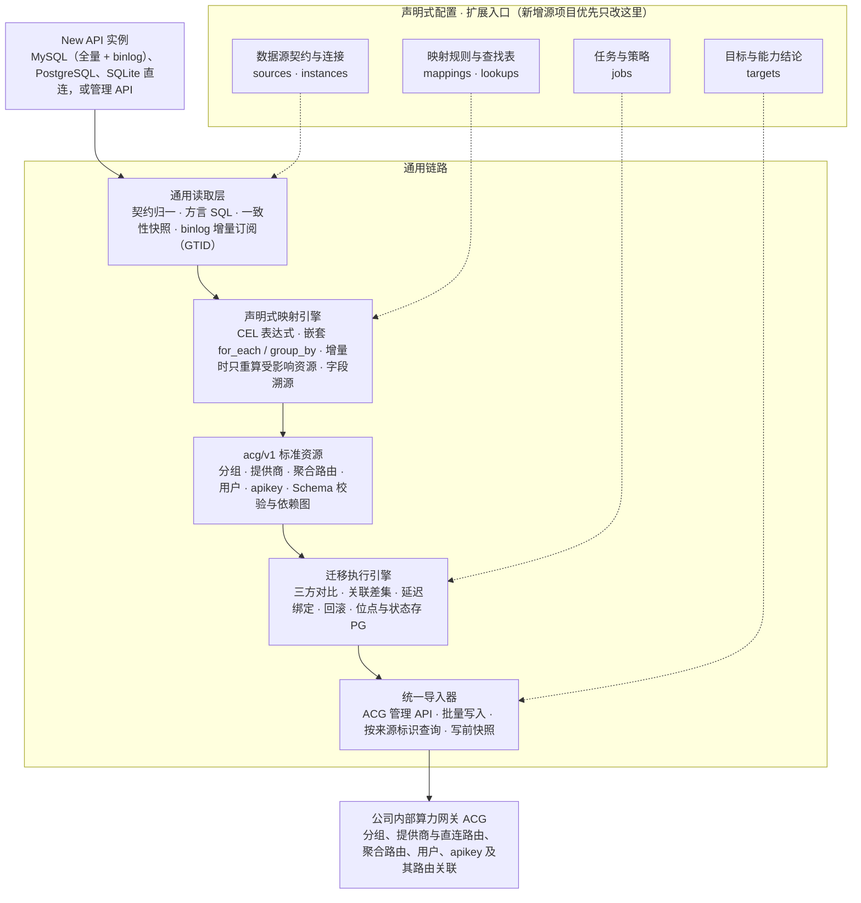
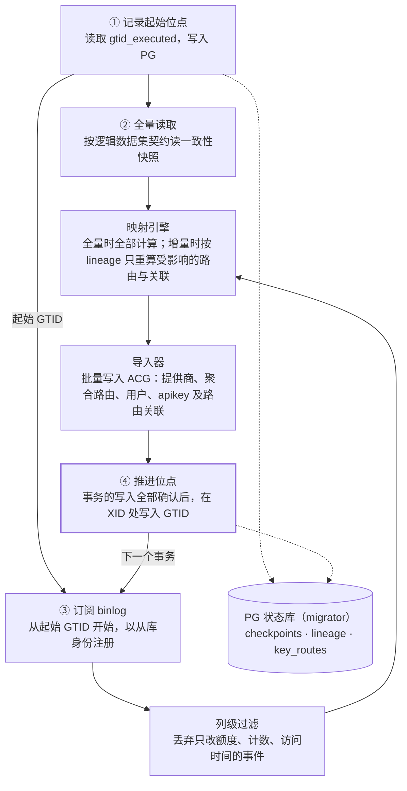

# AI 算力网关数据迁移工具——修订版架构设计（v3）

Oct 28, 2026 · @Liam

## 修订说明

v2 将首期范围收敛为 New API → 内部算力网关（下称 ACG），并补齐 v1 评审中发现的缺口。LiteLLM、Higress 保留扩展点，后续接入。用户账号迁移，密码统一重置；历史日志和用量数据不迁移。

| 主题 | v1 | v2 |
| --- | --- | --- |
| 首期源项目 | New API、LiteLLM、Higress 分阶段 | 仅 New API，其余后续 |
| 数据范围 | 以上游渠道为主 | 增加分组、用户、令牌、额度；日志与用量不迁移 |
| 用户密码 | 未涉及 | 统一重置为初始密码 User@123，强制首次登录修改 |
| 读取层 | 手写 SQL | 逻辑数据集契约，按方言生成 SQL，源版本探测，一致性快照 |
| 映射 DSL | 字段、拆分、引用 | 增加 join、when、group\_by、保真度声明、漏映射告警 |
| 模型映射 | 每个渠道每个模型一个部署 | 逻辑模型与部署分离，保留 model\_mapping、group、优先级与权重 |
| 密钥 | 脱敏与恢复并存，未定方案 | 密钥不落盘，断点重读源端；以 HMAC 指纹比对 |
| 执行引擎 | 预览、幂等、断点续跑 | 增加延迟绑定、失败传播、计划指纹、三方对比、prune、回滚 |
| 目标网关 | 未列要求 | 列出前置能力清单，阶段一逐项确认 |

### v3 变更

v3 在 v2 基础上确定了 ACG 侧的路由映射方式，并增加 binlog 增量同步。迁移范围收敛为分组、用户、apikey、渠道。

| 主题 | v2 | v3 |
| --- | --- | --- |
| 迁移范围 | 渠道、分组、用户、令牌、额度 | 分组、用户、apikey、渠道；额度暂不纳入 |
| ACG 资源 | 9 类，含逻辑模型、部署、路由策略 | 5 类：分组、提供商、聚合路由、用户、apikey |
| 分组语义 | 部署与分组关联 | 每个“分组 × 模型”映射为聚合路由 `<分组>--<模型>`，apikey 只关联本分组的路由 |
| 客户端调用 | 模型名不变 | model 字段填写路由名，客户端需按对照表修改 |
| 直连路由 | 未涉及 | 每个提供商自动生成；默认不关联迁移过来的 apikey |
| 增量同步 | 多轮全量加三方对比 | 首次全量，之后订阅 MySQL binlog 持续同步 |
| 状态库 | 本地 SQLite | ACG 所用 PostgreSQL 的独立 schema，工具无状态 |

## 一、设计目标与范围

本期目标：把一个或多个 New API 实例的分组、用户、apikey、渠道，以可预览、可回滚的方式迁移到 ACG，并在切换前通过 binlog 持续同步增量。

### 1.1 设计目标

- 框架化：读取、映射、导入、执行四层保持通用，New API 的差异只体现在配置（sources、mappings、lookups）和少量扩展函数中。
- 多数据源：New API 支持 MySQL、PostgreSQL、SQLite 直连读取，以及管理 API 读取。
- 可靠：默认只预览，冲突默认失败，资源级幂等，失败可续跑，按任务回滚。
- 可扩展：后续接入 LiteLLM、Higress 时优先只新增配置；缺少能力时补充通用能力，不在引擎中加项目分支。

非目标：历史日志、用量统计、充值与兑换码记录；双向迁移；复刻源网关的运行逻辑（例如渠道健康检查）。

### 1.2 范围矩阵

处理方式分为：原值迁移、转换迁移、近似迁移（语义有损，需在报告中标出）、重置、不迁移。字段名以实际部署的 New API 版本为准，阶段一核对。

| 数据 | New API 来源 | 处理方式 | ACG 资源 | 说明 |
| --- | --- | --- | --- | --- |
| 渠道基本信息 | channels：name、type、base\_url、status | 转换迁移 | 提供商（自动生成直连路由） | base\_url 为空时按渠道类型取默认地址 |
| 上游密钥 | channels.key | 原值迁移 | 提供商的密钥列表 | 支持多密钥拆分；部分类型的 key 是 JSON 或组合格式 |
| 模型重定向 | channels.model\_mapping | 转换迁移 | 提供商的模型映射 | 请求模型名到上游模型名 |
| 分组 | channels.group、users.group、tokens.group | 转换迁移 | 分组，同时作为聚合路由名前缀 | 对外分组名可通过别名表调整 |
| 分组下可用模型 | channels.group × channels.models | 转换迁移 | 聚合路由 `<分组>--<模型>` | 成员为该分组下提供该模型的渠道 |
| 优先级与权重 | channels.priority、weight | 近似迁移 | 聚合路由成员的优先级与权重 | 保真度取决于 ACG 的降级能力 |
| 渠道高级设置 | param\_override、header\_override、status\_code\_mapping、setting 等 | 逐项评估 | 待定 | ACG 不支持的字段显式声明 dropped |
| 用户账号 | users：username、display\_name、email、role、status | 转换迁移 | 用户 | 软删除用户不迁移 |
| 用户密码 | users.password | 重置 | 用户 | 统一重置为 User@123，强制首次登录修改，见第六节 |
| 令牌 | tokens：key、名称、状态、过期时间、IP 限制、模型限制、分组 | 原值迁移 | apikey 及其路由关联 | 关联有效分组下的聚合路由，见 5.6 |
| 用户余额、令牌额度 | users.quota、tokens.remain\_quota 等 | 暂不纳入 | — | 待单独确认 |
| 第三方登录绑定 | users：github\_id、oidc\_id 等 | 待确认 | — | 见第十一节待确认事项 |
| 用户系统访问令牌 | users.access\_token | 不迁移 | — | 管理用途，迁移后由用户重新生成 |
| 分组倍率、模型倍率与价格 | options 表 | 不迁移 | — | 本期范围外 |
| 历史日志、用量统计 | logs 等 | 不迁移 | — | 本期范围外 |
| 兑换码、充值记录 | redemptions、top\_ups 等 | 不迁移 | — | 本期范围外 |
| 其余系统设置 | options 表 | 不迁移 | — | 在 ACG 中单独配置 |

## 二、总体架构

架构沿用 v1 的主链路，核心原则不变：外部项目的原始结构不进入引擎，引擎只处理标准记录和 acg/v1 资源。



实线是数据流向，虚线是配置作用点。新增源项目时，优先只新增配置；读取驱动、映射引擎、执行引擎和导入器都不随源项目增加。

| 层 | 职责 | 扩展方式 |
| --- | --- | --- |
| 通用读取层 | 全量：按逻辑数据集契约输出标准记录；增量：订阅 binlog，输出行变更 | 新驱动写代码；新项目只加契约配置 |
| 映射引擎 | 执行 YAML 规则，生成 acg/v1 资源和字段溯源；增量时只重算受影响的资源 | YAML；特殊转换用 Transformer 扩展 |
| 标准资源层 | acg/v1 的 5 类资源与 JSON Schema | 随 ACG 导入契约升级版本 |
| 执行引擎 | 规划、执行、关联差集、回滚；位点与状态存 PG，工具无状态 | 框架通用 |
| 统一导入器 | 写入 ACG，始终只有一套 | 随 ACG 接口变化 |

## 三、数据读取层

映射规则只依赖逻辑数据集契约，不依赖具体 SQL 或 API 字段。各读取方式负责把原始数据归一到契约，同一份映射因此可以复用于 MySQL、PostgreSQL、SQLite 和管理 API。

### 3.1 项目级契约与实例级连接分离

项目级配置描述 New API 有哪些数据集、每个数据集的逻辑字段，以及各读取方式如何绑定到这些字段。实例级配置只描述连接哪个具体实例。多个 New API 实例共用一份项目级配置。

```yaml
# configs/sources/new-api.yaml —— 项目级：逻辑数据集契约（示例，字段以实际版本核定）
version: 2
project: new-api

compat:
  supported: ">=0.6.0"              # 首期支持的版本区间，阶段一核定
  probe:
    api: {path: /api/status, version_path: data.version}
    database:                        # 直连时以表结构指纹判定
      require_columns:
        channels: [id, type, key, base_url, models, group, model_mapping, priority, weight, status]
        users: [id, username, role, status, quota, used_quota, group]
        tokens: [id, user_id, key, status, expired_time, remain_quota, unlimited_quota]

datasets:
  channels:
    primary_key: id
    schema:
      id:            {type: int, required: true}
      type:          {type: int, required: true}
      name:          {type: string}
      key:           {type: secret}
      base_url:      {type: string}
      models:        {type: string}
      group:         {type: string, default: "default"}
      model_mapping: {type: json}
      priority:      {type: int, default: 0}
      weight:        {type: int, default: 0}
      status:        {type: int, required: true}
    dropped: [balance, used_quota, response_time, test_time]   # 显式声明不迁移的列
    bindings:
      database: {table: channels}    # 框架按方言生成显式列名 SQL，自动处理 group、key 等保留字
      api:
        path: /api/channel/
        records_path: data.items     # 以实际接口为准
        pagination: {type: page, page_param: p, size_param: page_size, size: 100}
        unavailable: [key]           # 管理 API 通常不返回完整密钥
```

```yaml
# configs/instances/newapi-prod.yaml —— 实例级：连接方式
instance: newapi-prod
project: new-api
access:
  type: database
  driver: postgres                   # mysql | postgres | sqlite
  dsn_env: NEWAPI_PROD_DSN
```

通过管理 API 读取时，渠道密钥通常拿不到。框架把 unavailable 字段标记为缺失，由 missing\_secret 策略决定阻止或跳过。因此渠道密钥迁移以数据库直连为准，API 模式适用于无数据库权限、只迁移非密钥数据的场景。

### 3.2 方言与类型归一

- 生成 SQL：按契约生成显式列名查询，不使用 SELECT \*；按方言引用保留字（MySQL 用反引号，PostgreSQL、SQLite 用双引号）。
- 类型归一：tinyint 与 boolean、以文本存储的 JSON、Unix 秒级时间戳统一转换为契约类型；转换失败即报错。
- 分批读取：按主键游标分页（WHERE id > ? ORDER BY id LIMIT ?），不使用 OFFSET。
- 只读保护：连接层开启只读事务，并建议使用只读账号；read\_only 不再是一个可关闭的配置项。

### 3.3 一致性快照

所有数据集在同一个只读事务中读取，避免渠道、用户、令牌之间出现时间差。PostgreSQL 使用 REPEATABLE READ，MySQL 使用 START TRANSACTION WITH CONSISTENT SNAPSHOT，SQLite 使用单个读事务。API 模式无法保证一致性，报告中会标注。

### 3.4 版本与漂移检测

采集前先执行探测。版本不在 supported 区间内，或契约要求的列缺失，则阻止迁移。源表中出现契约未声明、也未列入 dropped 的列时给出告警，因为这往往意味着新版本增加了需要迁移的字段。

## 四、映射 DSL 规范

DSL 只做声明，所有表达式统一使用 CEL；首期能力以 New API 所需为准，不为 LiteLLM、Higress 预先增加语法。

### 4.1 规则结构

| 关键字 | 作用 | 是否必填 |
| --- | --- | --- |
| name | 规则名，用于报告和字段溯源 | 是 |
| dataset | 主数据集 | 是 |
| join | 关联其他数据集，左连接或内连接 | 否 |
| let | 规则内的局部变量，例如令牌的有效分组 | 否 |
| when | 条件为假时不生成资源 | 否 |
| for\_each | 将字段展开为多行；写成列表时逐层嵌套展开 | 否 |
| group\_by | 跨记录聚合，生成一个资源；组内记录通过 `rows` 访问 | 否 |
| emit.kind | 目标资源类型 | 是 |
| emit.identity | 资源局部标识 | 是 |
| emit.fields | 字段映射；`ref_select` 按条件引用一组已生成的资源 | 是 |
| fidelity | 规则或字段的语义保真度 | 否，默认 exact |

### 4.2 表达式、插值与空值

- 统一 CEL：`expr` 直接写 CEL；identity 和字符串中的 `${...}` 是 CEL 的语法糖，编译期转换为 CEL 字符串拼接，两者错误处理一致。
- 空值区分：字段缺失、值为 null、值为空字符串是三种情况，分别用 `has(row.x)`、`row.x == null`、`row.x == ""` 判断；内置 `blank(x)` 同时判断后两种。
- 类型严格：类型不匹配、枚举未定义、引用无法解析默认阻止迁移，不做隐式转换。
- 编译期检查：配置加载时编译全部表达式，引用了契约中不存在的字段直接报错，而不是运行时得到 null。

### 4.3 资源标识

- 作者只写局部标识，例如 `channel:${row.id}`；框架自动加上 `<instance>/<kind>/` 前缀，作者无需也不能省略来源实例。
- 标识必须由稳定的源字段构成，不能使用数组下标、时间戳或随机值。
- 由多条源记录聚合出的资源用业务名称作标识：分组用 `group:${g}`，聚合路由用 `route:${g}:${m}`，多个渠道会自然收敛到同一个资源。
- 密钥用 `fingerprint(secret)` 做比对和去重，即带盐 HMAC-SHA256，密钥顺序变化不会被识别为变更。

### 4.4 join、when、group\_by 示例

```yaml
# 嵌套 for_each + group_by：每个“分组 × 模型”聚合为一条路由，rows 为组内全部渠道
- name: group-model-to-route
  dataset: channels
  for_each:
    - {from: group,  transform: split_csv, as: g}
    - {from: models, transform: split_csv, as: m}
  group_by: "[g, m]"
  emit:
    kind: AggregateRoute
    identity: "route:${key[0]}:${key[1]}"
    fields:
      name: {expr: "route_name(key[0], key[1])"}
      members: {expr: "rows.map(r, {'provider_ref': 'Provider/channel:' + string(r.id)})"}

# join + let + ref_select：令牌关联所属用户，按有效分组引用该分组的全部路由
- name: token-to-apikey
  dataset: tokens
  join:
    users: {on: "tokens.user_id == users.id", type: inner}
  let:
    group: "blank(row.group) ? users.group : row.group"
  when: "users.deleted_at == null"
  emit:
    kind: ApiKey
    identity: "token:${row.id}"
    fields:
      route_refs:
        ref_select: {kind: AggregateRoute, where: "r.group == group"}
```

### 4.5 语义保真度与漏映射告警

保真度分四级，预览报告按资源和字段汇总，让操作者看到哪些行为会改变：

| 级别 | 含义 | 报告处理 |
| --- | --- | --- |
| exact | 语义完全等价 | 只计数 |
| approximate | 主要行为一致，细节不同 | 列出并附 note |
| lossy | 部分行为丢失 | 列出，可配置为需人工确认 |
| dropped | 显式声明不迁移 | 列出字段及原因 |

契约中的每个字段必须被至少一条规则使用，或列入 dropped。两者都不满足时，validate 给出告警，严格模式下报错。这条规则用于防止 group 这类关键字段被静默遗漏。

### 4.6 内置函数与查找表

沿用 v1 的内置函数（类型转换、字符串、拆分合并、parse\_json、lookup、default、filter、map），新增 split\_lines、fingerprint、blank、map\_get（安全读取 JSON 对象的键）、slug（转为小写字母、数字、连字符、点号）、route\_name（按 5.4 的规则生成聚合路由名）。查找表支持 default 项与 `on_missing: fail`，例如渠道类型找不到对应供应商类型时直接报错，不猜测。

### 4.7 扩展点

- Transformer：处理配置无法表达的字段转换，接口与 v1 相同，只做纯函数转换，不写入、不重试。
- Decryptor：独立于 Transformer 的解密扩展，用于源端加密存储的密钥（LiteLLM 接入时需要）。单独注册、单独授权，调用全部记入审计日志。首期 New API 不需要。

## 五、New API → ACG 映射设计

渠道映射为提供商；每个“分组 × 模型”统一映射为聚合路由 `<分组>--<模型>`；apikey 只关联其有效分组下的聚合路由。New API“由 key 的分组决定可用渠道”的语义，在 ACG 中由“路由名带分组前缀 + key 只关联本分组路由”表达。

### 5.1 ACG 的路由与授权约束

- ACG 基于 Higress。请求的 model 字段必须填写路由名：聚合路由名（如 `vip--opus-5.5`）或直连路由名（如 `provider1/opus-5.5`），不能用裸模型名访问。
- 每个提供商创建后自动生成一条直连路由；聚合路由的成员是提供商，允许只有一个成员。
- apikey 直接关联可访问的聚合路由和直连路由，没有授权组这一层。
- 路由数量暂无上限。

### 5.2 映射关系

| New API | ACG | 数量关系 | 规则 |
| --- | --- | --- | --- |
| 渠道 | 提供商（自动生成直连路由） | 1 : 1 | 渠道状态对应提供商启用状态；被多条聚合路由共享，不随分组复制 |
| 渠道 key | 提供商的密钥列表 | 1 : N | 多密钥按行拆分；JSON 或组合格式整体作为一个密钥 |
| 渠道 model\_mapping | 提供商的模型映射 | 1 : 1 | 请求模型名到上游模型名 |
| 分组 | 分组，同时作为聚合路由名前缀 | 1 : 1 | 对外分组名可通过别名表调整 |
| 分组 × 模型（由渠道的 group、models 推导） | 聚合路由 `<分组>--<模型>` | 每个组合一条 | 成员为该分组下 models 包含该模型的全部渠道 |
| 渠道 priority、weight | 聚合路由成员的优先级与权重 | — | 见 5.4 |
| 用户 | 用户 | 1 : 1 | 统一初始密码，见第六节 |
| 令牌 | apikey 及其路由关联 | 1 : 1 | 原值迁移；关联有效分组下的聚合路由，见 5.6 |

用户余额、令牌额度暂不纳入映射，待单独确认。

### 5.3 提供商

```yaml
# configs/mappings/newapi-to-acg/providers.yaml
- name: channel-to-provider
  dataset: channels
  emit:
    kind: Provider
    identity: "channel:${row.id}"
    fields:
      name: {expr: "slug(row.name) + '-' + string(row.id)"}   # 渠道名不唯一，追加渠道 ID
      type: {from: type, lookup: newapi_channel_types, on_missing: fail}
      endpoint:
        expr: "blank(row.base_url) ? lookup('newapi_default_base_url', row.type) : row.base_url"
      enabled:
        expr: "row.status == 1 || (row.status == 3 && policy.auto_disabled_channel == 'enabled')"
      api_keys:
        expr: "lookup('newapi_key_format', row.type) == 'multi_line' ? split_lines(row.key) : [row.key]"
        secret: true
      model_mapping: {expr: "blank(row.model_mapping) ? {} : row.model_mapping"}
```

- 命名：提供商名同时是直连路由名的前缀，必须唯一、稳定，并符合 K8s 资源命名规则。格式为 `<渠道名转换>-<渠道 ID>`，例如 `claude-12`。
- 渠道状态：手动禁用（2）对应提供商禁用；自动禁用（3）由策略 `auto_disabled_channel` 决定，默认禁用并在报告中列出。
- 直连路由：默认不关联任何迁移过来的 apikey。New API 的普通用户不能指定渠道，直连路由还会绕过令牌的模型限制；需要开放时，通过策略 `direct_routes: group_channels` 只授权给有效分组内的渠道，且只授权给未开启模型限制的令牌。
- 渠道高级设置（参数覆盖、请求头覆盖、状态码映射、代理）在 ACG 支持前一律列入 dropped，报告逐渠道列出被丢弃的非空值。

### 5.4 聚合路由

```yaml
# configs/mappings/newapi-to-acg/routes.yaml
- name: group-model-to-route
  dataset: channels
  for_each:
    - {from: group,  transform: split_csv, as: g}
    - {from: models, transform: split_csv, as: m}
  group_by: "[g, m]"
  emit:
    kind: AggregateRoute
    identity: "route:${key[0]}:${key[1]}"
    fields:
      name:  {expr: "route_name(key[0], key[1])"}
      group: {expr: "key[0]"}
      model: {expr: "key[1]"}
      members:
        expr: >
          rows.map(r, {
            "provider_ref": "Provider/channel:" + string(r.id),
            "priority": r.priority,
            "weight": r.weight
          })
        fidelity: approximate
```

- 命名：`route_name(g, m)` = `<分组对外名>--<模型名转换>`。模型名转为小写，字母、数字、连字符、点号以外的字符（包括 `/`）转为 `-`，例如 `Qwen/Qwen2.5-72B` 在 vip 分组下为 `vip--qwen-qwen2.5-72b`。转换后重名直接报错，由人工在别名表中指定，不自动加哈希。
- 名字冻结：路由名是客户端填写的 model，首次发布后记入状态库，增量同步期间不改名。
- 模型名取渠道 models 字段中的请求模型名，不是 model\_mapping 之后的上游模型名。
- 成员：该分组下 models 包含该模型的全部渠道，不论启用状态。路由是否存在只由渠道的 group 和 models 决定，渠道启用或禁用只改变提供商状态。原因是 New API 的自动禁用会频繁切换，若由状态决定路由存在，路由和关联会反复增删。
- 优先级与权重：最高优先级的成员作为加权上游，权重取 weight（全为 0 时等权）；较低优先级的成员按优先级降序进入降级列表。最高优先级成员全部禁用时，依赖 ACG 跳过禁用成员并降级，需 ACG 确认。重试次数等细节与 New API 不同，保真度为 approximate。
- 只有一个成员的组合照常建聚合路由，不改用直连路由，保证命名规则统一。

### 5.5 用户

```yaml
# configs/mappings/newapi-to-acg/users.yaml
- name: user-to-user
  dataset: users
  when: "row.deleted_at == null"
  emit:
    kind: User
    identity: "user:${row.id}"
    fields:
      username: {from: username}
      display_name: {from: display_name}
      email: {from: email}
      role: {from: role, lookup: newapi_roles, on_missing: fail}
      enabled: {expr: "row.status == 1"}
      group_ref:
        expr: "'Group/group:' + (blank(row.group) ? 'default' : row.group)"
        as_ref: true
      password: {initial_password: true}      # 不读取源端密码哈希，按第六节处理
```

- 角色映射：普通用户（1）、管理员（10）、超级管理员（100）通过 `newapi_roles` 查找表映射；未定义的角色值阻止迁移。
- 不迁移：软删除用户、系统访问令牌（access\_token）、密码哈希。

### 5.6 apikey 与路由关联

```yaml
# configs/mappings/newapi-to-acg/apikeys.yaml
- name: token-to-apikey
  dataset: tokens
  join:
    users: {on: "tokens.user_id == users.id", type: inner}
  let:
    group: "blank(row.group) ? (blank(users.group) ? 'default' : users.group) : row.group"
    limits: "row.model_limits_enabled ? split_csv(row.model_limits) : []"
  when: "users.deleted_at == null"
  emit:
    kind: ApiKey
    identity: "token:${row.id}"
    fields:
      user_ref: {ref: "User/user:${users.id}"}
      name: {from: name}
      key: {secret_from: key, prefix: "${target.key_prefix}"}
      enabled: {expr: "row.status != 2"}
      expires_at: {expr: "row.expired_time == -1 ? null : timestamp(row.expired_time)"}
      ip_allowlist: {expr: "split_lines(row.allow_ips)"}
      route_refs:
        ref_select:
          kind: AggregateRoute
          where: "r.group == group && (size(limits) == 0 || r.model in limits)"
```

- 有效分组：令牌分组非空时取令牌分组，否则取用户分组，都为空时取 default。
- 关联范围：有效分组下的全部聚合路由；令牌开启了模型限制时，只关联限制范围内的模型对应的路由。令牌模型限制由此表达，ACG 不必另设模型白名单。
- key 原值：New API 库中令牌一般不含 sk- 前缀，导入时按目标配置拼接，保证用户手中的 key 原样可用。
- 写入方式：每个 key 应有的关联集合与 PG 中上次写入的集合做差集，只批量写入新增和撤销部分。新建时先建路由再写关联，删除时先撤销关联再删路由。

### 5.7 客户端对照表与等价校验

- 对照表：客户端需把 model 改为路由名。迁移报告按分组导出“原模型名 → 路由名”对照表，供各客户端负责人修改配置。
- 等价校验：verify 阶段对每个“分组 × 模型”，比较 New API 计算出的候选渠道集合与 ACG 聚合路由的成员；对每个 apikey，比较应有关联集合与 ACG 实际关联。两者都必须完全一致。

## 六、账号与密钥安全

用户密码统一重置为 User@123，令牌和上游密钥原值迁移。统一初始密码意味着知道这个值的人可以登录任何未改密的账号，因此必须配套下列措施，缺一项即不允许正式执行用户迁移。

### 6.1 用户密码统一重置

- 不读取源端密码：源端 bcrypt 哈希不参与迁移，User 资源的 password 字段只声明 `initial_password: true`。
- 初始密码参数化：初始密码从环境变量 `MIGRATOR_INITIAL_PASSWORD` 读取，本项目约定取值 User@123，不写入代码、映射配置、日志、预览报告和状态库。
- 写入方式：优先调用 ACG 的“设置密码”接口传入；若 ACG 支持导入哈希，则由迁移工具按 ACG 的哈希算法计算后写入。
- 强制首次登录修改：每个迁移用户写入 `must_change_password = true`。修改前只允许访问改密页面，不能进入控制台其他功能。
- 初始密码有效期：默认 7 天，可配置。到期仍未修改的账号自动锁定，需管理员重置。
- 管理员账号单独处理：角色为管理员或超级管理员的账号不使用统一初始密码，改为生成一次性随机密码，加密导出后线下交付；或迁移后保持禁用，待人工启用。二选一，见待确认事项。
- 登录保护：ACG 对登录失败做限流和锁定，所有初始密码登录写入审计日志。
- 跟踪与通知：迁移完成后导出用户清单（用户名、邮箱、角色），供业务方通知；report 命令可随时列出仍未改密的账号。

密码重置只影响控制台登录。令牌原值迁移，下游程序调用 API 不受影响。

### 6.2 上游密钥

- 受控容器：被 `secret_from` 标记的值装入 SecretValue 类型。该类型的字符串化、JSON 序列化、日志输出都只得到 `***`，只有导入器在写入时能取出原值。
- 指纹比对：每个密钥计算带盐 HMAC-SHA256 指纹，盐从环境变量读取。指纹用于资源标识、变更检测、多源去重；ACG 的密钥通常只写不读，比对只能依赖指纹。
- 不落盘，断点重读：状态库只存指纹，不存密钥原值。续跑时按资源标识回到源端重新读取密钥，并校验指纹一致；源端不可用时，涉及密钥的操作无法续跑，其余操作可以继续。

### 6.3 令牌原值迁移

New API 的令牌在数据库中以原值存储，可以原值迁移，前提是 ACG 支持指定 key 值写入。目标已存在相同 key 时一律失败，不允许覆盖或跳过后静默共用。

ACG 不支持指定 key 时，降级为重签模式：生成新 key，导出加密的新旧对照文件，由业务方分发，新旧网关并行运行一段时间后再关闭旧 key。重签模式需要在任务配置中显式开启。

### 6.4 数据保护

- 日志、预览报告、状态库全部脱敏；报告中的密钥只显示指纹前 8 位。
- 源库 DSN、ACG 凭据、指纹盐、初始密码全部来自环境变量或密钥管理系统，配置文件中只出现变量名。
- 任务产物中含敏感内容的文件（管理员一次性密码、重签对照表）一律加密输出，并在报告中提示保管和销毁。

## 七、内部标准模型、统一导入器与前置要求

acg/v1 首期定义 5 类资源，与 ACG 的业务对象一一对应；导入器优先走 ACG 管理 API，且要求 ACG 具备下文列出的前置能力。

### 7.1 acg/v1 首期资源

| 资源 | 引用 | New API 来源 | 说明 |
| --- | --- | --- | --- |
| Group | — | 渠道、用户、令牌中的分组 | 分组名同时是聚合路由名前缀 |
| Provider | — | 渠道 | 地址、类型、密钥列表（只写）、模型映射、启用状态；ACG 自动生成直连路由 |
| AggregateRoute | Group、Provider | 分组 × 模型 | 路由名即客户端填写的 model；成员带优先级和权重 |
| User | Group | 用户 | 角色、状态、强制改密标记 |
| ApiKey | User、AggregateRoute | 令牌 | key 原值、过期时间、IP 白名单、关联的路由列表 |

所有资源携带统一元数据：`source_identity`（带实例前缀的来源标识）、`migration_job`（任务 ID）、`content_hash`（期望内容哈希）。资源结构同时由 Go 类型和 JSON Schema 约束，schema 带版本号。

### 7.2 统一导入器接口

相比 v1，接口增加能力探测、按来源标识查询、批量写入、写前快照，引用改为执行时绑定。

```go
type Importer interface {
    // 探测 ACG 支持的能力，用于预检与降级决策
    Capabilities(ctx context.Context) (Capabilities, error)

    // 按来源标识查询目标资源，用于幂等、超时后确认、回滚
    Lookup(ctx context.Context, kind Kind, sourceIdentity string) (*TargetRef, error)

    // 读取目标现状，生成操作计划；Operation 中的引用尚未解析
    Plan(ctx context.Context, desired []Resource, state StateReader) (*Plan, error)

    // 批量写入；执行前由 RefResolver 把逻辑引用替换为目标 ID
    ApplyBatch(ctx context.Context, ops []Operation, refs RefResolver) ([]ApplyResult, error)

    // 更新或删除前保存目标原值，用于回滚
    Snapshot(ctx context.Context, ref TargetRef) (Resource, error)

    // 回读并校验关键字段与引用关系
    Verify(ctx context.Context, results []ApplyResult) error
}
```

### 7.3 对 ACG 的前置要求

以下能力需在阶段一与 ACG 团队逐项确认，结论写入 targets 配置的 capabilities 部分。

| 能力 | 用途 | 状态 |
| --- | --- | --- |
| 聚合路由允许只有一个成员 | 命名规则统一 | 已确认 |
| apikey 直接关联可访问的聚合路由和直连路由 | 分组隔离、令牌模型限制 | 已确认 |
| 路由数量 | 分组 × 模型全量建路由 | 已确认，暂无上限 |
| 资源可写入并按 source\_identity 查询 | 幂等、超时后确认、回滚、prune | 待确认；缺失时只能按名称匹配 |
| 按 migration\_job 列出资源 | 回滚、对账 | 待确认；缺失时回滚依赖 PG 状态库 |
| 指定 API Key 原值写入，支持前缀规则 | apikey 无感迁移 | 待确认；缺失时降级为重签 |
| apikey 路由关联的批量增删接口 | 首次迁移与增量扇出 | 待确认；缺失时逐条写入并限速 |
| 聚合路由成员的优先级分层与禁用成员跳过 | 路由语义 | 待确认；缺失时降级为 lossy |
| 设置密码接口或哈希导入、强制改密标记、初始密码有效期 | 第六节安全措施 | 待确认 |
| 写入幂等键或业务唯一键 | 安全重试 | 待确认 |
| 配置下发限速或批量刷新 | 大批量写入路由与关联 | 待确认 |

ACG 只能直写数据库时，作为受控的离线写入模式单独评审，不作为默认方案。

## 八、迁移执行引擎

引擎分阶段运行，状态以资源级操作记录在 PG；首次全量之后由第九节的 binlog 增量同步持续收敛到源端当前状态，也可以整体回滚。

### 8.1 执行阶段

1. 预检：配置与表达式编译、源版本探测、漂移检测、ACG 能力探测。任何一项失败即停止。
2. 采集：在一致性快照中读取全部数据集。
3. 映射：生成期望资源，同时记录字段溯源（目标字段来自哪个源字段、哪条规则）。
4. 校验：JSON Schema 校验、引用解析、依赖图构建与环检测、保真度汇总、漏映射检查。
5. 规划：读取 ACG 现状，三方对比生成操作计划，计算计划指纹。plan 模式到此输出报告并结束。
6. 执行：按依赖拓扑分批写入，写入前绑定引用，更新或删除前保存快照。
7. 验证：回读关键字段与引用关系；可选功能探测（对每个上游部署发一次低成本请求，默认关闭，会产生费用）。
8. 报告：操作结果、保真度、dropped 字段、额度对账、未改密用户清单。

### 8.2 依赖、延迟绑定与失败传播

- 依赖图由资源引用构建，写入顺序为 Group → Provider → AggregateRoute → User → ApiKey → apikey 的路由关联。
- Plan 阶段目标 ID 尚不存在，Operation 中保留逻辑引用；执行时由 RefResolver 从 ID 映射表取出真实 ID 填入。
- 原子单元：一个提供商及其密钥为一个单元，失败时引用它的聚合路由标记为 blocked；一个 apikey 及其路由关联为一个单元，关联写入失败时该 key 保持禁用，不留下“key 可用但授权不完整”的状态。

### 8.3 幂等与超时处理

- 每个操作的幂等键 = 来源标识 + 期望内容哈希。ACG 支持幂等键时随请求传入。
- 写入超时或连接中断时，不直接重试：先用 Lookup 按来源标识查询，目标已存在且内容哈希一致则视为成功，否则再重试。
- 重试次数有限，超过后记为失败，等待人工处理或下次 resume。

### 8.4 增量收敛：三方对比

状态库记录每个资源上次写入的内容哈希（last\_applied）。重复执行时对比源端期望、上次写入、ACG 当前三者：

| 源端期望 vs 上次写入 | ACG 当前 vs 上次写入 | 判定 | 默认动作 |
| --- | --- | --- | --- |
| 相同 | 相同 | 无变化 | 跳过 |
| 不同 | 相同 | 源端变化 | 更新 |
| 相同 | 不同 | 目标被人工修改（drift） | 保留目标，报告 |
| 不同 | 不同 | 双方都变 | 冲突，按 conflict 策略 |
| 源端已删除 | 任意 | 源端删除 | 按 prune 策略，默认只报告 |
| 首次出现，目标已有同名资源 | — | 与非迁移资源冲突 | 按 conflict 策略，默认失败 |

### 8.5 计划指纹

plan 输出计划文件及其指纹。`apply --plan <文件>` 执行前重新读取相关目标资源，与计划生成时的状态比较；不一致则拒绝执行，要求重新 plan。这样审核过的计划和实际执行的操作保持一致。

### 8.6 回滚

- 写前快照：update 和 delete 操作执行前保存目标原值。
- `rollback --job <ID>` 按逆拓扑顺序执行：删除本任务创建的资源，用快照恢复被更新的资源。
- 回滚前检查用户和令牌是否已在 ACG 上产生使用记录；已使用的资源默认不删除，列入报告由人工决定。

### 8.7 切换流程

1. 在预演环境用生产数据副本完成全量迁移、校验和一次回滚演练。
2. 生产 ACG 全量迁移，记录全量开始时的 GTID，导出报告，人工审核保真度与 dropped 字段。
3. 启动 binlog 增量同步，持续追平源端变化。
4. 按分组发布“原模型名 → 路由名”对照表，客户端准备好新的 base\_url 与 model 名。
5. 冻结窗口：New API 停止配置变更（分组、渠道、用户、令牌的增删改）。
6. 确认同步延迟为 0、位点已追平最新 GTID，执行等价校验。
7. 客户端切换 base\_url 与 model 名，流量进入 ACG。
8. 停止增量同步，New API 置为只读或停止对外服务；数据保留一段时间用于追溯，再按规定下线。

### 8.8 策略配置

```yaml
policies:
  conflict: fail              # fail | skip | update
  unsupported: fail
  missing_reference: fail
  missing_secret: fail
  drift: report               # report | overwrite
  prune: report               # report | delete；增量同步时源端删除的处理
  auto_disabled_channel: disabled
  direct_routes: none         # none | group_channels
  lossy_requires_ack: true    # 存在 lossy 字段时正式执行需人工确认

execution:
  mode: plan                  # plan | apply | sync（全量后持续增量）
  batch_size: 100
  retries: 3
  verify_after_write: true
  probe: false
```

### 8.9 状态库

状态存放在 ACG 所用 PostgreSQL 实例的独立 schema（`migrator`）中，使用独立账号，不和 ACG 业务表混用。工具本身无状态，重启后从 PG 读取状态继续执行，可作为单副本 Deployment 运行。

| 表 | 内容 |
| --- | --- |
| `jobs` | 任务定义、阶段（snapshot 或 streaming）、执行记录 |
| `checkpoints` | 全量进度（表名 + 最大主键）与增量位点（GTID 集合） |
| `id_map` | 来源标识 → 目标 ID、last\_applied 内容哈希、密钥指纹、名字冻结标记 |
| `lineage` | 源记录 → 其产出的资源标识集合，用于增量时计算差集 |
| `key_routes` | 每个 apikey 上次写入的路由关联集合 |
| `operations` | 资源级操作记录与结果 |
| `snapshots` | update、delete 前保存的目标原值，用于回滚 |

同一任务用 `pg_try_advisory_lock` 保证只有一个实例在执行或消费 binlog。状态库不存密钥原值，但仍属于敏感数据，按 6.4 管理。

## 九、增量同步（binlog CDC）

首次全量迁移后，迁移工具以从库身份订阅 New API 所用 MySQL 的 binlog，把分组、用户、apikey、渠道的变更持续同步到 ACG。位点用 GTID 表示，与其余状态一起存入 PG，工具本身无状态。

### 9.1 同步流程

全量与增量共用同一套映射和导入，区别只在输入：全量读快照，增量读行变更。



实线是数据流向，虚线是写入 PG 的状态。位点推进之后才处理下一个事务，崩溃时最多重放一个未确认的事务。

### 9.2 对源端 MySQL 的要求

| 配置 | 要求 | 原因 |
| --- | --- | --- |
| binlog\_format | ROW | 需要行级变更 |
| binlog\_row\_image | FULL | 需要完整的前后镜像，才能计算旧值与新值的差集 |
| gtid\_mode | ON | 主备切换后位点仍然有效 |
| 账号权限 | REPLICATION SLAVE、REPLICATION CLIENT、SELECT | 订阅 binlog、读取全量 |
| server\_id | 与现有从库不冲突，向 DBA 申请 | 工具以从库身份注册 |
| binlog 保留时间 | 长于工具可能的最长停机时间 | 位点对应的 binlog 被清理后只能重新全量 |

### 9.3 实现选型

- 使用 go-mysql-org/go-mysql 的 replication 包或 canal 订阅 binlog。canal 内置 TiDB 的 SQL 解析器，用于解析 binlog 中的 DDL。
- 全量不使用 canal 自带的 dump：它调用外部 mysqldump，输出原始行并绕过逻辑数据集契约。全量由第三节的读取器完成，增量从记录的 GTID 启动订阅。
- TiDB DM 只作设计参考，不直接依赖。它把检查点存在下游库、重启后以幂等方式重放，与本节做法一致。

### 9.4 全量与增量的衔接

1. 读取当前的 `gtid_executed`，写入 checkpoints。
2. 按逻辑数据集契约完成全量读取与导入。
3. 从第 1 步记录的 GTID 开始订阅 binlog。

全量期间发生的变更会被重放一次；写入幂等且按最终状态比对，结果会收敛。这种做法不需要全局读锁和 RELOAD 权限，适用于云数据库。

### 9.5 位点与一致性

- 位点用 GTID 集合，不用 binlog 文件名加偏移量；后者只对单台实例有效，主备切换后会对不上。
- 只在事务提交事件（XID）处推进位点，不在事务中间推进。
- 至少一次：一个事务对应的 ACG 写入全部确认成功后，才把该事务的 GTID 写入 checkpoints。崩溃后从上次位点重放，依靠按来源标识的幂等写入保证不重复。
- 单实例消费：通过 `pg_try_advisory_lock` 抢占任务锁，未抢到的实例待命。
- 同步延迟（已处理 GTID 与源端最新 GTID 的差距）作为监控指标，也是切换时的判断依据。

### 9.6 事件处理

- 列级过滤：只处理契约中声明、且未列入 dropped 的列发生变化的事件。New API 每次 API 调用都会更新用户和令牌的额度、请求计数、访问时间，以及渠道的已用额度、响应时间；这类事件占 binlog 的绝大多数，直接丢弃。
- 行变更到资源变更：按变更后的行重新执行映射，与 lineage 中该行上次产出的资源集合做差集，得到新增、更新、删除。
- 聚合路由重算：渠道的 group 或 models 变化时，受影响的组合为（旧分组 ∪ 新分组）×（旧模型 ∪ 新模型），只重算这些组合的成员；成员为空的路由按 prune 策略处理。
- 反查关联：用户更换分组或被软删除时，回源查询该用户的全部令牌重新计算；分组出现新路由时，回源查询有效分组为该分组的全部令牌。
- 删除：硬删除对应 DELETE 事件，软删除对应 deleted\_at 的 UPDATE 事件，两者统一按 prune 策略处理。
- DDL：New API 升级会自动加列。收到 DDL 事件后暂停同步，重新执行契约探测，通过后再继续。
- 密钥：binlog 行镜像中的明文 key 只在内存中处理，不写日志和状态库。

### 9.7 扇出与写入速率

apikey 直接关联路由，一处源端变化可能影响大量 key：

| 源端变化 | 对 ACG 的影响 |
| --- | --- |
| 渠道为某分组新增模型（出现新的分组 × 模型组合） | 新建聚合路由，该分组全部 apikey 新增关联 |
| 某组合的最后一个渠道被移除 | 撤销该分组全部 apikey 的关联，再按 prune 策略删除路由 |
| 渠道 key、地址、model\_mapping 变化 | 只更新提供商 |
| 渠道权重或优先级变化 | 只更新相关路由的成员 |
| 渠道启用或禁用 | 只改提供商启用状态，路由和关联不变 |
| 用户或令牌更换分组 | 该 apikey 的关联整体替换 |
| 令牌模型限制变化 | 重新计算该 apikey 的关联 |
| 新增用户或令牌 | 新建用户或 apikey，并写入关联 |

扇出写入走批量接口并限速，避免触发 ACG 配置下发风暴；单次变更的扇出量记入监控。

### 9.8 其他数据源

- PostgreSQL：后续通过逻辑复制实现，位点为 replication slot 的 LSN。slot 会保留 WAL，工具长时间停机可能撑满源库磁盘，需要监控。
- SQLite、管理 API：没有变更流，退化为周期性全量加三方对比（8.4）。
- 读取层为此提供 Snapshot 和 Stream 两个接口，引擎不感知具体来源。

## 十、配置组织、工程结构与 CLI

配置按“项目契约、实例连接、映射、查找表、目标、任务、测试”七类分开管理；映射配置与代码一样需要通过 golden test 才能合入。

### 10.1 配置目录

```
configs/
├── sources/
│   └── new-api.yaml                 # 项目级：逻辑数据集契约、版本探测
├── instances/
│   └── newapi-prod.yaml             # 实例级：连接方式、binlog 订阅参数（server_id 等）
├── mappings/
│   └── newapi-to-acg/
│       ├── providers.yaml           # 渠道 → 提供商
│       ├── routes.yaml              # 分组 × 模型 → 聚合路由
│       ├── users.yaml
│       └── apikeys.yaml             # 令牌 → apikey 及路由关联
├── lookups/
│   ├── newapi-channel-types.yaml    # 渠道类型 → 供应商类型
│   ├── newapi-default-base-url.yaml
│   ├── newapi-key-format.yaml       # 渠道类型 → key 格式
│   ├── newapi-roles.yaml
│   ├── group-aliases.yaml           # 分组对外名称
│   └── route-name-aliases.yaml      # 路由名冲突时的人工别名
├── targets/
│   └── acg-prod.yaml                # 地址、认证、能力确认结论、PG 状态库连接
├── jobs/
│   └── newapi-prod-to-acg.yaml      # 来源实例、映射、策略
└── tests/
    └── newapi-to-acg/
        ├── fixtures/                # 脱敏样例输入
        └── expected/                # 期望输出的资源
```

后续接入 LiteLLM 时，新增 sources/litellm.yaml、mappings/litellm-to-acg/ 及对应 lookups 和 tests。

### 10.2 Go 工程结构

```
gateway-migrator/
├── cmd/migrator/
├── internal/
│   ├── config/            # 配置解析、DSL schema 校验
│   ├── source/
│   │   ├── contract/      # 逻辑数据集契约、版本探测、漂移检测
│   │   ├── database/      # MySQL、PostgreSQL、SQLite 全量读取，方言与快照
│   │   ├── cdc/mysql/     # binlog 订阅（go-mysql）、列级过滤、DDL 处理
│   │   ├── api/           # HTTP 读取、分页、限流、重试
│   │   ├── kubernetes/    # 预留给 Higress
│   │   └── file/
│   ├── mapping/
│   │   ├── compiler/      # CEL 编译、插值语法糖
│   │   ├── evaluator/     # join、let、when、嵌套 for_each、group_by、ref_select
│   │   ├── incremental/   # 增量影响范围计算、lineage 差集
│   │   ├── identity/      # 标识规则、路由命名与冻结
│   │   ├── fidelity/      # 保真度汇总、漏映射检查
│   │   └── lineage/       # 字段溯源
│   ├── transforms/        # 内置函数、查找表
│   ├── extensions/        # Transformer、Decryptor 注册
│   ├── domain/            # acg/v1 五类资源
│   ├── importer/acg/      # ACG 导入器，含路由关联的批量差集写入
│   ├── engine/            # 规划、执行、三方对比、计划指纹、回滚、验证
│   ├── sync/              # 全量与增量衔接、位点推进、任务锁
│   ├── secrets/           # SecretValue、指纹、初始密码
│   ├── state/             # PG 状态库（migrator schema）
│   └── report/            # 预览与结果报告、模型名对照表
├── schemas/acg/v1/
├── configs/
└── go.mod
```

### 10.3 CLI

| 命令 | 作用 |
| --- | --- |
| `validate` | 校验配置、编译表达式、检查漏映射，不连接任何系统 |
| `test` | 运行映射 golden test |
| `probe` | 探测源版本、表结构漂移、binlog 配置、ACG 能力 |
| `plan` | 采集、映射、校验、规划，输出计划文件与预览报告 |
| `apply --plan` | 校验计划指纹后执行全量 |
| `sync --job` | 全量完成后从记录的 GTID 持续增量同步 |
| `status --job` | 查看阶段、位点、同步延迟、扇出积压 |
| `resume --job` | 从上次确认完成的操作或位点继续 |
| `verify --job` | 等价校验与回读校验，可选功能探测 |
| `rollback --job` | 撤销任务写入 |
| `report --job` | 输出结果、模型名对照表、未改密用户清单 |

每次 apply、resume、rollback 写入审计日志：执行人、时间、计划指纹、操作统计。报告提供 JSON 和 HTML 两种格式。

## 十一、实施计划与待确认事项

首期分四个阶段，每个阶段有明确的通过条件；LiteLLM、Higress 在首期完成后再启动。

### 11.1 实施阶段

1. 契约定稿：确认 ACG 前置能力（7.3），定稿 acg/v1 五类资源、DSL 规范与路由命名规则。
   - 通过条件：7.3 每项能力都有结论，缺失项有降级方案或 ACG 开发排期。
2. 渠道闭环：三种数据库方言读取；渠道到提供商、分组 × 模型到聚合路由的映射；plan、apply、verify。
   - 通过条件：测试环境全量迁移成功；等价校验通过；同一任务重复执行变更数为零。
3. 用户与 apikey：用户、apikey 及路由关联，密码统一重置及 6.1 全部配套措施，模型名对照表。
   - 通过条件：抽样 apikey 用路由名经 ACG 调用成功，访问其他分组的路由被拒绝；新用户首次登录被强制改密。
4. 增量同步与生产化：binlog 订阅、PG 状态库与位点、扇出写入、回滚、审计、切换演练。
   - 通过条件：在预演环境完成一次包含增量追平和回滚的完整切换演练。

后续：LiteLLM 接入（Decryptor 解密扩展、virtual key 只存哈希导致的重签流程）；Higress 接入（K8s 读取器、嵌套结构遍历、插件作用域语义）。

### 11.2 待确认事项

- [ ] ACG 的额度单位，以及与 New API quota 的换算比例
- [ ] 分组倍率、模型倍率与价格是否迁移，ACG 计费体系如何对应
- [ ] 第三方登录绑定（GitHub、OIDC 等）是否迁移
- [ ] 管理员账号处理方式：一次性随机密码线下交付，或迁移后禁用待人工启用
- [ ] 初始密码有效期（默认 7 天）是否合适
- [ ] 自动禁用的渠道迁移后保持禁用还是启用
- [ ] 多个 New API 实例迁入同一 ACG 时，同名用户、同名分组是否合并
- [ ] 渠道高级设置（参数覆盖、请求头覆盖、状态码映射、代理）在 ACG 中的支持情况
- [ ] 首期支持的 New API 版本区间
- [ ] ACG 令牌的 key 前缀规则与 New API 是否一致
