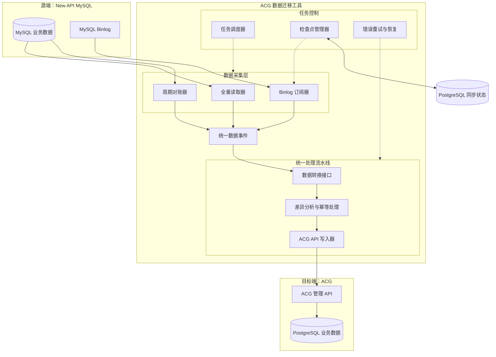
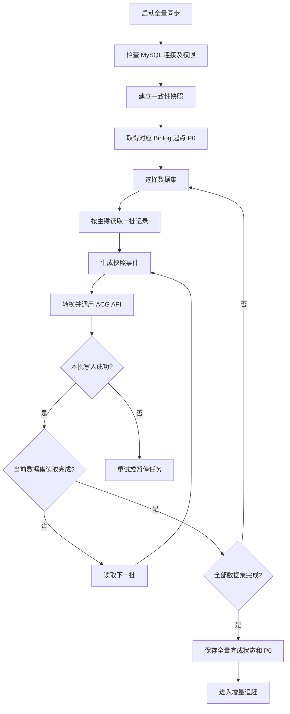
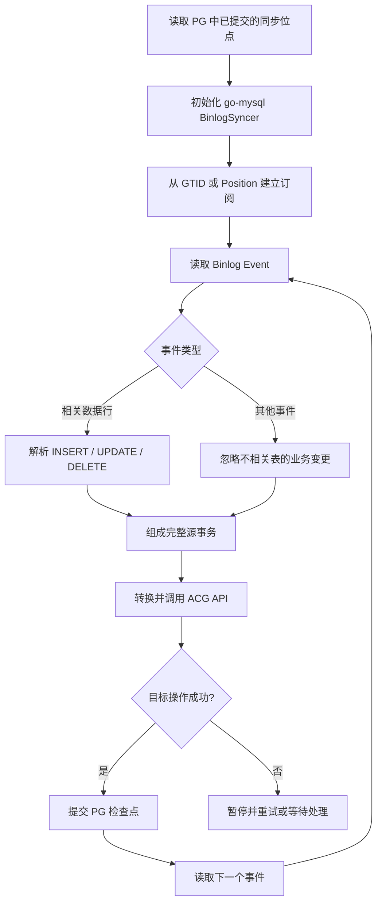
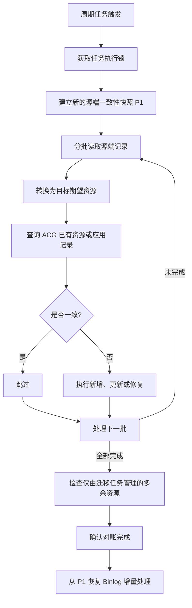
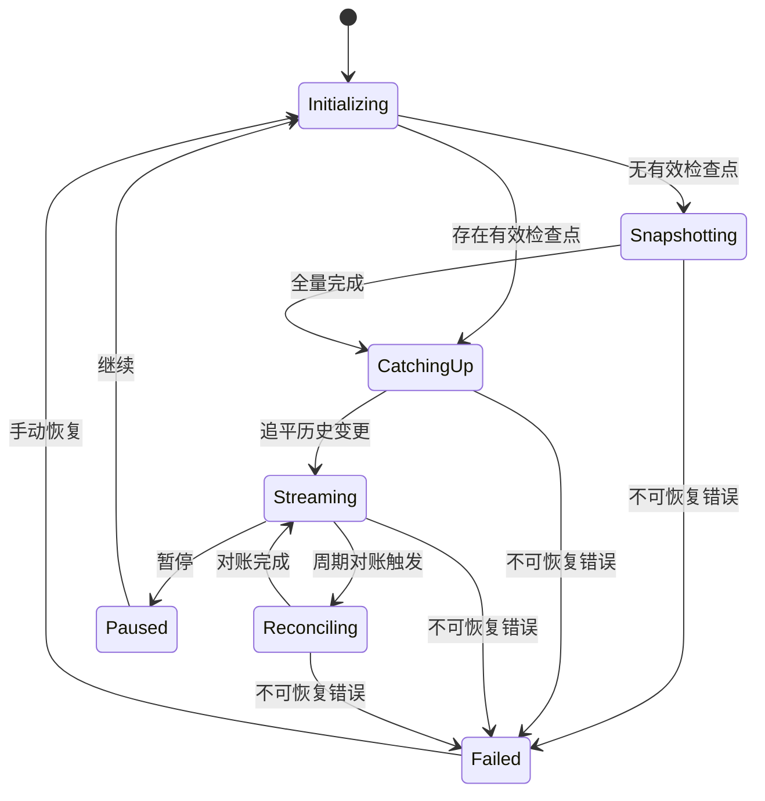
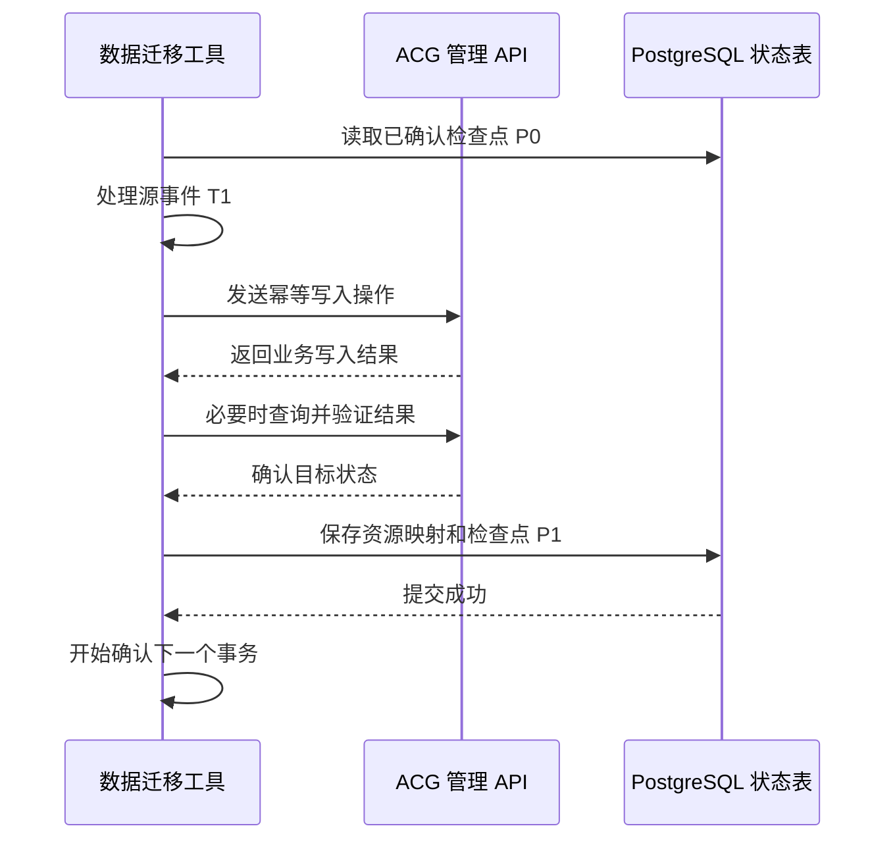
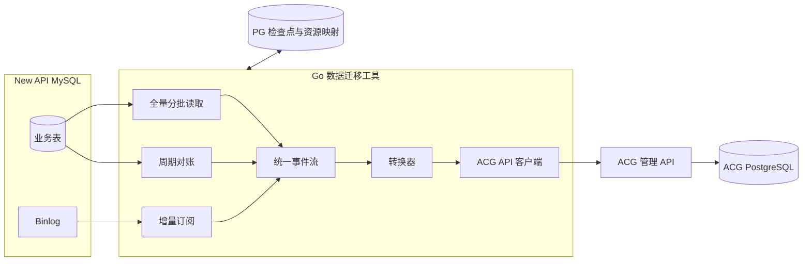

# ACG 算力网关数据迁移工具——项目架构与核心机制设计方案

## 一、项目定位与设计目标

本项目定位为一个基于 Go 的配置驱动型数据迁移与同步工具，用于将 New API、LiteLLM 等外部算力网关的数据迁移到公司内部的 ACG 算力网关。

当前优先实现 New API（MySQL）→ ACG（PostgreSQL）场景，但底层架构不与 New API 或 ACG 的具体业务表结构强耦合。

### 1.1 核心设计原则

整个项目以“读取 → 转换 → 写入”为核心主链路，再通过全量、增量、周期三种机制驱动这条链路。

| 设计项    | 最终方案                   |
| ------ | ---------------------- |
| 开发语言   | Go                     |
| 源端     | New API MySQL，后续支持其他网关 |
| 目标端    | ACG 管理 API             |
| 全量同步   | 一致性快照 + 主键游标分批读取       |
| 增量同步   | MySQL Binlog 复制协议      |
| 周期同步   | 定期对账、差异补偿              |
| 数据转换   | YAML 配置驱动，支持扩展函数       |
| 持久化状态  | ACG PostgreSQL         |
| 中间数据存储 | 不需要数据库副本               |
| 部署方式   | 无状态 K8s Deployment     |
| 可靠性机制  | 检查点、幂等写入、失败重试、断点恢复     |
| 第一阶段目标 | 优先完成底层同步框架，业务字段映射延后    |

### 1.2 明确项目边界

本项目负责：

- 从源数据库读取存量业务数据。
- 通过 Binlog 获取数据变更。
- 定期进行数据对账和补偿。
- 将源数据转换为 ACG 的目标业务资源。
- 调用 ACG API 创建、更新或删除相关资源。
- 记录必要的同步状态，实现异常恢复。

本项目不负责：

- 在 ACG PostgreSQL 中复制 New API 的完整数据库。
- 实现 MySQL 主从数据存储。
- 直接同步 New API 的原始 SQL 到 PostgreSQL。
- 承担 ACG 运行时的模型路由与权限判断。
- 实现跨网关双向数据同步。

当前确定的业务迁移范围为 分组、用户、API Key、渠道。ACG 提供商、聚合路由及权限关联由后续数据映射规则派生，本阶段只保留相关接口。

## 二、项目总体架构



### 2.1 分层职责

| 层次    | 模块         | 职责                    |
| ----- | ---------- | --------------------- |
| 数据采集层 | 全量读取器      | 在一致性快照中分批查询数据         |
| 数据采集层 | Binlog 订阅器 | 模拟 MySQL 复制客户端，订阅增量变化 |
| 数据采集层 | 周期对账器      | 定期扫描源端，发现并修复数据差异      |
| 数据处理层 | 统一数据事件     | 屏蔽不同采集方式的输出差异         |
| 数据处理层 | 转换器        | 将源端记录转换成目标资源          |
| 数据处理层 | 差异处理器      | 计算创建、更新、删除等目标操作       |
| 数据写入层 | ACG 写入器    | 调用管理 API，并验证执行结果      |
| 任务控制层 | 调度器        | 管理任务启动、停止、同步阶段及调度     |
| 任务控制层 | 检查点管理器     | 持久化同步进度               |
| 任务控制层 | 恢复模块       | 重试、重新连接、断点恢复          |

这里不建议将全量、增量和周期同步分别开发成三个完整迁移系统。

三者只负责产生数据事件，后续统一交给相同的转换和写入流水线。

不过它们产生的事件语义稍有差异：全量和周期对账主要产生资源状态，Binlog 则产生变更事件。统一事件模型需要保留这种差异，不能把周期查询到的一行记录直接理解为一次新增。

## 三、统一数据事件设计

在实现三种同步机制之前，建议首先定义一个统一的数据输入协议。这是各模块之间最重要的接口。

### 3.1 统一事件结构

```
type Operation string

const (
    OpSnapshot Operation = "snapshot"
    OpInsert   Operation = "insert"
    OpUpdate   Operation = "update"
    OpDelete   Operation = "delete"
)

type Record struct {
    Dataset string
    Key     string
    Data    map[string]any
}

type ChangeEvent struct {
    SourceID  string
    Operation Operation

    Before *Record
    After  *Record

    // 来源位置，用于追踪和恢复
    Position SourcePosition
}
```

其中：

- `Dataset` 表示逻辑数据集，例如 `users`、`tokens`、`channels`。
- `Before` 表示变更前的数据。
- `After` 表示变更后的数据。
- `Operation` 用于区分新增、修改、删除和快照记录。
- `Position` 表示事件在源数据库日志中的位置。

具体数据通过 `map[string]any` 表达，不需要预先定义 New API 的每个业务字段。

不过，统一事件不等于统一确认粒度。

Binlog 需要按 MySQL 事务提交边界确认进度，所以实际流水线还要支持事务批次：

```
type ChangeBatch struct {
    Events []ChangeEvent

    // 只有整个批次成功处理，才能提交该位点
    EndPosition SourcePosition
}
```

首期建议保证一个源数据库事务内的事件按顺序应用，整个事务对应的目标操作成功后再提交检查点。

快照批次则可以使用相同的事件处理接口，但其批次游标不能直接作为已提交的 Binlog 位点。

### 3.2 为什么先实现这一层？

后续即使增加其他数据来源：

```
New API MySQL       → ChangeEvent
LiteLLM PostgreSQL  → ChangeEvent
其他网关 API        → ChangeEvent
JSON/YAML 文件      → ChangeEvent
```

数据转换和目标写入模块都不需要关心记录来自 MySQL Binlog、SQL 查询还是 HTTP API。

## 四、全量同步机制

### 4.1 设计目标

全量同步需要满足：

1. 不一次性读取全部数据。
2. 支持配置读取哪些表或逻辑数据集。
3. 尽可能保证跨批次数据一致性。
4. 读取、转换、写入采用流式处理。
5. 支持批大小、超时、限速等参数。
6. 执行失败后可以安全重新开始。

### 4.2 全量同步流程



图中对失败批次的重试必须保留原始批次，不能因为内存队列已经读出数据就推进读取进度。

### 4.3 分批读取方式

首期推荐基于主键游标的分页方式。

例如：

```
SELECT *
FROM tokens
WHERE id > ?
ORDER BY id ASC
LIMIT 500;
```

每一批处理成功以后，更新下一次读取的主键游标。

不推荐默认采用：

```
SELECT * FROM tokens
LIMIT 500 OFFSET 50000;
```

因为大偏移量通常需要扫描或跳过较多数据，性能不如基于索引的游标分页。

对于非整数主键、复合主键或没有合适索引的数据集，读取器应支持由配置指定分页方式，不能假设所有源表都使用自增 ID。

### 4.4 分批读取与一致性快照的关系

这是全量同步最需要正确设计的地方。

推荐在 MySQL 中建立一个 InnoDB 一致性读事务：

```
SET TRANSACTION ISOLATION LEVEL REPEATABLE READ;
START TRANSACTION WITH CONSISTENT SNAPSHOT;
```

随后在同一个事务和数据库连接中，按主键分批读取多个数据集。这样即使源端持续写入，这些查询仍然可以基于同一快照读取数据。

但还必须取得与该快照一致的 Binlog 起点。正式实现时，需要参考 MySQL 官方 `mysqldump --single-transaction --source-data` 的协调方式，在短暂同步写入的窗口内取得日志位置并建立一致性视图，随后释放锁，而不是在任意时间读取一个 Binlog 位置。


整个过程不需要把快照写入另一个数据库。

读取过程中只维护：

- 当前数据集。
- 当前主键游标。
- 已处理数量。
- 快照对应的 Binlog 起点。

需要注意，长期保持一致性快照会增加 MySQL 的历史版本保留压力，并且快照期间的 DDL 可能影响读取。因此首期采用单连接、分批查询、限速和快照时长监控。

如果全量执行过程中 Pod 崩溃，原有快照事务无法恢复。建议第一期直接重新建立快照并幂等重做全量，而不是错误地在新事务中接着旧游标读取并声称保持原快照一致性。

### 4.5 全量同步的 Go 接口

```
type SnapshotReader interface {
    Open(
        ctx context.Context,
    ) (SnapshotSession, error)
}

type SnapshotSession interface {
    Position() SourcePosition

    ReadBatch(
        ctx context.Context,
        dataset string,
        cursor Cursor,
        limit int,
    ) (records []Record, next Cursor, err error)

    Close() error
}
```

`Open()` 必须保证它返回的快照会话与 `Position()` 对应同一个一致性数据视图。

事务的提交、回滚及清理由实现负责，不能在 `ReadBatch()` 之间更换快照事务。

从应用层看：

```
OpenSnapshot()
    ↓
ReadBatch(500)
    ↓
Transform()
    ↓
WriteToACG()
    ↓
ReadBatch(500)
    ↓
...
    ↓
CloseSnapshot()
```

批大小建议默认 500，但需要根据记录大小和 ACG API 性能调整，不应将它固定为不可修改的值。

## 五、Binlog 增量同步机制

### 5.1 实现选型

推荐使用：

[go-mysql GitHub 仓库](https://github.com/go-mysql-org/go-mysql?utm_source=chatgpt.com)

其中：

- `replication`：底层 Binlog 订阅、解析及恢复。
- `canal`：提供更高层次的全量转储和增量订阅功能，可作为实现参考。

`go-mysql` 的 `BinlogSyncer` 已经提供从文件 Position 或 GTID 集合启动订阅的接口，无需自行实现 MySQL 复制协议。


对于当前项目，我倾向于直接使用 `replication` 模块构建增量读取器。

原因是我们已经计划自己实现 SQL 分批读取和 PostgreSQL 检查点，直接使用较底层的订阅组件，能够更清晰地控制事件确认和任务恢复。

### 5.2 Binlog 增量流程



这里的关键是识别事务边界。

例如某个 MySQL 事务同时修改了用户与 API Key：

```
BEGIN;
UPDATE users SET status = 1 WHERE id = 100;
UPDATE tokens SET status = 1 WHERE user_id = 100;
COMMIT;
```

Binlog 可能包含多条行变更事件，但只有完整事务提交以后，才可以确认新的同步位点。

因此，增量模块应负责把原始日志事件整理为 `ChangeBatch`，而不是每读到一条行事件就立刻更新 PostgreSQL 检查点。

对于不相关表产生的事务，虽然不需要调用 ACG API，也应在确认事务完成后推进同步位置，避免持续重复读取。

### 5.3 检查点设计

建议定义统一位置类型：

```
type SourcePosition struct {
    Mode string // gtid 或 filepos

    GTIDSet string

    BinlogFile string
    BinlogPos  uint64
}
```

优先使用 GTID；源端未启用时使用 Binlog 文件名和 Position。

但实现时应特别注意：

必须区分“已经从 MySQL 读取的位置”和“已经成功写入 ACG 的位置”。

只持久化后者。

即：

```
读取 Binlog 事务 T1
         ↓
转换 T1
         ↓
调用 ACG API
         ↓
确认目标操作成功
         ↓
保存 T1 的检查点
         ↓
继续下一个事务
```

这样发生崩溃时，最多重复处理尚未确认的事务，而不会主动跳过尚未成功写入的事务。

如果一个源事务派生出多个 ACG API 操作，而执行到一半失败，重试时必须能够安全识别已经完成的操作。因此，幂等导入是必需机制。

### 5.4 Binlog 订阅的前置条件

源 MySQL 至少需要满足：

- 开启 Binlog。
- 使用行级日志格式（ROW）。
- 建议使用 `binlog_row_image=FULL`。
- 为订阅客户端分配不冲突的 `server_id`。
- 提供必要的 SELECT 和复制权限。
- 保留足够长时间的 Binlog。

MySQL 官方文档说明，`FULL` 行镜像会记录完整的变更前后字段，有利于后续转换逻辑读取所需的数据。


如果连接的是真实 MySQL 只读副本，还需要确保副本记录了来自上游主库的变更日志，即启用了自身 Binlog 和 `log_replica_updates`。


首期建议全量 SQL 读取与 Binlog 订阅都使用同一个逻辑 MySQL 实例，避免两个实例之间的复制延迟、位点空间和快照对应关系增加实现复杂度。

## 六、周期同步机制

周期同步不需要另一套数据迁移逻辑。

建议将它定义为：定期执行一次源端与 ACG 目标端的差异对账，并通过现有写入流水线修复差异。

Binlog 是主同步机制，周期同步是补偿机制。

### 6.1 为什么已经有 Binlog，还需要周期同步？

主要用于处理以下情况：

| 场景             | Binlog 增量同步   | 周期同步          |
| -------------- | ------------- | ------------- |
| 源端新增数据         | 实时捕获          | 确认目标已存在       |
| 源端更新数据         | 实时捕获          | 检查目标配置是否一致    |
| 源端删除数据         | 实时捕获          | 检查目标是否仍存在多余资源 |
| ACG API 曾经写入失败 | 重试或阻塞后续确认     | 对账补偿          |
| ACG 目标数据被人工修改  | 不会产生源端 Binlog | 检测并按冲突策略处理    |
| 映射规则修改         | 不会产生源端 Binlog | 重新计算目标期望数据    |

需要注意：周期同步本身不能代替可靠的 Binlog 恢复。发现 Binlog 缺失时，应主动触发重新建立一致性快照，而不是直接从最新位点继续，造成中间变更遗漏。

### 6.2 周期对账的流程



### 6.3 周期同步如何避免与 Binlog 冲突？

这是一个值得在首期就解决的问题。

假设：

1. 周期任务读取到用户状态为 `enabled`。
2. Binlog 接收到该用户被禁用的事件。
3. 增量任务先将 ACG 用户设为 `disabled`。
4. 周期任务随后将之前读取的 `enabled` 写入 ACG。

就可能出现旧数据覆盖新数据的问题。

推荐第一版采用同一任务的串行调和机制。

执行周期对账时：

1. 暂停该任务的 Binlog 事件应用。
2. 建立新的一致性快照，取得位置 `P1`。
3. 分批读取并调和源数据。
4. 全部目标操作成功后，将已应用检查点推进到 `P1`。
5. 从 `P1` 继续处理后续 Binlog 事件。

在对账期间，MySQL 可以继续正常写入，并不需要长期锁库。只是迁移工具暂时不应用增量事件。

如果对账失败，保留原有已确认检查点，重新执行完整对账或恢复原增量任务；不能将未完成的快照进度当作新的增量起点。

这种方式不需要增加事件缓冲数据库，也能避免两种同步任务同时修改相同目标资源。

代价是周期对账期间增量会暂时滞后。首期可以接受，后续如果出现较大数据规模，再优化为并行读取和带版本控制的调和。

### 6.4 如何发现已删除的数据？

仅仅遍历源端现存记录，无法知道哪些数据已经从源端删除。

因此需要保存一份非常轻量的源目标资源对应关系。

例如：

| 来源       | 源 ID | ACG 目标 ID    | 最近一次发现 |
| -------- | ---- | ------------ | ------ |
| channels | 101  | provider-201 | run-10 |
| channels | 102  | provider-202 | run-10 |
| tokens   | 501  | key-301      | run-9  |

执行第 10 次周期对账时，读取到的资源更新 `last_seen_run`。

等整个数据集确认扫描完成后，仍停留在 `run-9` 的记录才可能代表源端已删除的资源。

随后按配置执行停用、删除或告警。

这个资源对应关系表不是源数据库副本。它只保存源目标标识、必要的版本指纹和同步管理信息，不保存 New API 的完整业务字段。

删除清理仅限于当前迁移任务明确拥有的目标资源，不能误删 ACG 原本存在的其他配置。

## 七、三种同步机制的统一调度

建议为每一个迁移任务维护独立状态机。



其中：

- `Initializing`：检查配置、数据库权限、任务及位点。
- `Snapshotting`：执行首次全量。
- `CatchingUp`：处理全量过程中产生的历史 Binlog。
- `Streaming`：持续增量同步。
- `Reconciling`：周期对账。
- `Paused`：主动暂停。
- `Failed`：遇到需要处理的不可恢复错误。

可恢复的网络超时不必立即进入 `Failed`，应由模块内部按重试策略处理。

建议第一版采用一个迁移任务、一个活动执行器、顺序提交检查点的模式。

数据查询可以分批，API 写入也可以在不破坏依赖关系的前提下分批；不需要一开始就设计复杂的分布式任务调度系统。

## 八、PostgreSQL 状态持久化设计

迁移工具需要保持无状态部署，因此 PostgreSQL 只负责保存必要的执行元数据。

首期建议三张表就够。

### 8.1 `migration_tasks`

保存任务基本信息与执行状态。

| 字段            | 含义       |
| ------------- | -------- |
| `task_id`     | 迁移任务唯一标识 |
| `source_id`   | 数据源标识    |
| `phase`       | 当前同步阶段   |
| `config_hash` | 当前任务配置指纹 |
| `last_error`  | 最近一次错误摘要 |
| `lease_owner` | 当前执行实例   |
| `lease_until` | 执行租约到期时间 |
| `updated_at`  | 最近状态更新时间 |

### 8.2 `migration_checkpoints`

保存数据同步的恢复位置。

| 字段                  | 含义                |
| ------------------- | ----------------- |
| `task_id`           | 对应迁移任务            |
| `snapshot_position` | 首次快照关联的 Binlog 起点 |
| `applied_position`  | 已经成功应用的 Binlog 位点 |
| `snapshot_done`     | 全量是否完成            |
| `reconcile_run_id`  | 最近一次对账任务标识        |
| `updated_at`        | 检查点更新时间           |

`applied_position` 是最重要的字段。

需要注意，即使采用主键游标分页，全量任务中的游标也不能脱离原来的快照事务独立恢复。因此首期不强求保存能够跨 Pod 重建继续使用的 `snapshot_cursor`。

可以在任务运行时维护分页游标，而在 Pod 崩溃后重新建立快照。

### 8.3 `migration_resource_map`

保存源目标资源的关联关系。

| 字段                  | 含义             |
| ------------------- | -------------- |
| `task_id`           | 迁移任务           |
| `source_dataset`    | 源数据集           |
| `source_key`        | 源资源主键          |
| `target_kind`       | ACG 目标资源类型     |
| `target_id`         | ACG 目标资源 ID    |
| `last_applied_hash` | 上次应用的目标资源指纹    |
| `last_seen_run`     | 最近一次对账发现该资源的任务 |
| `updated_at`        | 更新时间           |

一个源资源可能转换出多个 ACG 目标资源，因此不能简单要求 `source_key` 在整个表中唯一。唯一性需要包含目标资源逻辑身份。

对于 API Key 等敏感资源，数据指纹应采用受控密钥的 HMAC 或其他安全比较方式，不要把原始密钥或容易离线猜测的普通哈希存进状态表。

### 8.4 写入与检查点提交顺序



这里无法依赖 PostgreSQL 事务自动覆盖前面的 ACG HTTP API 调用，因此要允许重复消费。

实际可靠性模型为：

至少一次处理 + 目标操作幂等 + 成功后持久化检查点。

如果 API 已写入成功但响应丢失，迁移工具需要能够通过幂等键或目标查询判断操作是否已经生效，不能直接将超时当成确定失败。

## 九、推荐的 Go 项目架构

建议项目先采用单进程、模块化结构，不需要拆成多个微服务。

```
acg-migrator/
├── cmd/
│   └── migrator/
│       └── main.go
│
├── internal/
│   ├── app/
│   │   └── bootstrap.go
│   │
│   ├── config/
│   │   ├── config.go
│   │   └── validator.go
│   │
│   ├── source/
│   │   ├── source.go
│   │   └── mysql/
│   │       ├── client.go
│   │       ├── snapshot.go
│   │       ├── binlog.go
│   │       ├── decoder.go
│   │       └── pagination.go
│   │
│   ├── event/
│   │   ├── record.go
│   │   ├── change.go
│   │   └── position.go
│   │
│   ├── sync/
│   │   ├── coordinator.go
│   │   ├── full.go
│   │   ├── incremental.go
│   │   ├── reconcile.go
│   │   ├── pipeline.go
│   │   └── retry.go
│   │
│   ├── mapping/
│   │   ├── mapper.go
│   │   └── registry.go
│   │
│   ├── target/
│   │   ├── target.go
│   │   ├── acg/
│   │   │   ├── client.go
│   │   │   ├── writer.go
│   │   │   └── inspector.go
│   │   └── mock/
│   │       └── writer.go
│   │
│   ├── state/
│   │   ├── store.go
│   │   └── postgres/
│   │       ├── store.go
│   │       ├── checkpoint.go
│   │       ├── resource_map.go
│   │       └── lease.go
│   │
│   └── observability/
│       ├── metrics.go
│       └── logging.go
│
├── migrations/
│   └── postgres/
│
├── configs/
│   ├── sources/
│   ├── mappings/
│   └── jobs/
│
├── tests/
│   ├── integration/
│   └── fixtures/
│
├── go.mod
└── README.md
```

### 9.1 各模块的开发独立性

这套目录结构的重点是：

| 模块                 | 当前是否可以独立开发        | 是否需要 ACG 数据模型 |
| ------------------ | ----------------- | ------------- |
| `source/mysql`     | 可以                | 不需要           |
| `event`            | 可以                | 不需要           |
| `sync/full`        | 可以                | 不需要           |
| `sync/incremental` | 可以                | 不需要           |
| `sync/reconcile`   | 可以开发调度与扫描机制       | 差异比较需目标查询接口   |
| `state/postgres`   | 可以                | 不需要           |
| `config`           | 可以                | 不需要           |
| `mapping`          | 可以先定义接口           | 具体规则需要        |
| `target/acg`       | 可以先定义接口和 HTTP 客户端 | 具体 API 需要     |
| `target/mock`      | 可以                | 不需要           |

因此，无需等待 ACG 业务映射设计完成，就能先实现大部分核心代码。

### 9.2 关键接口

建议先稳定以下三个接口。

数据源接口：

```
type Source interface {
    OpenSnapshot(
        ctx context.Context,
    ) (SnapshotSession, error)

    Stream(
        ctx context.Context,
        from SourcePosition,
        consume func(ChangeBatch) error,
    ) error
}
```

周期同步可以复用 `OpenSnapshot()`，由任务调度器决定本次执行属于首次全量还是周期对账。

其他来源如果没有 Binlog 能力，可通过能力声明只支持快照或定时查询，不要求所有 Source 都必须实现 `Stream`。

数据转换接口：

```
type Mapper interface {
    Transform(
        ctx context.Context,
        batch ChangeBatch,
    ) ([]TargetOperation, error)
}
```

`TargetOperation` 只定义通用操作信息，例如资源类型、目标逻辑标识、操作类型和目标数据，具体字段后续确认。

目标端接口：

```
type Target interface {
    Apply(
        ctx context.Context,
        operations []TargetOperation,
    ) error

    Inspect(
        ctx context.Context,
        ids []TargetIdentity,
    ) ([]TargetResource, error)
}
```

其中 `Inspect` 很重要。

它既供周期对账比较目标状态，也供失败重试时确定某次 API 调用是否已经执行成功。

真实 ACG 接口确定之前，可以先使用 Mock Target 测试完整迁移流程。

## 十、配置文件设计

建议第一版只定义机制层配置，暂不引入具体字段映射。

```
version: 1

job:
  id: newapi-to-acg
  enabled: true

source:
  type: mysql
  dsn_env: NEWAPI_MYSQL_DSN

  replication:
    server_id: 10086
    position_mode: auto

  datasets:
    - name: users
      table: users
      primary_key: id

    - name: tokens
      table: tokens
      primary_key: id

    - name: channels
      table: channels
      primary_key: id

sync:
  full:
    enabled: true
    on_first_run: true
    batch_size: 500

  incremental:
    enabled: true
    batch_size: 100
    max_retries: 5

  reconcile:
    enabled: true
    interval: 24h
    batch_size: 500

target:
  type: acg-api
  base_url: ${ACG_API_URL}
  token_env: ACG_API_TOKEN
  timeout: 30s

state:
  type: postgres
  dsn_env: ACG_PG_DSN
  schema: migration

mapping:
  profile: newapi-to-acg
```

该配置是拟定的框架规范。

目前仅列出三个示例数据表。New API 的分组可能由系统配置管理，正式接入时需要根据实际版本补充数据集及相关变更捕获规则。

首期还有几个配置约束：

- `server_id` 对同一复制拓扑的活动客户端必须唯一。
- `position_mode: auto` 表示优先使用 GTID，无法使用时退回文件位置。
- `batch_size` 表示读取或提交批大小，不代表可以跨 MySQL 事务随意确认检查点。
- `reconcile.interval` 为周期对账间隔，而不是每次无条件覆盖目标数据。
- 数据库连接、API Token 等凭据只从环境变量或受控密钥系统读取。

## 十一、分阶段开发计划

建议分成四个阶段，各阶段都能独立测试和验收。

阶段一：项目骨架 + 分批全量读取

建立 Go 项目、配置加载、MySQL 连接器、数据集定义、统一事件结构，以及 Mock Target。

实现基于同一快照的主键分页读取、快照起点获取、批次处理和读取中断。

验收标准： 可从测试 MySQL 分批读取多张表，源端在同步过程中发生写入，也能取得一致的快照视图；整个过程不把全量数据一次性加载到内存。

阶段二：Binlog 订阅 + PostgreSQL 检查点

集成 go-mysql，处理事务边界、INSERT、UPDATE、DELETE、Binlog 切换与重连。

实现 PostgreSQL 状态表、已应用位点保存及断点恢复。

验收标准： 完成一次全量后，源端新增、修改、删除能够通过 Binlog 被捕获；模拟 Pod 重启后能够从检查点继续；写入失败时不会错误地推进位点。

阶段三：周期对账 + 任务调度

实现任务状态机、周期触发、增量与周期任务串行协调、资源差异比较和删除检测。

验收标准： 人为修改 Mock Target 数据后，周期任务能够发现差异并修复；任务中断不会导致旧快照覆盖新数据。

阶段四：正式对接 ACG

在获得 ACG 数据模型和管理 API 后，实现 YAML 映射、资源依赖、ACG 写入器与权限关联。

验收标准： New API 的分组、用户、API Key 和渠道可以正确转换并写入 ACG，且全量、增量、周期三种机制共用相同转换和写入流程。

## 十二、第一期必须覆盖的测试场景

建议使用容器化 MySQL、PostgreSQL 和 Mock ACG API 进行集成测试。

| 测试场景              | 预期结果                     |
| ----------------- | ------------------------ |
| 全量读取过程中新增记录       | 通过后续 Binlog 补齐，不重复生成目标资源 |
| 全量读取过程中修改记录       | 最终目标与源端最新状态一致            |
| 全量读取过程中 Pod 崩溃    | 重新建立快照，幂等重做              |
| 一个事务修改多条记录        | 完整应用后才推进检查点              |
| ACG API 返回超时      | 查询结果或幂等重试，不盲目重复创建        |
| API 成功但 PG 位点未提交  | 重放事件，不出现重复资源             |
| Binlog 连接断开       | 自动重连并恢复订阅                |
| Binlog 已被清理       | 停止错误恢复，转入重新全量流程          |
| 周期对账期间出现新增事件      | 后续增量补齐，不出现旧数据覆盖          |
| 源端删除资源            | 周期对账能够发现；仅清理迁移任务拥有的资源    |
| 源端发生不兼容 DDL       | 暂停并报错，不错误推进检查点           |
| API Key 数据读取及日志输出 | 原始密钥不进入普通日志或状态快照         |

### 两个运行保障

第一，监控 Binlog 同步延迟。 如果 ACG API 变慢，迁移工具可能持续落后于源端。需要监控最后成功提交位点、事件积压时长和重试次数，并确保 MySQL 的日志保留时间足够覆盖最长中断时间。

第二，限制对源 MySQL 的影响。 全量读取应支持限速与快照超时监控，周期对账不宜过于频繁。尤其是长时间一致性快照可能增加 InnoDB 的历史版本保留压力。

## 十三、最终建议的最小可实施架构



目前已经足以开始开发的内容是：

- Go 项目骨架与配置管理。
- MySQL 分批快照读取器。
- go-mysql Binlog 订阅器。
- 统一数据事件及批次处理接口。
- PostgreSQL 检查点和任务状态。
- 周期对账与任务调度机制。
- Mock 写入器和自动化集成测试。

真正需要延后确认的只有源数据字段如何映射到 ACG 目标资源，以及 ACG 各类资源的管理 API 调用规范。

我的建议是将第一阶段的交付目标明确为：

> 在不依赖任何 ACG 业务字段的情况下，实现一个能够连接 MySQL、分批完成一致性全量读取、衔接 Binlog 增量订阅、执行周期对账，并在 PostgreSQL 持久化检查点的无状态 Go 同步框架。

这个基础框架完成以后，再接入 New API 的具体字段映射与 ACG 的业务 API，能够最大程度减少后续返工。