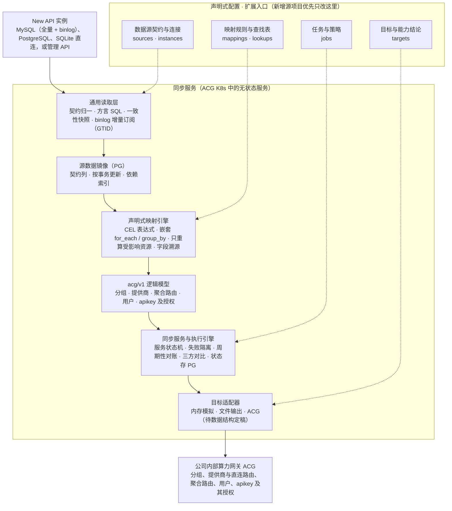
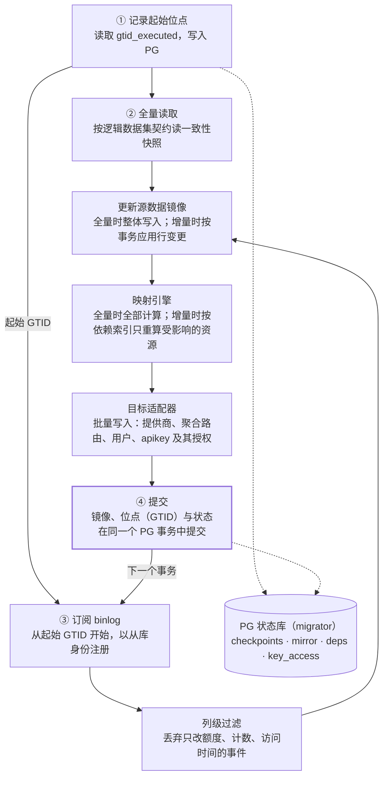

# AI 算力网关数据迁移工具——修订版架构设计（v3.1）

Oct 28, 2026 · @Liam

## 修订说明

v2 将首期范围收敛为 New API → 内部算力网关（下称 ACG），并补齐 v1 评审中发现的缺口。LiteLLM、Higress 保留扩展点，后续接入。用户账号迁移，密码统一重置；历史日志和用量数据不迁移。

| 主题 | v1 | v2 |
| --- | --- | --- |
| 首期源项目 | New API、LiteLLM、Higress 分阶段 | 仅 New API，其余后续 |
| 数据范围 | 以上游渠道为主 | 增加分组、用户、令牌、额度；日志与用量不迁移 |
| 用户密码 | 未涉及 | 统一重置为初始密码 User@123，强制首次登录修改 |
| 读取层 | 手写 SQL | 逻辑数据集契约，按方言生成 SQL，源版本探测，一致性快照 |
| 映射 DSL | 字段、拆分、引用 | 增加 join、when、group\_by、保真度声明、漏映射告警 |
| 模型映射 | 每个渠道每个模型一个部署 | 逻辑模型与部署分离，保留 model\_mapping、group、优先级与权重 |
| 密钥 | 脱敏与恢复并存，未定方案 | 密钥不落盘，断点重读源端；以 HMAC 指纹比对 |
| 执行引擎 | 预览、幂等、断点续跑 | 增加延迟绑定、失败传播、计划指纹、三方对比、prune、回滚 |
| 目标网关 | 未列要求 | 列出前置能力清单，阶段一逐项确认 |

### v3 变更

v3 在 v2 基础上确定了 ACG 侧的路由映射方式，并增加 binlog 增量同步。迁移范围收敛为分组、用户、apikey、渠道。

| 主题 | v2 | v3 |
| --- | --- | --- |
| 迁移范围 | 渠道、分组、用户、令牌、额度 | 分组、用户、apikey、渠道；额度暂不纳入 |
| ACG 资源 | 9 类，含逻辑模型、部署、路由策略 | 5 类：分组、提供商、聚合路由、用户、apikey |
| 分组语义 | 部署与分组关联 | 聚合路由按裸模型名建立，成员为提供该模型的全部渠道；apikey 只被授权其有效分组内的提供商 |
| 客户端调用 | 模型名不变 | 模型名不变，切换时只更换 base\_url |
| 直连路由 | 未涉及 | 每个提供商自动生成；默认不授权给迁移过来的 apikey |
| 运行形态 | 命令驱动：plan、apply、resume、verify 逐步执行 | ACG K8s 中的无状态长期运行服务，预检、全量、增量、对账自动衔接 |
| 增量同步 | 多轮全量加三方对比 | 首次全量，之后订阅 MySQL binlog 持续同步，周期性对账兜底 |
| 增量计算 | 回源查询关联数据 | PG 中的源数据镜像加依赖索引，只重算受影响资源 |
| 目标端 | 统一导入器，直接对接 ACG | 目标适配器：内存模拟、文件输出先行，ACG 实现待其数据结构定稿 |
| 失败处理 | 失败即停，人工续跑 | 临时故障自动重试；数据问题进入失败队列，不阻塞同步 |
| 状态库 | 本地 SQLite | ACG 所用 PostgreSQL 的独立 schema，工具无状态 |

## 一、设计目标与范围

本期目标：由一个运行在 ACG K8s 环境中的无状态服务，把一个或多个 New API 实例的分组、用户、apikey、渠道迁移到 ACG。服务完成首次全量后持续同步增量，直到业务切换完成。

### 1.1 设计目标

- 框架化：读取、映射、导入、执行四层保持通用，New API 的差异只体现在配置（sources、mappings、lookups）和少量扩展函数中。
- 多数据源：New API 支持 MySQL、PostgreSQL、SQLite 直连读取，以及管理 API 读取；MySQL 支持 binlog 增量订阅。
- 服务化：作为无状态服务长期运行，预检、全量、增量、对账自动衔接，Pod 重启后自动续跑，不需要人工驱动流程。
- 可靠：资源级幂等；临时故障自动重试，数据问题进入失败队列而不阻塞同步；周期性对账保证最终一致。
- 可扩展：后续接入 LiteLLM、Higress 时优先只新增配置；缺少能力时补充通用能力，不在引擎中加项目分支。

非目标：历史日志、用量统计、充值与兑换码记录；双向迁移；复刻源网关的运行逻辑（例如渠道健康检查）。

### 1.2 范围矩阵

处理方式分为：原值迁移、转换迁移、近似迁移（语义有损，需在报告中标出）、重置、不迁移。字段名以实际部署的 New API 版本为准，阶段一核对。

| 数据 | New API 来源 | 处理方式 | ACG 资源 | 说明 |
| --- | --- | --- | --- | --- |
| 渠道基本信息 | channels：name、type、base\_url、status | 转换迁移 | 提供商（自动生成直连路由） | base\_url 为空时按渠道类型取默认地址 |
| 上游密钥 | channels.key | 原值迁移 | 提供商的密钥列表 | 支持多密钥拆分；部分类型的 key 是 JSON 或组合格式 |
| 模型重定向 | channels.model\_mapping | 转换迁移 | 提供商的模型映射 | 请求模型名到上游模型名 |
| 模型 | channels.models | 转换迁移 | 聚合路由（以裸模型名命名） | 成员为提供该模型的全部渠道 |
| 优先级与权重 | channels.priority、weight | 近似迁移 | 聚合路由成员的优先级与权重 | 保真度取决于 ACG 的选路方式，见 5.4 |
| 分组 | channels.group、users.group、tokens.group | 转换迁移 | 分组 | 用于计算 apikey 可访问的提供商与路由 |
| 渠道高级设置 | param\_override、header\_override、status\_code\_mapping、setting 等 | 逐项评估 | 待定 | ACG 不支持的字段显式声明 dropped |
| 用户账号 | users：username、display\_name、email、role、status | 转换迁移 | 用户 | 软删除用户不迁移 |
| 用户密码 | users.password | 重置 | 用户 | 统一重置为 User@123，强制首次登录修改，见第六节 |
| 令牌 | tokens：key、名称、状态、过期时间、IP 限制、模型限制、分组 | 原值迁移 | apikey 及其授权 | 可访问的提供商与路由由有效分组决定，见 5.6 |
| 用户余额、令牌额度 | users.quota、tokens.remain\_quota 等 | 暂不纳入 | — | 待单独确认 |
| 第三方登录绑定 | users：github\_id、oidc\_id 等 | 待确认 | — | 见第十二节待确认事项 |
| 用户系统访问令牌 | users.access\_token | 不迁移 | — | 管理用途，迁移后由用户重新生成 |
| 分组倍率、模型倍率与价格 | options 表 | 不迁移 | — | 本期范围外 |
| 历史日志、用量统计 | logs 等 | 不迁移 | — | 本期范围外 |
| 兑换码、充值记录 | redemptions、top\_ups 等 | 不迁移 | — | 本期范围外 |
| 其余系统设置 | options 表 | 不迁移 | — | 在 ACG 中单独配置 |

## 二、总体架构

架构沿用 v1 的主链路，核心原则不变：外部项目的原始结构不进入引擎，引擎只处理标准记录和 acg/v1 资源。



实线是数据流向，虚线是配置作用点。新增源项目时，优先只新增配置；读取驱动、映射引擎、执行引擎和导入器都不随源项目增加。

| 层 | 职责 | 扩展方式 |
| --- | --- | --- |
| 通用读取层 | 全量：按逻辑数据集契约输出标准记录；增量：订阅 binlog，按事务输出行变更 | 新驱动写代码；新项目只加契约配置 |
| 源数据镜像 | 在 PG 中保存契约列，按事务更新；维护“源记录 → 资源”的依赖索引 | 框架通用 |
| 映射引擎 | 执行 YAML 规则，生成 acg/v1 逻辑资源和字段溯源；增量时只重算受影响资源 | YAML；特殊转换用 Transformer 扩展 |
| 逻辑模型层 | acg/v1 的 5 类资源与 JSON Schema；授权只表达“能访问什么” | 随 ACG 导入契约升级版本 |
| 同步服务与执行引擎 | 服务状态机、失败隔离、周期性对账、三方对比；位点与状态存 PG，服务无状态 | 框架通用 |
| 目标适配器 | 把逻辑变更写入目标；内置内存模拟和文件输出，ACG 实现待定 | 每种目标一个实现，唯一依赖 ACG 数据结构的部分 |

## 三、数据读取层

映射规则只依赖逻辑数据集契约，不依赖具体 SQL 或 API 字段。各读取方式负责把原始数据归一到契约，同一份映射因此可以复用于 MySQL、PostgreSQL、SQLite 和管理 API。

### 3.1 项目级契约与实例级连接分离

项目级配置描述 New API 有哪些数据集、每个数据集的逻辑字段，以及各读取方式如何绑定到这些字段。实例级配置只描述连接哪个具体实例。多个 New API 实例共用一份项目级配置。

```yaml
# configs/sources/new-api.yaml —— 项目级：逻辑数据集契约（示例，字段以实际版本核定）
version: 2
project: new-api

compat:
  supported: ">=0.6.0"              # 首期支持的版本区间，阶段一核定
  probe:
    api: {path: /api/status, version_path: data.version}
    database:                        # 直连时以表结构指纹判定
      require_columns:
        channels: [id, type, key, base_url, models, group, model_mapping, priority, weight, status]
        users: [id, username, role, status, quota, used_quota, group]
        tokens: [id, user_id, key, status, expired_time, remain_quota, unlimited_quota]

datasets:
  channels:
    primary_key: id
    schema:
      id:            {type: int, required: true}
      type:          {type: int, required: true}
      name:          {type: string}
      key:           {type: secret}
      base_url:      {type: string}
      models:        {type: string}
      group:         {type: string, default: "default"}
      model_mapping: {type: json}
      priority:      {type: int, default: 0}
      weight:        {type: int, default: 0}
      status:        {type: int, required: true}
    dropped: [balance, used_quota, response_time, test_time]   # 显式声明不迁移的列
    bindings:
      database: {table: channels}    # 框架按方言生成显式列名 SQL，自动处理 group、key 等保留字
      api:
        path: /api/channel/
        records_path: data.items     # 以实际接口为准
        pagination: {type: page, page_param: p, size_param: page_size, size: 100}
        unavailable: [key]           # 管理 API 通常不返回完整密钥
```

```yaml
# configs/instances/newapi-prod.yaml —— 实例级：连接方式
instance: newapi-prod
project: new-api
access:
  type: database
  driver: postgres                   # mysql | postgres | sqlite
  dsn_env: NEWAPI_PROD_DSN
```

通过管理 API 读取时，渠道密钥通常拿不到。框架把 unavailable 字段标记为缺失，由 missing\_secret 策略决定阻止或跳过。因此渠道密钥迁移以数据库直连为准，API 模式适用于无数据库权限、只迁移非密钥数据的场景。

### 3.2 方言与类型归一

- 生成 SQL：按契约生成显式列名查询，不使用 SELECT \*；按方言引用保留字（MySQL 用反引号，PostgreSQL、SQLite 用双引号）。
- 类型归一：tinyint 与 boolean、以文本存储的 JSON、Unix 秒级时间戳统一转换为契约类型；转换失败即报错。
- 分批读取：按主键游标分页（WHERE id > ? ORDER BY id LIMIT ?），不使用 OFFSET。
- 只读保护：连接层开启只读事务，并建议使用只读账号；read\_only 不再是一个可关闭的配置项。

### 3.3 一致性快照

所有数据集在同一个只读事务中读取，避免渠道、用户、令牌之间出现时间差。PostgreSQL 使用 REPEATABLE READ，MySQL 使用 START TRANSACTION WITH CONSISTENT SNAPSHOT，SQLite 使用单个读事务。API 模式无法保证一致性，报告中会标注。

### 3.4 版本与漂移检测

采集前先执行探测。版本不在 supported 区间内，或契约要求的列缺失，则阻止迁移。源表中出现契约未声明、也未列入 dropped 的列时给出告警，因为这往往意味着新版本增加了需要迁移的字段。

## 四、映射 DSL 规范

DSL 只做声明，所有表达式统一使用 CEL；首期能力以 New API 所需为准，不为 LiteLLM、Higress 预先增加语法。

### 4.1 规则结构

| 关键字 | 作用 | 是否必填 |
| --- | --- | --- |
| name | 规则名，用于报告和字段溯源 | 是 |
| dataset | 主数据集 | 是 |
| join | 关联其他数据集，左连接或内连接 | 否 |
| let | 规则内的局部变量，例如令牌的有效分组 | 否 |
| when | 条件为假时不生成资源 | 否 |
| for\_each | 将字段展开为多行；写成列表时逐层嵌套展开 | 否 |
| group\_by | 跨记录聚合，生成一个资源；组内记录通过 `rows` 访问 | 否 |
| emit.kind | 目标资源类型 | 是 |
| emit.identity | 资源局部标识 | 是 |
| emit.fields | 字段映射；`ref_select` 按条件引用一组已生成的资源；标记 `internal: true` 的字段只用于引用计算，不写入 ACG | 是 |
| fidelity | 规则或字段的语义保真度 | 否，默认 exact |

### 4.2 表达式、插值与空值

- 统一 CEL：`expr` 直接写 CEL；identity 和字符串中的 `${...}` 是 CEL 的语法糖，编译期转换为 CEL 字符串拼接，两者错误处理一致。
- 空值区分：字段缺失、值为 null、值为空字符串是三种情况，分别用 `has(row.x)`、`row.x == null`、`row.x == ""` 判断；内置 `blank(x)` 同时判断后两种。
- 类型严格：类型不匹配、枚举未定义、引用无法解析默认阻止迁移，不做隐式转换。
- 编译期检查：配置加载时编译全部表达式，引用了契约中不存在的字段直接报错，而不是运行时得到 null。

### 4.3 资源标识

- 作者只写局部标识，例如 `channel:${row.id}`；框架自动加上 `<instance>/<kind>/` 前缀，作者无需也不能省略来源实例。
- 标识必须由稳定的源字段构成，不能使用数组下标、时间戳或随机值。
- 由多条源记录聚合出的资源用业务名称作标识：分组用 `group:${g}`，聚合路由用 `route:${m}`，多个渠道会自然收敛到同一个资源。
- 密钥用 `fingerprint(secret)` 做比对和去重，即带盐 HMAC-SHA256，密钥顺序变化不会被识别为变更。

### 4.4 join、when、group\_by 示例

```yaml
# for_each + group_by：同名模型聚合为一条路由，rows 为提供该模型的全部渠道
- name: model-to-route
  dataset: channels
  for_each: {from: models, transform: split_csv, as: m}
  group_by: "m"
  emit:
    kind: AggregateRoute
    identity: "route:${key}"
    fields:
      name: {expr: "route_name(key)"}
      members: {expr: "rows.map(r, {'provider_ref': 'Provider/channel:' + string(r.id)})"}
      groups:                      # 只用于计算授权，不写入 ACG
        expr: "rows.map(r, split_csv(r.group)).flatten().distinct()"
        internal: true

# join + let + ref_select：令牌按有效分组引用可访问的提供商
- name: token-to-apikey
  dataset: tokens
  join:
    users: {on: "tokens.user_id == users.id", type: inner}
  let:
    group: "blank(row.group) ? users.group : row.group"
  when: "users.deleted_at == null"
  emit:
    kind: ApiKey
    identity: "token:${row.id}"
    fields:
      provider_refs:
        ref_select: {kind: Provider, where: "group in r.groups"}
```

### 4.5 语义保真度与漏映射告警

保真度分四级，预览报告按资源和字段汇总，让操作者看到哪些行为会改变：

| 级别 | 含义 | 报告处理 |
| --- | --- | --- |
| exact | 语义完全等价 | 只计数 |
| approximate | 主要行为一致，细节不同 | 列出并附 note |
| lossy | 部分行为丢失 | 列出，可配置为需人工确认 |
| dropped | 显式声明不迁移 | 列出字段及原因 |

契约中的每个字段必须被至少一条规则使用，或列入 dropped。两者都不满足时，validate 给出告警，严格模式下报错。这条规则用于防止 group 这类关键字段被静默遗漏。

### 4.6 内置函数与查找表

沿用 v1 的内置函数（类型转换、字符串、拆分合并、parse\_json、lookup、default、filter、map），新增 split\_lines、fingerprint、blank、map\_get（安全读取 JSON 对象的键）、slug（转为小写字母、数字、连字符、点号）、route\_name（按 5.4 的规则生成聚合路由名）。查找表支持 default 项与 `on_missing: fail`，例如渠道类型找不到对应供应商类型时直接报错，不猜测。字段可以声明 `unique` 约束：在指定范围内检查重名，冲突时按 `on_conflict` 表达式重命名，`freeze: true` 表示首次写入后不再改名，见 5.3。

### 4.7 扩展点

- Transformer：处理配置无法表达的字段转换，接口与 v1 相同，只做纯函数转换，不写入、不重试。
- Decryptor：独立于 Transformer 的解密扩展，用于源端加密存储的密钥（LiteLLM 接入时需要）。单独注册、单独授权，调用全部记入审计日志。首期 New API 不需要。

## 五、New API → ACG 映射设计

渠道映射为提供商；同名模型聚合为一条以裸模型名命名的聚合路由，成员是提供该模型的全部渠道；apikey 的授权决定它能访问哪些路由，以及在路由内能使用哪些提供商。New API“由 key 的分组决定可用渠道”的语义，由“apikey 只被授权其有效分组内的提供商”表达，客户端调用的模型名保持不变。

### 5.1 ACG 的路由与授权能力

- 请求的 model 字段填写裸模型名（如 `opus-5.5`）时命中同名聚合路由；填写“提供商名/模型名”（如 `provider1/opus-5.5`）时命中直连路由。
- 每个提供商创建后自动生成一条直连路由；聚合路由的成员是提供商，允许只有一个成员。
- apikey 可以被授权访问指定的聚合路由和直连路由，也可以限定可访问的提供商：命中聚合路由后，只在该 apikey 有权访问的成员中选择。
- 路由数量暂无上限。

### 5.2 映射关系

| New API | ACG | 数量关系 | 规则 |
| --- | --- | --- | --- |
| 渠道 | 提供商（自动生成直连路由） | 1 : 1 | 渠道状态对应提供商启用状态 |
| 渠道 key | 提供商的密钥列表 | 1 : N | 多密钥按行拆分；JSON 或组合格式整体作为一个密钥 |
| 渠道 model\_mapping | 提供商的模型映射 | 1 : 1 | 请求模型名到上游模型名 |
| 模型（渠道的 models 字段） | 聚合路由，以裸模型名命名 | 每个模型一条 | 成员为 models 包含该模型的全部渠道，不分分组 |
| 渠道 priority、weight | 聚合路由成员的优先级与权重 | — | 见 5.4 |
| 分组 | 分组 | 1 : 1 | 不出现在路由名中，用于计算 apikey 的授权 |
| 用户 | 用户 | 1 : 1 | 统一初始密码，见第六节 |
| 令牌 | apikey 及其授权 | 1 : 1 | 原值迁移；授权由有效分组决定，见 5.6 |

用户余额、令牌额度暂不纳入映射，待单独确认。

### 5.3 提供商

```yaml
# configs/mappings/newapi-to-acg/providers.yaml
- name: channel-to-provider
  dataset: channels
  emit:
    kind: Provider
    identity: "channel:${row.id}"
    fields:
      name:
        expr: "slug(row.name)"
        unique:
          scope: Provider              # 在全部提供商中唯一，包括 ACG 中已有的非迁移提供商
          on_conflict: "slug(row.name) + '-' + string(row.id)"   # 重名时追加渠道 ID
          freeze: true                 # 首次写入后不再改名
      display_name: {from: name}        # 保留原渠道名，ACG 支持时写入
      type: {from: type, lookup: newapi_channel_types, on_missing: fail}
      endpoint:
        expr: "blank(row.base_url) ? lookup('newapi_default_base_url', row.type) : row.base_url"
      enabled:
        expr: "row.status == 1 || (row.status == 3 && policy.auto_disabled_channel == 'enabled')"
      api_keys:
        expr: "lookup('newapi_key_format', row.type) == 'multi_line' ? split_lines(row.key) : [row.key]"
        secret: true
      model_mapping: {expr: "blank(row.model_mapping) ? {} : row.model_mapping"}
      groups: {expr: "split_csv(row.group)", internal: true}   # 只用于计算授权，不写入 ACG
```

- 命名与重名处理：New API 允许多个渠道同名，靠渠道 ID 区分；ACG 要求提供商名唯一，且提供商名同时是直连路由名的前缀。规则如下：
  - 全量时先把全部渠道名转换为符合 K8s 命名规则的形式，再统计重名；转换后相同也算重名，例如 `OpenAI` 与 `openai`。
  - 名字唯一的渠道直接使用转换后的名字。重名的渠道全部追加渠道 ID，例如三个名为 OpenAI 的渠道分别命名为 `openai-12`、`openai-15`、`openai-27`。不保留其中某一个的原名，避免“谁保留原名”取决于读取顺序。
  - 追加 ID 后仍然冲突（例如恰好另有渠道名为 openai-12，或与 ACG 中已有的非迁移提供商重名）时，该渠道进入失败队列，由人工在别名表中指定名字。
  - 多源迁移时不同实例的渠道 ID 可能相同，追加 ID 后仍冲突的，再加实例简称前缀，例如 `a-openai-12`。
- 名字冻结：提供商名首次写入后记入 PG，之后不再改变。增量期间新增一个与已有提供商同名的渠道时，只给新渠道追加 ID，已有提供商保持原名；源端修改渠道名时，提供商名保持不变，只更新显示名。这样直连路由名不会因源端改名而变化。
- 引用不受改名影响：聚合路由的成员、apikey 的提供商授权都通过来源标识 `Provider/channel:<id>` 引用，执行时经 id\_map 解析为 ACG 中的提供商 ID（ACG 授权接口按名称引用时解析为当前名称）。分组归属由渠道的 group 字段计算，与名称无关。因此重命名不需要额外处理分组和 apikey 的映射。
- 改名清单：dry\_run 报告和对账报告列出所有被重命名的渠道（原渠道名、渠道 ID → 提供商名），便于运维对照识别。
- 渠道状态：手动禁用（2）对应提供商禁用；自动禁用（3）由策略 `auto_disabled_channel` 决定，默认禁用并在报告中列出。
- 直连路由：默认不授权给迁移过来的 apikey。New API 的普通用户不能指定渠道，直连路由还会绕过令牌的模型限制；需要开放时，通过策略 `direct_routes: group_channels`，只授权有效分组内的渠道，且只授权给未开启模型限制的令牌。
- 渠道高级设置（参数覆盖、请求头覆盖、状态码映射、代理）在 ACG 支持前一律列入 dropped，报告逐渠道列出被丢弃的非空值。

### 5.4 聚合路由

```yaml
# configs/mappings/newapi-to-acg/routes.yaml
- name: model-to-route
  dataset: channels
  for_each: {from: models, transform: split_csv, as: m}
  group_by: "m"
  emit:
    kind: AggregateRoute
    identity: "route:${key}"
    fields:
      name: {expr: "route_name(key)"}
      members:
        expr: >
          rows.map(r, {
            "provider_ref": "Provider/channel:" + string(r.id),
            "priority": r.priority,
            "weight": r.weight
          })
        fidelity: approximate
      model:  {expr: "key", internal: true}
      groups: {expr: "rows.map(r, split_csv(r.group)).flatten().distinct()", internal: true}
```

- 命名：路由名就是客户端调用的模型名，取渠道 models 字段中的原始请求模型名，不是 model\_mapping 之后的上游模型名。ACG 能否接受大写字母、斜杠等字符需要确认；必须转换的模型会改变客户端调用方式，这类模型在报告中单独列出，由人工在别名表中指定新名字。
- 成员：models 包含该模型的全部渠道，不分分组，也不论启用状态。路由是否存在只由渠道的 models 决定，渠道启用或禁用只改变提供商状态，避免 New API 自动禁用频繁切换时路由反复增删。
- 选路语义：New API 先按分组筛出候选渠道，再取最高优先级、按权重随机。对应到 ACG，要求先按 apikey 的提供商授权过滤成员，再在剩余成员中按优先级和权重选择，并跳过禁用成员。这一点需要 ACG 确认；如果 ACG 先选成员再校验授权，请求会被错误拒绝。
- 优先级与权重：直接取渠道的 priority 和 weight（全为 0 时等权）。在上述选路语义成立的前提下，与 New API 行为基本一致；重试次数等细节不同，保真度为 approximate。
- 只有一个成员的模型照常建聚合路由。

### 5.5 用户

```yaml
# configs/mappings/newapi-to-acg/users.yaml
- name: user-to-user
  dataset: users
  when: "row.deleted_at == null"
  emit:
    kind: User
    identity: "user:${row.id}"
    fields:
      username: {from: username}
      display_name: {from: display_name}
      email: {from: email}
      role: {from: role, lookup: newapi_roles, on_missing: fail}
      enabled: {expr: "row.status == 1"}
      group_ref:
        expr: "'Group/group:' + (blank(row.group) ? 'default' : row.group)"
        as_ref: true
      password: {initial_password: true}      # 不读取源端密码哈希，按第六节处理
```

- 角色映射：普通用户（1）、管理员（10）、超级管理员（100）通过 `newapi_roles` 查找表映射；未定义的角色值阻止迁移。
- 不迁移：软删除用户、系统访问令牌（access\_token）、密码哈希。

### 5.6 apikey 及其授权

```yaml
# configs/mappings/newapi-to-acg/apikeys.yaml
- name: token-to-apikey
  dataset: tokens
  join:
    users: {on: "tokens.user_id == users.id", type: inner}
  let:
    group: "blank(row.group) ? (blank(users.group) ? 'default' : users.group) : row.group"
    limits: "row.model_limits_enabled ? split_csv(row.model_limits) : []"
  when: "users.deleted_at == null"
  emit:
    kind: ApiKey
    identity: "token:${row.id}"
    fields:
      user_ref: {ref: "User/user:${users.id}"}
      name: {from: name}
      key: {secret_from: key, prefix: "${target.key_prefix}"}
      enabled: {expr: "row.status != 2"}
      expires_at: {expr: "row.expired_time == -1 ? null : timestamp(row.expired_time)"}
      ip_allowlist: {expr: "split_lines(row.allow_ips)"}
      provider_refs:
        ref_select: {kind: Provider, where: "group in r.groups"}
      route_refs:
        ref_select:
          kind: AggregateRoute
          where: "group in r.groups && (size(limits) == 0 || r.model in limits)"
```

- 有效分组：令牌分组非空时取令牌分组，否则取用户分组，都为空时取 default。
- 可访问的提供商：有效分组内全部渠道对应的提供商。
- 可访问的路由：有效分组内至少有一个渠道提供该模型的聚合路由；令牌开启了模型限制时，只授权限制范围内的模型。令牌模型限制由此表达，ACG 不必另设模型白名单。
- 直连路由：默认不授权，见 5.3。
- key 原值：New API 库中令牌一般不含 sk- 前缀，导入时按目标配置拼接，保证用户手中的 key 原样可用。
- 写入方式：每个 apikey 应有的授权集合（路由与提供商）与 PG 中上次写入的集合做差集，只批量写入新增和撤销部分。新建时先建提供商和路由再写授权，删除时先撤销授权再删资源。

### 5.7 等价校验与客户端影响

- 等价校验：每轮对账时，对每个“分组 × 模型”，比较 New API 计算出的候选渠道集合，与“该模型聚合路由的成员 ∩ 该分组 apikey 可访问的提供商”；对每个 apikey，比较应有授权与 ACG 实际授权。两者都必须完全一致。
- 客户端影响：模型名和 key 都不变，切换时只更换 base\_url。只有路由名因字符限制被转换的模型，需要通知对应客户端，见 5.4。

## 六、账号与密钥安全

用户密码统一重置为 User@123，令牌和上游密钥原值迁移。统一初始密码意味着知道这个值的人可以登录任何未改密的账号，因此必须配套下列措施，缺一项即不允许正式执行用户迁移。

### 6.1 用户密码统一重置

- 不读取源端密码：源端 bcrypt 哈希不参与迁移，User 资源的 password 字段只声明 `initial_password: true`。
- 初始密码参数化：初始密码从环境变量 `MIGRATOR_INITIAL_PASSWORD` 读取，本项目约定取值 User@123，不写入代码、映射配置、日志、预览报告和状态库。
- 写入方式：优先调用 ACG 的“设置密码”接口传入；若 ACG 支持导入哈希，则由迁移工具按 ACG 的哈希算法计算后写入。
- 强制首次登录修改：每个迁移用户写入 `must_change_password = true`。修改前只允许访问改密页面，不能进入控制台其他功能。
- 初始密码有效期：默认 7 天，可配置。到期仍未修改的账号自动锁定，需管理员重置。
- 管理员账号单独处理：角色为管理员或超级管理员的账号不使用统一初始密码，改为生成一次性随机密码，加密导出后线下交付；或迁移后保持禁用，待人工启用。二选一，见待确认事项。
- 登录保护：ACG 对登录失败做限流和锁定，所有初始密码登录写入审计日志。
- 跟踪与通知：迁移完成后导出用户清单（用户名、邮箱、角色），供业务方通知；report 命令可随时列出仍未改密的账号。

密码重置只影响控制台登录。令牌原值迁移，下游程序调用 API 不受影响。

### 6.2 上游密钥

- 受控容器：被 `secret_from` 标记的值装入 SecretValue 类型。该类型的字符串化、JSON 序列化、日志输出都只得到 `***`，只有导入器在写入时能取出原值。
- 指纹比对：每个密钥计算带盐 HMAC-SHA256 指纹，盐从环境变量读取。指纹用于资源标识、变更检测、多源去重；ACG 的密钥通常只写不读，比对只能依赖指纹。
- 不落盘，断点重读：状态库只存指纹，不存密钥原值。续跑时按资源标识回到源端重新读取密钥，并校验指纹一致；源端不可用时，涉及密钥的操作无法续跑，其余操作可以继续。

### 6.3 令牌原值迁移

New API 的令牌在数据库中以原值存储，可以原值迁移，前提是 ACG 支持指定 key 值写入。目标已存在相同 key 时一律失败，不允许覆盖或跳过后静默共用。

ACG 不支持指定 key 时，降级为重签模式：生成新 key，导出加密的新旧对照文件，由业务方分发，新旧网关并行运行一段时间后再关闭旧 key。重签模式需要在任务配置中显式开启。

### 6.4 数据保护

- 日志、预览报告、状态库全部脱敏；报告中的密钥只显示指纹前 8 位。
- 源库 DSN、ACG 凭据、指纹盐、初始密码全部来自环境变量或密钥管理系统，配置文件中只出现变量名。
- 任务产物中含敏感内容的文件（管理员一次性密码、重签对照表）一律加密输出，并在报告中提示保管和销毁。

## 七、内部标准模型、目标适配器与前置要求

acg/v1 是 ACG 侧的逻辑模型，首期定义 5 类资源。授权只表达“能访问什么”，不规定 ACG 如何存储。所有与 ACG 数据结构相关的写入都收敛在目标适配器中，ACG 定稿前，框架可以先用模拟目标完整运行。

### 7.1 acg/v1 首期资源

| 资源 | 引用 | New API 来源 | 说明 |
| --- | --- | --- | --- |
| Group | — | 渠道、用户、令牌中的分组 | 组织与展示；授权由迁移工具按分组计算后写到 apikey 上 |
| Provider | — | 渠道 | 地址、类型、密钥列表（只写）、模型映射、启用状态；ACG 自动生成直连路由 |
| AggregateRoute | Provider | 模型 | 路由名即客户端调用的裸模型名；成员带优先级和权重 |
| User | Group | 用户 | 角色、状态、强制改密标记 |
| ApiKey | User、AggregateRoute、Provider | 令牌 | key 原值、过期时间、IP 白名单、可访问的路由与提供商 |

所有资源携带统一元数据：`source_identity`（带实例前缀的来源标识）、`migration_job`（任务 ID）、`content_hash`（期望内容哈希）。资源结构同时由 Go 类型和 JSON Schema 约束，schema 带版本号。

授权的逻辑表达：每个 ApiKey 只有两个集合，可访问的提供商与可访问的路由，元素都是来源标识引用。ACG 最终采用哪种实现（在 key 上直接存提供商列表、授权组或策略对象、路由成员级访问控制等），都由目标适配器转换；例如 ACG 采用授权组时，适配器可以把授权集合完全相同的 key 归为同一组。映射引擎、增量计算和状态库都不感知这些差异。

### 7.2 目标适配器接口

引擎负责计算变更：期望状态、last\_applied 与目标观测三方对比，按依赖排序、划分原子单元。适配器只负责把逻辑变更翻译成目标的接口调用，这是整个工具中唯一依赖 ACG 数据结构的部分。

```go
type Target interface {
    // 探测目标能力，用于预检和降级决策
    Capabilities(ctx context.Context) (Capabilities, error)

    // 读取目标中由本工具管理的资源的当前状态，用于对账与超时后确认
    Observe(ctx context.Context, kinds []model.Kind) (*model.Observed, error)

    // 按给定顺序应用一批变更；逻辑引用已由引擎解析为目标 ID 或名称
    Apply(ctx context.Context, changes []model.Change) ([]model.Result, error)
}

type Change struct {
    Op       Op              // Create | Update | Delete
    Resource model.Resource  // 期望状态（逻辑资源）
    Prev     *model.Resource // 上次写入的内容，用于更新与回滚
    IdemKey  string          // 幂等键：来源标识 + 期望内容哈希
}
```

| 实现 | 用途 | 状态 |
| --- | --- | --- |
| `target/memory` | 在内存中模拟 ACG 规则：提供商名唯一、按模型名匹配聚合路由、先按授权过滤成员再按优先级与权重选路。用于自动化测试和等价校验 | 首期实现 |
| `target/file` | 输出期望状态与变更日志（JSON 或 YAML），用于 dry\_run 检查，也作为与 ACG 团队对齐数据结构的样例 | 首期实现 |
| `target/acg` | 对接 ACG 管理 API | 待 ACG 授权方式与数据结构定稿 |

### 7.3 对 ACG 的前置要求

以下能力需在阶段一与 ACG 团队逐项确认，结论写入 targets 配置的 capabilities 部分。

| 能力 | 用途 | 状态 |
| --- | --- | --- |
| 聚合路由允许只有一个成员 | 所有模型统一建聚合路由 | 已确认 |
| apikey 授权可访问的聚合路由和直连路由 | 令牌模型限制、直连路由控制 | 已确认 |
| apikey 限定可访问的提供商 | 分组隔离 | 已确认 |
| 路由数量 | 每个模型一条聚合路由 | 已确认，暂无上限 |
| 提供商名唯一 | 重名渠道需重命名，见 5.3 | 已确认 |
| 先按 apikey 授权过滤成员，再按优先级与权重选择，并跳过禁用成员 | 还原 New API 按分组选渠道的语义 | 待确认；先选成员再校验授权会导致请求被错误拒绝 |
| 聚合路由名支持原始模型名字符（大写字母、点号、斜杠、冒号等） | 客户端模型名不变 | 待确认；不支持的模型需改名并通知客户端 |
| 提供商的显示名或备注字段 | 保留 New API 原渠道名，便于识别 | 待确认；缺失时只在报告中保留对应关系 |
| 资源可写入并按 source\_identity 查询 | 幂等、超时后确认、回滚、prune | 待确认；缺失时只能按名称匹配 |
| 按 migration\_job 列出资源 | 回滚、对账 | 待确认；缺失时回滚依赖 PG 状态库 |
| 指定 API Key 原值写入，支持前缀规则 | apikey 无感迁移 | 待确认；缺失时降级为重签 |
| apikey 授权的批量增删接口 | 首次迁移与增量扇出 | 待确认；缺失时逐条写入并限速 |
| 设置密码接口或哈希导入、强制改密标记、初始密码有效期 | 第六节安全措施 | 待确认 |
| 写入幂等键或业务唯一键 | 安全重试 | 待确认 |
| 配置下发限速或批量刷新 | 大批量写入路由与授权 | 待确认 |

ACG 只能直写数据库时，作为受控的离线写入模式单独评审，不作为默认方案。

## 八、同步服务与执行引擎

工具作为无状态服务长期运行在 ACG 的 K8s 环境中。每个同步任务由服务内部的状态机自动推进，人工只在首次接入、处理失败队列和业务切换时介入。

### 8.1 服务状态机

| 状态 | 做什么 | 何时进入下一状态 |
| --- | --- | --- |
| 预检 | 校验配置、编译表达式，探测源版本、表结构漂移、binlog 配置和 ACG 能力 | 全部通过后进入全量；失败则停在预检并告警，配置修复后自动重试 |
| 全量 | 记录起始 GTID，读取一致性快照，映射并写入 ACG | 全量写完后进入增量 |
| 增量 | 从起始 GTID 持续消费 binlog，见第九节 | 持续运行，直到人工停止任务 |
| 对账 | 增量期间在后台周期执行，见 8.3 | 不打断增量 |

状态、位点、失败队列都存在 PG 中。Pod 重启或被调度到其他节点后，新实例从 PG 读取当前状态接着运行，不需要人工恢复。

首次接入时可设置 `dry_run: true`：状态机完整运行但不写入 ACG，只输出报告，包括将创建的路由名、dropped 字段、保真度汇总和冲突清单。确认无误后关闭 dry\_run，服务自动开始写入。

### 8.2 失败隔离

| 错误类型 | 例子 | 处理 | 位点 |
| --- | --- | --- | --- |
| 临时故障 | ACG 或 PG 不可用、网络超时、被限流 | 退避重试，恢复后自动继续 | 不推进 |
| 数据问题 | 路由名冲突、枚举值未定义、映射失败、目标存在非迁移的同名资源 | 出问题的资源进入失败队列并告警，其余数据照常处理 | 推进 |
| 源端不兼容 | DDL 导致契约不匹配、位点对应的 binlog 已被清理 | 任务暂停并告警；契约修复后自动继续，binlog 丢失则需人工触发 resync | 不推进 |

失败队列中的资源会定期自动重试；配置或查找表修正后立即重放；周期性对账也会把它们补上。这样一条坏数据不会让整个同步停下来。

### 8.3 周期性对账

只靠 binlog 长期运行，偏差会逐渐累积，例如程序缺陷、有人在 ACG 上手工修改、失败队列积压。对账是长期运行的兜底：

1. 重新读取源端一致性快照，刷新源数据镜像，并基于镜像全量计算全部资源的期望状态。
2. 读取目标的实际状态，与 PG 中记录的上次写入内容（last\_applied）做三方对比。
3. 按下表自动处理，结果写入监控指标和对账报告。

| 源端期望 vs 上次写入 | ACG 当前 vs 上次写入 | 判定 | 默认动作 |
| --- | --- | --- | --- |
| 相同 | 相同 | 无变化 | 跳过 |
| 不同 | 相同 | 增量漏同步 | 更新，并记录漏同步计数 |
| 相同 | 不同 | 目标被人工修改（drift） | 按 drift 策略，默认保留目标并告警 |
| 不同 | 不同 | 双方都变 | 冲突，进入失败队列 |
| 源端已删除 | 任意 | 源端删除 | 按 prune 策略，默认只告警 |

对账周期可配置，按源库负载设定。映射规则、查找表或任务配置变更后，服务热加载新配置并立即执行一轮对账，按新规则写入差异，不需要重新全量。

### 8.4 依赖与幂等

- 写入顺序：Group → Provider → AggregateRoute → User → ApiKey → apikey 的授权（路由与提供商）。执行时由 RefResolver 把逻辑引用替换为目标 ID。
- 原子单元：一个提供商及其密钥为一个单元，失败时引用它的聚合路由暂缓写入；一个 apikey 及其授权为一个单元，授权写入失败时该 key 保持禁用，不留下“key 可用但授权不完整”的状态。
- 幂等：每个写入带幂等键（来源标识 + 期望内容哈希）。写入超时时先按来源标识查询 ACG，已存在且内容一致则视为成功，否则再重试。

### 8.5 部署

- 形态：K8s Deployment，单副本（`replicas: 1`），更新策略使用 `Recreate`，保证同一时刻只有一个实例运行。Pod 异常退出后由 K8s 重新拉起，从 PG 中的状态和位点继续。
- 防重入：仍保留 PG 的 `pg_try_advisory_lock` 作为保护。节点失联、误操作扩容等情况下即使短时出现两个 Pod，也只有持有锁的实例消费 binlog 和写入 ACG。
- 中断影响：Pod 重建期间同步暂停，恢复后从上次位点追平。binlog 保留时间需覆盖最长可能的中断时间（见 9.2）；同步延迟的告警阈值应大于正常重建所需时间，避免误报。
- 配置：映射、查找表、任务配置通过 ConfigMap 挂载；源库 DSN、ACG 凭据、指纹盐、初始密码通过 K8s Secret 注入。ConfigMap 变更后热加载，并触发一轮对账。
- 网络：需要访问 New API 所用 MySQL（全量查询与 binlog 复制）、ACG 管理 API、ACG 的 PostgreSQL。
- 探针：liveness 检查进程存活；readiness 检查 PG 与 ACG 连接正常。
- 资源：全量和对账阶段需要构建全部期望状态，内存占用最高，按数据量设置 limits。
- 监控：暴露 Prometheus 指标，包括同步延迟、每秒事件数、失败队列长度、扇出积压、漏同步计数、上次对账结果；对同步延迟、失败队列和对账差异配置告警。
- 后续扩展：如需缩短中断时间，可改为多副本加更新策略 `RollingUpdate`，由任务锁选出活跃实例、其余待命，代码无需改动。

### 8.6 任务配置

```yaml
# configs/jobs/newapi-prod-to-acg.yaml
job:
  source: newapi-prod
  mapping: newapi-to-acg
  target: acg-prod
  dry_run: false              # 首次接入设为 true，只出报告不写入

policies:
  conflict: fail              # fail（进入失败队列）| skip | update
  unsupported: fail
  missing_reference: fail
  missing_secret: fail
  drift: report               # report | overwrite
  prune: report               # report | delete
  auto_disabled_channel: disabled
  direct_routes: none         # none | group_channels

reconcile:
  interval: 6h

execution:
  batch_size: 100
  retry_backoff: [1s, 5s, 30s, 2m]
  write_rate_limit: 200/s     # 写入 ACG 的速率上限，含扇出
```

### 8.7 状态库

状态存放在 ACG 所用 PostgreSQL 实例的独立 schema（`migrator`）中，使用独立账号，不和 ACG 业务表混用。

| 表 | 内容 |
| --- | --- |
| `jobs` | 任务定义、状态机当前状态、最近一次对账结果 |
| `checkpoints` | 全量进度（表名 + 最大主键）与增量位点（GTID 集合） |
| `mirror_<dataset>` | 源数据镜像：每个数据集一张表，只存契约列，密钥列只存指纹 |
| `deps` | 依赖索引：源记录 → 依赖它的资源标识 |
| `id_map` | 来源标识 → 目标 ID、目标名称（冻结后不变）、last\_applied 内容哈希、密钥指纹 |
| `key_access` | 每个 apikey 上次写入的授权集合（路由与提供商） |
| `failed_items` | 失败队列：资源标识、错误类型、错误信息、重试次数 |
| `operations` | 资源级写入记录，用于审计 |
| `snapshots` | update、delete 前保存的目标原值，用于应急回滚 |

状态库不存密钥原值，但仍属于敏感数据，按 6.4 管理。

### 8.8 应急操作

以下操作不属于主流程，只在异常时由运维通过管理接口触发，并写入审计日志：

- 失败队列处理：查看、重试、忽略指定条目。
- resync：清空位点，重新全量。用于 binlog 已被清理或怀疑状态损坏。
- rollback：先停止任务，再按 migration\_job 删除本任务创建的资源，用快照恢复被更新的资源。

### 8.9 切换流程

1. 服务处于增量状态，最近一次对账无差异，失败队列为空。
2. 通知客户端准备新的 base\_url；模型名和 key 保持不变，只有路由名被转换的少数模型需要单独通知（见 5.4）。
3. 冻结 New API 的配置变更（分组、渠道、用户、令牌的增删改）。
4. 确认同步延迟为 0。
5. 客户端切换 base\_url，流量进入 ACG。
6. 停止同步任务；New API 置为只读或停止对外服务，保留一段时间用于追溯后下线。

## 九、增量同步（binlog CDC）

首次全量迁移后，迁移工具以从库身份订阅 New API 所用 MySQL 的 binlog，把分组、用户、apikey、渠道的变更持续同步到 ACG。位点用 GTID 表示，与其余状态一起存入 PG，工具本身无状态。

### 9.1 同步流程

全量与增量共用同一套映射和导入，区别只在输入：全量读快照，增量读行变更。



实线是数据流向，虚线是写入 PG 的状态。位点推进之后才处理下一个事务，崩溃时最多重放一个未确认的事务。

### 9.2 对源端 MySQL 的要求

| 配置 | 要求 | 原因 |
| --- | --- | --- |
| binlog\_format | ROW | 需要行级变更 |
| binlog\_row\_image | FULL | 需要完整的前后镜像，才能计算旧值与新值的差集 |
| gtid\_mode | ON | 主备切换后位点仍然有效 |
| 账号权限 | REPLICATION SLAVE、REPLICATION CLIENT、SELECT | 订阅 binlog、读取全量 |
| server\_id | 与现有从库不冲突，向 DBA 申请 | 工具以从库身份注册 |
| binlog 保留时间 | 长于工具可能的最长停机时间 | 位点对应的 binlog 被清理后只能重新全量 |

### 9.3 实现选型

- 使用 go-mysql-org/go-mysql 的 replication 包或 canal 订阅 binlog。canal 内置 TiDB 的 SQL 解析器，用于解析 binlog 中的 DDL。
- 全量不使用 canal 自带的 dump：它调用外部 mysqldump，输出原始行并绕过逻辑数据集契约。全量由第三节的读取器完成，增量从记录的 GTID 启动订阅。
- TiDB DM 只作设计参考，不直接依赖。它把检查点存在下游库、重启后以幂等方式重放，与本节做法一致。

### 9.4 全量与增量的衔接

1. 读取当前的 `gtid_executed`，写入 checkpoints。
2. 按逻辑数据集契约完成全量读取并写入源数据镜像；每张表的读取进度单独保存，中断后从断点继续。基于镜像计算期望状态并写入目标。
3. 从第 1 步记录的 GTID 开始订阅 binlog。

全量期间发生的变更会被重放一次；写入幂等且按最终状态比对，结果会收敛。这种做法不需要全局读锁和 RELOAD 权限，适用于云数据库。

### 9.5 位点与一致性

- 位点用 GTID 集合，不用 binlog 文件名加偏移量；后者只对单台实例有效，主备切换后会对不上。
- 只在事务提交事件（XID）处推进位点，不在事务中间推进。
- 提交协议：每个事务的镜像变更、位点、id\_map、last\_applied、key\_access、失败队列在同一个 PG 事务中提交，状态与位点始终一致。目标写入在 PG 事务之外。
- 至少一次：目标写入全部确认成功，或因数据问题已进入失败队列后，才提交该事务。临时故障时不提交，退避后重放该事务，依靠按来源标识的幂等写入保证不重复。
- 无关事务：事务中没有相关变更时只推进位点，并合并批量提交，减少 PG 写入。
- 单实例消费：服务以单副本运行；`pg_try_advisory_lock` 作为保护，确保即使短时出现两个 Pod 也只有一个在消费，见 8.5。
- 同步延迟（已处理 GTID 与源端最新 GTID 的差距）作为监控指标，也是切换时的判断依据。

### 9.6 源数据镜像

增量处理时，单行变更往往需要其他行的数据：重算某个模型的聚合路由，需要当前所有提供该模型的渠道；重算一个 apikey 的授权，需要其分组的全部渠道。为此在 PG 中维护一份源数据镜像，取代回源查询。

- 内容：每个数据集一张表，只保存契约中声明且未列入 dropped 的列。密钥列只存指纹，不存明文；需要写入密钥而当前事件中没有原值时，按主键回源读取该行。
- 更新：全量时整体写入；增量时每个事务的行变更先应用到镜像，与位点在同一个 PG 事务中提交。
- 依赖索引：记录“源记录 → 依赖它的资源”，例如一个渠道行对应其提供商、其 models 对应的聚合路由、其 group 对应分组内全部 apikey 的授权。处理事务时据此确定需要重算的资源。
- 重算：只对受影响的资源基于镜像重新执行映射，与 last\_applied 做差集。期望状态是镜像的纯函数，重算结果与事务顺序严格一致，不会读到“未来”的数据。
- 对账：重新快照刷新镜像，再全量重算并与目标比对，见 8.3。
- 体量：迁移的是配置类数据，镜像很小；存于 PG，服务本身仍然无状态。

关键不变式：任意时刻，增量累积得到的期望状态都等于基于当前镜像重新全量计算的结果。这条规则写成自动化测试，也是对账的依据。

### 9.7 事件处理

- 列级过滤：只处理契约中声明、且未列入 dropped 的列发生变化的事件。New API 每次 API 调用都会更新用户和令牌的额度、请求计数、访问时间，以及渠道的已用额度、响应时间；这类事件占 binlog 的绝大多数，直接丢弃。
- 镜像与重算：行变更先应用到源数据镜像，再通过依赖索引找出受影响的资源，基于镜像只重算这些资源，与 last\_applied 做差集得到新增、更新、删除。
- 聚合路由重算：渠道的 models 变化时，只重算（旧模型 ∪ 新模型）对应路由的成员；没有成员的路由按 prune 策略处理。
- 授权重算：渠道的 group 变化时，（旧分组 ∪ 新分组）内全部 apikey 的提供商授权需要更新；渠道的 group 或 models 变化使某个分组新增或失去某个模型时，该分组 apikey 的路由授权随之更新。受影响的 apikey 从镜像中查出。
- 用户与令牌：用户更换分组或被软删除时，从镜像中查出该用户的全部令牌重新计算授权，不回源查询。
- 删除：硬删除对应 DELETE 事件，软删除对应 deleted\_at 的 UPDATE 事件，两者统一按 prune 策略处理。
- DDL：New API 升级会自动加列。收到 DDL 事件后暂停同步，重新执行契约探测，通过后再继续。
- 密钥：binlog 行镜像中的明文 key 只在内存中处理，不写日志、镜像和状态库。

### 9.8 扇出与写入速率

apikey 的授权直接写在每个 key 上，一处源端变化可能影响大量 key：

| 源端变化 | 对 ACG 的影响 |
| --- | --- |
| 渠道加入某个分组 | 该分组全部 apikey 新增对该提供商的授权；若该分组因此新增可用模型，再新增对应路由的授权 |
| 渠道移出某个分组 | 撤销该分组全部 apikey 对该提供商的授权；若该分组因此失去某个模型，撤销对应路由的授权 |
| 渠道新增模型 | 该模型路由新增成员，路由不存在则新建；渠道所在分组若因此新增可用模型，这些分组的 apikey 新增路由授权 |
| 渠道移除模型 | 该模型路由移除成员，没有成员时按 prune 策略处理；相关分组失去该模型时撤销路由授权 |
| 新增渠道，名称与已有提供商重名 | 新渠道追加渠道 ID 命名，已有提供商名不变 |
| 渠道改名 | 提供商名保持不变（冻结），只更新显示名 |
| 渠道 key、地址、model\_mapping 变化 | 只更新提供商 |
| 渠道权重或优先级变化 | 只更新相关路由的成员 |
| 渠道启用或禁用 | 只改提供商启用状态，路由和授权不变 |
| 用户或令牌更换分组 | 该 apikey 的授权整体替换 |
| 令牌模型限制变化 | 重新计算该 apikey 的路由授权 |
| 新增用户或令牌 | 新建用户或 apikey，并写入授权 |

扇出写入走批量接口并限速，避免触发 ACG 配置下发风暴；单次变更的扇出量记入监控。

### 9.9 其他数据源

- PostgreSQL：后续通过逻辑复制实现，位点为 replication slot 的 LSN。slot 会保留 WAL，工具长时间停机可能撑满源库磁盘，需要监控。
- SQLite、管理 API：没有变更流，退化为周期性全量加三方对比（8.4）。
- 读取层为此提供 Snapshot 和 Stream 两个接口，引擎不感知具体来源。

## 十、配置组织、工程结构与运维接口

配置按“项目契约、实例连接、映射、查找表、目标、任务、测试”七类分开管理；映射配置与代码一样需要通过 golden test 才能合入。

### 10.1 配置目录

```
configs/
├── sources/
│   └── new-api.yaml                 # 项目级：逻辑数据集契约、版本探测
├── instances/
│   └── newapi-prod.yaml             # 实例级：连接方式、binlog 订阅参数（server_id 等）
├── mappings/
│   └── newapi-to-acg/
│       ├── providers.yaml           # 渠道 → 提供商
│       ├── routes.yaml              # 模型 → 聚合路由
│       ├── users.yaml
│       └── apikeys.yaml             # 令牌 → apikey 及其授权
├── lookups/
│   ├── newapi-channel-types.yaml    # 渠道类型 → 供应商类型
│   ├── newapi-default-base-url.yaml
│   ├── newapi-key-format.yaml       # 渠道类型 → key 格式
│   ├── newapi-roles.yaml
│   └── route-name-aliases.yaml      # 模型名无法直接作为路由名时的人工别名
├── targets/
│   └── acg-prod.yaml                # 地址、认证、能力确认结论、PG 状态库连接
├── jobs/
│   └── newapi-prod-to-acg.yaml      # 来源实例、映射、策略
└── tests/
    └── newapi-to-acg/
        ├── fixtures/                # 脱敏样例输入
        └── expected/                # 期望输出的资源
```

后续接入 LiteLLM 时，新增 sources/litellm.yaml、mappings/litellm-to-acg/ 及对应 lookups 和 tests。

### 10.2 Go 工程结构

```
gateway-migrator/
├── cmd/migrator/main.go             # run / validate / test / admin
├── internal/
│   ├── service/                     # 服务状态机、任务调度、任务锁、管理接口、指标、探针
│   ├── config/                      # 配置加载、校验、热加载
│   ├── source/
│   │   ├── source.go                # Source、Record、RowChange、Tx、Position 接口
│   │   ├── contract/                # 逻辑数据集契约、版本探测、漂移检测
│   │   ├── mysql/
│   │   │   ├── snapshot.go          # 一致性快照、主键游标分页、断点续读
│   │   │   ├── binlog.go            # go-mysql 订阅、GTID、按事务组装
│   │   │   ├── filter.go            # 库表过滤、列级过滤
│   │   │   └── ddl.go               # DDL 识别与暂停
│   │   ├── postgres/                # 仅全量
│   │   ├── sqlite/                  # 仅全量
│   │   └── api/                     # 管理 API 读取
│   ├── mirror/                      # 源数据镜像读写（PG）
│   ├── mapping/
│   │   ├── dsl/                     # 规则解析与 schema 校验
│   │   ├── cel/                     # 表达式编译与内置函数
│   │   ├── eval/                    # join、let、for_each、group_by、ref_select、unique
│   │   ├── deps/                    # 依赖索引：源记录 → 受影响资源
│   │   └── naming/                  # 唯一命名、名字冻结、别名表
│   ├── model/                       # acg/v1 逻辑模型（含授权的逻辑表达）、校验
│   ├── engine/
│   │   ├── diff.go                  # 期望状态、last_applied、目标观测三方对比
│   │   ├── planner.go               # 依赖排序、原子单元
│   │   ├── applier.go               # 批量应用、重试、失败隔离
│   │   └── reconcile.go             # 周期性对账
│   ├── pipeline/
│   │   ├── full.go                  # 首次全量
│   │   └── stream.go                # 增量：单事务处理协议
│   ├── target/
│   │   ├── target.go                # Target 接口
│   │   ├── memory/                  # 内存模拟 ACG（含选路语义），用于测试与等价校验
│   │   ├── file/                    # 输出期望状态与变更日志，用于 dry_run 和与 ACG 团队对齐
│   │   └── acg/                     # 真实适配器，ACG 结构定稿后实现
│   ├── state/
│   │   ├── store.go                 # StateStore、StateTx 接口
│   │   └── pg/                      # migrator schema、表结构迁移、advisory lock
│   ├── secrets/                     # SecretValue、指纹、初始密码
│   └── report/                      # dry_run 报告、对账报告、改名清单
├── configs/                         # 见 10.1
├── schemas/acg/v1/                  # 逻辑模型 JSON Schema
├── deploy/k8s/                      # Deployment、ConfigMap、Secret 模板、告警规则
├── test/
│   ├── e2e/                         # docker-compose：MySQL（binlog + GTID）+ New API + PG
│   └── fixtures/                    # 脱敏样例数据
└── go.mod
```

### 10.3 命令行与管理接口

| 命令 | 用途 |
| --- | --- |
| `run` | 启动同步服务，自动推进全部任务 |
| `validate`、`test` | 校验配置、运行映射 golden test，供 CI 使用 |
| `admin status` | 查看任务状态、位点、同步延迟、失败队列 |
| `admin failed list / retry / ignore` | 处理失败队列 |
| `admin resync` | 应急：清空位点，重新全量 |
| `admin rollback` | 应急：撤销任务写入 |
| `admin report` | 导出对账报告、改名清单（提供商与模型）、未改密用户清单 |

admin 子命令通过服务的管理接口操作，可以用 `kubectl exec` 在服务 Pod 中执行。所有会改变状态的操作都写入审计日志，记录执行人、时间和操作内容。

## 十一、首期实现方案

ACG 的授权方式与数据结构尚未定稿。读取、镜像、映射、binlog 订阅、状态管理和服务状态机都不依赖它，可以先行实现；ACG 相关部分收敛在目标适配器中，先用内存目标和文件目标跑通“全量 + 增量”的完整链路，ACG 定稿后只需补充 `target/acg`。

### 11.1 依赖边界

| 模块 | 是否依赖 ACG 数据结构 | 现在能做到的程度 |
| --- | --- | --- |
| 读取层：契约、方言、全量快照 | 否 | 完整实现 |
| binlog 订阅：GTID 位点、过滤、DDL 处理 | 否 | 完整实现 |
| 源数据镜像与依赖索引 | 否 | 完整实现 |
| 映射引擎：DSL、CEL、group\_by、ref\_select、唯一命名 | 否 | 完整实现 |
| 增量重算、授权差集 | 否，只对逻辑模型做差集 | 完整实现 |
| 服务状态机、失败隔离、对账、PG 状态库 | 否 | 完整实现 |
| acg/v1 逻辑模型 | 部分 | 授权按逻辑含义定义，不绑定 ACG 的存储方式 |
| New API 映射配置 | 部分，字段名与 ACG 相关 | 先按逻辑模型编写，ACG 字段名定稿后调整 |
| 目标适配器 | 是 | 内存目标与文件目标完整实现；`target/acg` 待定 |

### 11.2 核心接口

```go
// 读取层
type Source interface {
    // 探测版本、表结构、binlog 配置
    Probe(ctx context.Context) (*SourceInfo, error)
    // 一致性快照：逐条回调记录，返回快照对应的起始位点
    Snapshot(ctx context.Context, progress *SnapshotProgress, fn func(Record) error) (Position, error)
    // 从指定位点按事务推送行变更，直到 ctx 取消
    Stream(ctx context.Context, from Position, fn func(Tx) error) error
}

type Record struct {
    Dataset string
    Key     Value
    Fields  map[string]Value
}

type RowChange struct {
    Dataset       string
    Op            Op // Insert | Update | Delete
    Before, After *Record
}

type Tx struct {
    GTID    string
    Changes []RowChange // 已经过库表过滤和列级过滤
    Pos     Position    // 该事务提交后的位点
}

// 映射：期望状态是镜像的纯函数
type Mapper interface {
    // 全量：计算全部资源的期望状态
    Full(ctx context.Context, m MirrorReader) (*model.Desired, error)
    // 增量：根据行变更与依赖索引，只重算受影响的资源
    Affected(ctx context.Context, m MirrorReader, changes []RowChange) (*model.Desired, error)
}

// 状态库：镜像、位点与状态在同一个 PG 事务中提交
type StateStore interface {
    Lock(ctx context.Context, job string) (unlock func(), err error)
    Checkpoint(ctx context.Context, job string) (*Checkpoint, error)
    Begin(ctx context.Context, job string) (StateTx, error)
}

type StateTx interface {
    MirrorReader                          // 映射读取到本事务内尚未提交的镜像变更
    ApplyMirror(changes []RowChange) error
    LastApplied(ids []model.Identity) (map[model.Identity]model.Resource, error)
    SaveApplied(results []model.Result) error
    SaveFailed(items []FailedItem) error
    Advance(pos Position) error
    Commit() error
    Rollback() error
}
```

目标适配器接口见 7.2。

### 11.3 单事务处理协议

1. 开启 PG 事务，把本事务的行变更应用到镜像（尚未提交）。
2. 通过依赖索引找出受影响的资源，在同一个 PG 事务视图中基于镜像重算期望状态。
3. 与 last\_applied 做差集生成变更，按依赖顺序交给目标适配器写入。
4. 全部成功，或数据问题已记入失败队列：写入 id\_map、last\_applied、key\_access、失败队列和新位点，提交 PG 事务。
5. 临时故障：回滚 PG 事务，镜像与位点都不变，退避后重放这个事务。

PG 事务在目标写入期间保持打开，需要设置事务超时；配置类数据单个事务的写入量很小，影响可控。全量阶段按数据集分批写入镜像并提交读取进度，全部读完后整体计算期望状态，再按同样的方式写入目标。

### 11.4 不依赖 ACG 的验证方式

- 映射 golden test：固定样例输入，比对期望输出的逻辑资源。
- 端到端测试：docker-compose 启动开启 binlog 与 GTID 的 MySQL 8、New API 官方镜像和 PG。测试脚本通过 New API 自身的接口创建分组、渠道、用户、令牌，迁移工具接内存目标运行。
- 增量场景：在 New API 上新增、修改、删除渠道、用户和令牌，调整渠道的分组、模型、权重，验证每一步的增量结果都等于重新全量计算的结果。
- 故障注入：增量运行中强制杀掉进程、断开 MySQL 或 PG，重启后验证不丢、不重。
- 等价校验：内存目标模拟 ACG 选路，对每个“分组 × 模型”，比较 New API 的候选渠道集合与模拟选路结果，两者必须一致。

### 11.5 与 ACG 团队对齐

文件目标输出的期望状态（脱敏后）可以直接交给 ACG 团队，作为讨论授权方式和数据结构的样例。ACG 最终方案只需能实现 Target 接口的三个方法，并满足 7.3 中的前置能力。

## 十二、实施计划与待确认事项

首期分五个里程碑。M1 到 M4 不依赖 ACG 的授权方式与数据结构，可以立即开始；M5 在 ACG 定稿后实施。LiteLLM、Higress 在首期完成后再启动。

### 12.1 实施阶段

| 里程碑 | 内容 | 完成标志 | 依赖 ACG |
| --- | --- | --- | --- |
| M1 骨架 | 配置加载、PG 状态库与表结构迁移、服务状态机、任务锁、内存目标与文件目标、命令行与管理接口 | 服务能启动、抢锁、推进空任务；重启后从 PG 恢复状态 | 否 |
| M2 全量 | MySQL 契约探测与快照、源数据镜像、映射引擎、New API 映射配置、dry\_run 报告 | 端到端测试中全量结果通过 golden test 和等价校验 | 否 |
| M3 增量 | binlog 订阅、列级过滤、依赖索引、增量重算、单事务提交协议、失败隔离、DDL 处理 | 增量结果等于重新全量的结果；强杀重启后不丢不重 | 否 |
| M4 对账与运维 | 周期性对账、监控指标与告警、K8s 部署、故障注入测试 | 在预演环境长期运行稳定，对账无差异 | 否 |
| M5 ACG 适配器 | 按定稿结构实现 `target/acg`，补齐 7.3 中依赖 ACG 的能力；切换演练 | 对接测试环境 ACG，等价校验通过；完成一次完整切换演练 | 是 |

后续：LiteLLM 接入（Decryptor 解密扩展、virtual key 只存哈希导致的重签流程）；Higress 接入（K8s 读取器、嵌套结构遍历、插件作用域语义）。

### 12.2 待确认事项

- [ ] ACG 的额度单位，以及与 New API quota 的换算比例
- [ ] 分组倍率、模型倍率与价格是否迁移，ACG 计费体系如何对应
- [ ] 第三方登录绑定（GitHub、OIDC 等）是否迁移
- [ ] 管理员账号处理方式：一次性随机密码线下交付，或迁移后禁用待人工启用
- [ ] 初始密码有效期（默认 7 天）是否合适
- [ ] 自动禁用的渠道迁移后保持禁用还是启用
- [ ] 多个 New API 实例迁入同一 ACG 时，同名用户、同名分组是否合并
- [ ] 渠道高级设置（参数覆盖、请求头覆盖、状态码映射、代理）在 ACG 中的支持情况
- [ ] 首期支持的 New API 版本区间
- [ ] ACG 令牌的 key 前缀规则与 New API 是否一致
