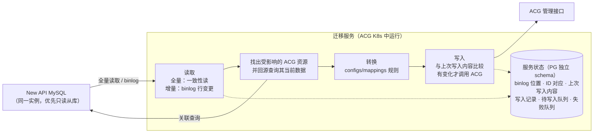
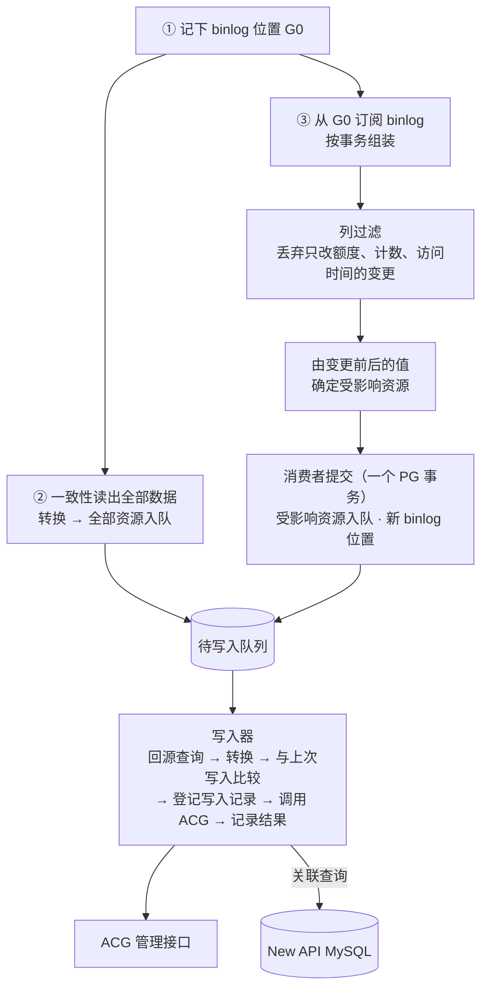

# AI 算力网关数据迁移工具——修订版架构设计（v3.3）

Oct 28, 2026 · @Liam（v3.2、v3.3 修订：Nov 4, 2026）

> 服务只做三件事：读取 New API 的 MySQL → 转换成 ACG 资源 → 调用 ACG 管理接口写入；同步方式为首次全量、之后 binlog 增量、外加定期核对。服务不保存 New API 数据的副本，需要关联数据时直接回源查询。用词：**待写入队列**是需要重新写入 ACG 的资源；**写入器**负责回源重算并写进 ACG；**字段清单**是要读取的表、列及类型；密钥只保存**加盐哈希**。

## 修订说明

v2 将首期范围收敛为 New API → 内部算力网关（下称 ACG），并补齐 v1 评审中发现的缺口。LiteLLM、Higress 保留扩展点，后续接入。用户账号迁移，密码统一重置；历史日志和用量数据不迁移。

| 主题 | v1 | v2 |
| --- | --- | --- |
| 首期源项目 | New API、LiteLLM、Higress 分阶段 | 仅 New API，其余后续 |
| 数据范围 | 以上游渠道为主 | 增加分组、用户、令牌、额度；日志与用量不迁移 |
| 用户密码 | 未涉及 | 统一重置为初始密码 User@123，强制首次登录修改 |
| 读取层 | 手写 SQL | 字段清单，按方言生成 SQL，源版本探测，一致性快照 |
| 映射 DSL | 字段、拆分、引用 | 增加 join、when、group\_by、保真度声明、漏映射告警 |
| 模型映射 | 每个渠道每个模型一个部署 | 逻辑模型与部署分离，保留 model\_mapping、group、优先级与权重 |
| 密钥 | 脱敏与恢复并存，未定方案 | 密钥不落盘，断点重读源端；以 加盐哈希比对 |
| 执行引擎 | 预览、幂等、断点续跑 | 增加延迟绑定、失败传播、计划哈希、三方对比、prune、回滚 |
| 目标网关 | 未列要求 | 列出前置能力清单，阶段一逐项确认 |

### v3 变更

v3 在 v2 基础上确定了 ACG 侧的路由映射方式，并增加 binlog 增量同步。迁移范围收敛为分组、用户、apikey、渠道。

| 主题 | v2 | v3 |
| --- | --- | --- |
| 迁移范围 | 渠道、分组、用户、令牌、额度 | 分组、用户、apikey、渠道；额度暂不纳入 |
| ACG 资源 | 9 类，含逻辑模型、部署、路由策略 | 5 类：分组、提供商、聚合路由、用户、apikey |
| 分组语义 | 部署与分组关联 | 聚合路由按裸模型名建立，成员为提供该模型的全部渠道；apikey 只被授权其有效分组内的提供商 |
| 客户端调用 | 模型名不变 | 模型名不变，切换时只更换 base\_url |
| 直连路由 | 未涉及 | 每个提供商自动生成；默认不授权给迁移过来的 apikey |
| 运行形态 | 命令驱动：plan、apply、resume、verify 逐步执行 | ACG K8s 中的无状态长期运行服务，预检、全量、增量、对账自动衔接 |
| 增量同步 | 多轮全量加三方对比 | 首次全量，之后订阅 MySQL binlog 持续同步，周期性对账兜底 |
| 增量计算 | 回源查询关联数据 | PG 中的源数据副本加依赖索引，只重算受影响资源 |
| 目标端 | 统一导入器，直接对接 ACG | 目标适配器：内存模拟、文件输出先行，ACG 实现待其数据结构定稿 |
| 失败处理 | 失败即停，人工续跑 | 临时故障自动重试；数据问题进入失败队列，不阻塞同步 |
| 状态库 | 本地 SQLite | ACG 所用 PostgreSQL 的独立 schema，工具无状态 |

### v3.2 变更

v3.2 不改变迁移范围和 ACG 资源模型，修正 v3.1 在一致性、提交协议、授权语义上的缺陷。

| 主题 | v3.1 | v3.2 |
| --- | --- | --- |
| 快照续读 | 按表游标断点续读 | 每次全量读取生成一份新副本；读取中断则丢弃这份副本重新读取，见 3.3 |
| 全量与增量衔接 | 先记 G0 再快照，从 G0 订阅，“结果会收敛” | G0 → 快照 → G1 → 回放到覆盖 G1 后才发布，见 9.4 |
| 提交协议 | 目标写入期间保持 PG 事务打开 | 更新副本与写入 ACG 解耦：每个源事务只更新副本和待写入队列；写入器按资源短事务写入，写前登记操作意图，见 9.5、11.3 |
| 全量写入 | 未定义中断恢复 | 全量与增量共用写入器：全量即“全部资源待写入”，天然可续跑 |
| 对账 | 重新快照后直接刷新当前副本 | 在后台构建新副本，在屏障处原子切换，不与 CDC 互相覆盖，见 8.3 |
| 纯函数边界 | 期望状态是副本的纯函数 | 逻辑期望 = Map(副本, 配置版本)；可写计划另依赖命名登记、上次写入与目标观测，见 9.6 |
| 源端删除 | prune=report 时目标资源保持可用 | 删除拆为“停用/撤权”（默认执行）与“物理删除”（prune 策略），见 8.6 |
| 授权变更 | 授权失败时 key 保持禁用 | 先撤权、后授权；仅撤权失败时禁用 key，见 8.4 |
| 令牌状态与模型限制 | `status != 2` 即启用；限制列表为空视为不限制 | 状态走查找表；开启限制且列表为空表示不可访问任何模型（表结构与能力核对阶段实测确认），见 5.6 |
| 多源 | 未定义同名路由归属 | 首期多实例时预检报告跨实例冲突并阻止；共享路由聚合列为后续扩展，见 5.8 |
| 密钥回源 | 回源后校验哈希 | 哈希不一致说明源端领先于副本，延后重试，不写入“未来”的值，见 6.2 |
| 密码初始化 | 未限定时机 | 仅新建用户时执行一次并持久化标记，对账与重放不再覆盖，见 6.1 |
| 切换判定 | 同步延迟为 0 | 已处理 GTID 集合覆盖切换屏障，且待写入、在途、失败均为空，见 8.9 |
| 源端版本 | 官方 New API | 实际部署可能为定制版（2026-10-29 会议），表结构与能力核对阶段需确认分支并以其为字段清单基准 |

### v3.3 变更

v3.3 去掉了 v3.2 中“在服务自己的 PG 里保存一份 New API 数据副本”的做法。服务以 MySQL 从库身份订阅 binlog，需要关联数据时直接回源 MySQL 查询，写入通过 ACG 管理接口完成。v3.2 表中与副本有关的条目（快照续读、全量与增量衔接、提交协议中的“更新副本”、对账、纯函数边界、密钥回源）以本表为准。

| 主题 | v3.2 | v3.3 |
| --- | --- | --- |
| 源数据存放 | PG 中保存源数据副本及依赖索引 | 不保存副本；关联数据回源 MySQL 查询，见二、9.6 |
| 源库连接 | 未规定 binlog 订阅与查询连哪台 MySQL | binlog 订阅、全量读取、回源查询必须连接同一个 MySQL 实例，优先使用 New API 的只读从库，见 9.2 |
| 全量 | 写入新副本，追平 binlog 到 G1 后启用 | 记下 G0 → 一致性读 → 全部资源入队写入；读取中断则重读，见 3.3、9.4 |
| 全量与增量衔接 | G0 → 快照 → G1 → 回放追平 | 从 G0 订阅 binlog；重复处理的事务按源库当前数据重算，无副作用，见 9.4 |
| 增量 | 更新副本 → 依赖索引 → 重算 | 由 binlog 变更前后的值确定受影响资源 → 入队 → 写入器回源重算，见 9.6 |
| 定期核对 | 后台新副本，屏障处切换 | 全量读取 → 与上次写入、ACG 现状比较 → 差异资源入队；无需暂停增量，见 8.3 |
| 服务状态机 | SNAPSHOTTING、CATCHING\_UP | 合并为 FULL\_SYNC，见 8.1 |
| 状态库 | 含 mirror\_rows、deps、generations | 删除这三张表，只保留同步所需状态，见 8.7 |
| 写入方式 | 目标适配器（ACG 待定） | 明确通过 ACG 管理接口写入，不直写 ACG 业务表 |

## 一、设计目标与范围

本期目标：由一个运行在 ACG K8s 环境中的无状态服务，把一个或多个 New API 实例的分组、用户、apikey、渠道迁移到 ACG。服务完成首次全量后持续同步增量，直到业务切换完成。

### 1.1 设计目标

- 框架化：读取、映射、导入、执行四层保持通用，New API 的差异只体现在配置（sources、mappings、lookups）和少量扩展函数中。
- 多数据源：New API 支持 MySQL、PostgreSQL、SQLite 直连读取，以及管理 API 读取；MySQL 支持 binlog 增量订阅。
- 服务化：作为无状态服务长期运行，预检、全量、增量、对账自动衔接，Pod 重启后自动续跑，不需要人工驱动流程。
- 可靠：资源级幂等；临时故障自动重试，数据问题进入失败队列而不阻塞同步；周期性对账保证最终一致。
- 可扩展：后续接入 LiteLLM、Higress 时优先只新增配置；缺少能力时补充通用能力，不在引擎中加项目分支。

非目标：历史日志、用量统计、充值与兑换码记录；双向迁移；复刻源网关的运行逻辑（例如渠道健康检查）。

### 1.2 范围矩阵

处理方式分为：原值迁移、转换迁移、近似迁移（语义有损，需在报告中标出）、重置、不迁移。字段名以实际部署的 New API 版本为准，阶段一核对。

| 数据 | New API 来源 | 处理方式 | ACG 资源 | 说明 |
| --- | --- | --- | --- | --- |
| 渠道基本信息 | channels：name、type、base\_url、status | 转换迁移 | 提供商（自动生成直连路由） | base\_url 为空时按渠道类型取默认地址 |
| 上游密钥 | channels.key | 原值迁移 | 提供商的密钥列表 | 支持多密钥拆分；部分类型的 key 是 JSON 或组合格式 |
| 模型重定向 | channels.model\_mapping | 转换迁移 | 提供商的模型映射 | 请求模型名到上游模型名 |
| 模型 | channels.models | 转换迁移 | 聚合路由（以裸模型名命名） | 成员为提供该模型的全部渠道 |
| 优先级与权重 | channels.priority、weight | 近似迁移 | 聚合路由成员的优先级与权重 | 保真度取决于 ACG 的选路方式，见 5.4 |
| 分组 | channels.group、users.group、tokens.group | 转换迁移 | 分组 | 用于计算 apikey 可访问的提供商与路由 |
| 渠道高级设置 | param\_override、header\_override、status\_code\_mapping、setting 等 | 逐项评估 | 待定 | ACG 不支持的字段显式声明 dropped |
| 用户账号 | users：username、display\_name、email、role、status | 转换迁移 | 用户 | 软删除用户不迁移 |
| 用户密码 | users.password | 重置 | 用户 | 统一重置为 User@123，强制首次登录修改，见第六节 |
| 令牌 | tokens：key、名称、状态、过期时间、IP 限制、模型限制、分组 | 原值迁移 | apikey 及其授权 | 可访问的提供商与路由由有效分组决定，见 5.6 |
| 用户余额、令牌额度 | users.quota、tokens.remain\_quota 等 | 暂不纳入 | — | 待单独确认 |
| 第三方登录绑定 | users：github\_id、oidc\_id 等 | 待确认 | — | 见第十二节待确认事项 |
| 用户系统访问令牌 | users.access\_token | 不迁移 | — | 管理用途，迁移后由用户重新生成 |
| 分组倍率、模型倍率与价格 | options 表 | 不迁移 | — | 本期范围外 |
| 历史日志、用量统计 | logs 等 | 不迁移 | — | 本期范围外 |
| 兑换码、充值记录 | redemptions、top\_ups 等 | 不迁移 | — | 本期范围外 |
| 其余系统设置 | options 表 | 不迁移 | — | 在 ACG 中单独配置 |

## 二、总体架构

服务只做三件事：**读取** New API 的 MySQL → 按规则**转换**成 ACG 资源 → 调用 ACG 管理接口**写入**。同步方式有三种：首次**全量**读取；之后以 MySQL 从库身份订阅 binlog 做**增量**；每隔一段时间再全量读取一次做**定期核对**。

服务不在自己的库里保存 New API 数据的副本。增量时需要的关联数据（例如某分组下的全部令牌）直接回源 MySQL 查询。

binlog 订阅、全量读取、回源查询三者必须连接**同一个 MySQL 实例**，优先使用 New API 的只读从库；没有从库时三者都连主库。原因见 9.2。



| 部分 | 职责 | 扩展方式 |
| --- | --- | --- |
| 读取 | 全量：按字段清单在一个一致性读事务里读出全部数据；增量：订阅 binlog，按事务输出行变更（含变更前后的值）；按需按条件查询源库 | 新数据库类型写代码；新项目只加字段清单配置 |
| 受影响资源计算 | 根据变更前后的值确定要重算的 ACG 资源，例如渠道换组 → 新旧两个分组下的全部令牌 | 框架通用，规则由映射配置推导 |
| 转换 | 执行 YAML 规则，生成 ACG 资源（逻辑表示） | YAML；特殊转换用 Transformer 扩展 |
| ACG 资源定义 | 5 类资源与 JSON Schema；授权只表达“能访问什么” | 随 ACG 接口升级版本 |
| 写入 | 与上次写入内容比较，按依赖顺序调用目标；写前登记、写后记录结果，崩溃后可恢复 | 每种目标一个实现：模拟 ACG、预览输出、真实 ACG |
| 服务状态 | 只保存同步所需的少量状态，见 8.7；不保存 New API 数据副本 | 框架通用 |

配置作用点：`sources`、`instances` 作用于读取；`mappings`、`lookups` 作用于转换；`jobs` 作用于整个任务；`targets` 作用于写入。新增源项目时，优先只新增配置。

## 三、数据读取层

映射规则只依赖字段清单，不依赖具体 SQL 或 API 字段。各读取方式负责把原始数据归一到字段清单，同一份映射因此可以复用于 MySQL、PostgreSQL、SQLite 和管理 API。

### 3.1 项目级字段清单与实例级连接分离

项目级配置描述 New API 有哪些数据集、每个数据集的逻辑字段，以及各读取方式如何绑定到这些字段。实例级配置只描述连接哪个具体实例。多个 New API 实例共用一份项目级配置。

```yaml
# configs/sources/new-api.yaml —— 项目级：逻辑数据集契约（示例，字段以实际版本核定）
version: 2
project: new-api

compat:
  supported: ">=0.6.0"              # 示例值；首期以实际部署的（可能是定制版）New API 版本与表结构指纹为准，表结构与能力核对阶段核定
  probe:
    api: {path: /api/status, version_path: data.version}
    database:                        # 直连时以表结构指纹判定
      require_columns:
        channels: [id, type, key, base_url, models, group, model_mapping, priority, weight, status]
        users: [id, username, role, status, quota, used_quota, group]
        tokens: [id, user_id, key, status, expired_time, remain_quota, unlimited_quota]

datasets:
  channels:
    primary_key: id
    schema:
      id:            {type: int, required: true}
      type:          {type: int, required: true}
      name:          {type: string}
      key:           {type: secret}
      base_url:      {type: string}
      models:        {type: string}
      group:         {type: string, default: "default"}
      model_mapping: {type: json}
      priority:      {type: int, default: 0}
      weight:        {type: int, default: 0}
      status:        {type: int, required: true}
    dropped: [balance, used_quota, response_time, test_time]   # 显式声明不迁移的列
    bindings:
      database: {table: channels}    # 框架按方言生成显式列名 SQL，自动处理 group、key 等保留字
      api:
        path: /api/channel/
        records_path: data.items     # 以实际接口为准
        pagination: {type: page, page_param: p, size_param: page_size, size: 100}
        unavailable: [key]           # 管理 API 通常不返回完整密钥
```

```yaml
# configs/instances/newapi-prod.yaml —— 实例级：连接方式
instance: newapi-prod
project: new-api
access:
  type: database
  driver: mysql                      # mysql | postgres | sqlite
  dsn_env: NEWAPI_PROD_DSN           # 同一个 DSN 用于 binlog 订阅、全量读取和回源查询，必须指向一个固定实例
  binlog:
    server_id: 4201                  # 向 DBA 申请，不能与现有从库冲突
```

MySQL 源只有一个连接地址：binlog 订阅、全量读取、回源查询都用它，保证三者连的是同一个实例（见 9.2）。地址必须指向一台固定的 MySQL，不能是会把连接分发到多台从库的负载均衡地址。

通过管理 API 读取时，渠道密钥通常拿不到。框架把 unavailable 字段标记为缺失，由 missing\_secret 策略决定阻止或跳过。因此渠道密钥迁移以数据库直连为准，API 模式适用于无数据库权限、只迁移非密钥数据的场景。

### 3.2 方言与类型归一

- 生成 SQL：按字段清单生成显式列名查询，不使用 SELECT \*；按方言引用保留字（MySQL 用反引号，PostgreSQL、SQLite 用双引号）。
- 类型归一：tinyint 与 boolean、以文本存储的 JSON、Unix 秒级时间戳统一转换为字段清单类型；转换失败即报错。
- 分批读取：按主键游标分页（WHERE id > ? ORDER BY id LIMIT ?），不使用 OFFSET。
- 只读保护：连接层开启只读事务，并建议使用只读账号；read\_only 不再是一个可关闭的配置项。

### 3.3 一致性读

所有数据集在同一个只读事务中读取，避免渠道、用户、令牌之间出现时间差。MySQL 使用 `START TRANSACTION WITH CONSISTENT SNAPSHOT, READ ONLY`，PostgreSQL 使用 REPEATABLE READ，SQLite 使用单个读事务。API 模式无法保证一致性，报告中会标注。

全量读取的记录直接交给转换和写入，不落盘保存。读取中途连接断开，本次全量作废，从头重新读取；已经写入 ACG 的部分不受影响，重读时内容相同的资源不会重复写入。

### 3.4 版本与漂移检测

采集前先执行探测。版本不在 supported 区间内，或字段清单要求的列缺失，则阻止迁移。源表中出现字段清单未声明、也未列入 dropped 的列时给出告警，因为这往往意味着新版本增加了需要迁移的字段。

## 四、映射 DSL 规范

DSL 只做声明，所有表达式统一使用 CEL；首期能力以 New API 所需为准，不为 LiteLLM、Higress 预先增加语法。

### 4.1 规则结构

| 关键字 | 作用 | 是否必填 |
| --- | --- | --- |
| name | 规则名，用于报告和字段溯源 | 是 |
| dataset | 主数据集 | 是 |
| join | 关联其他数据集，左连接或内连接 | 否 |
| let | 规则内的局部变量，例如令牌的有效分组 | 否 |
| when | 条件为假时不生成资源 | 否 |
| for\_each | 将字段展开为多行；写成列表时逐层嵌套展开 | 否 |
| group\_by | 跨记录聚合，生成一个资源；组内记录通过 `rows` 访问 | 否 |
| emit.kind | 目标资源类型 | 是 |
| emit.identity | 资源局部标识 | 是 |
| emit.fields | 字段映射；`ref_select` 按条件引用一组已生成的资源；标记 `internal: true` 的字段只用于引用计算，不写入 ACG | 是 |
| fidelity | 规则或字段的语义保真度 | 否，默认 exact |

### 4.2 表达式、插值与空值

- 统一 CEL：`expr` 直接写 CEL；identity 和字符串中的 `${...}` 是 CEL 的语法糖，编译期转换为 CEL 字符串拼接，两者错误处理一致。
- 空值区分：字段缺失、值为 null、值为空字符串是三种情况，分别用 `has(row.x)`、`row.x == null`、`row.x == ""` 判断；内置 `blank(x)` 同时判断后两种。
- 类型严格：类型不匹配、枚举未定义、引用无法解析默认阻止迁移，不做隐式转换。
- 编译期检查：配置加载时编译全部表达式，引用了字段清单中不存在的字段直接报错，而不是运行时得到 null。为此 `row`、join 别名、`let` 变量、`rows`、`r` 都按字段清单声明为具名对象类型，不能声明成任意 map，否则 CEL 无法静态发现错字段。
- 求值限制：设置 CEL 成本上限和单资源输出大小上限，超限按数据问题处理。
- 规则依赖：`ref_select` 与 `ref` 形成规则间依赖，编译期构建 DAG，循环引用直接报错；`ref_select` 只能读取被引用资源的字段（含 internal 字段），不能读取目标 ID，目标 ID 由执行阶段解析。

### 4.3 资源标识

- 作者只写局部标识，例如 `channel:${row.id}`；框架自动加上 `<instance>/<kind>/` 前缀，作者无需也不能省略来源实例。
- 标识必须由稳定的源字段构成，不能使用数组下标、时间戳或随机值。
- 由多条源记录聚合出的资源用业务名称作标识：分组用 `group:${g}`，聚合路由用 `route:${m}`，多个渠道会自然收敛到同一个资源。
- 密钥用 `fingerprint(secret)` 做比对和去重，即带盐 HMAC-SHA256，密钥顺序变化不会被识别为变更。

### 4.4 join、when、group\_by 示例

```yaml
# for_each + group_by：同名模型聚合为一条路由，rows 为提供该模型的全部渠道
- name: model-to-route
  dataset: channels
  for_each: {from: models, transform: split_csv, as: m}
  group_by: "m"
  emit:
    kind: AggregateRoute
    identity: "route:${key}"
    fields:
      name: {expr: "route_name(key)"}
      members: {expr: "rows.map(r, {'provider_ref': 'Provider/channel:' + string(r.id)})"}
      groups:                      # 只用于计算授权，不写入 ACG
        expr: "rows.map(r, split_csv(r.group)).flatten().distinct()"
        internal: true

# join + let + ref_select：令牌按有效分组引用可访问的提供商
- name: token-to-apikey
  dataset: tokens
  join:
    users: {on: "tokens.user_id == users.id", type: inner}
  let:
    group: "blank(row.group) ? (blank(users.group) ? 'default' : users.group) : row.group"
  when: "users.deleted_at == null"
  emit:
    kind: ApiKey
    identity: "token:${row.id}"
    fields:
      provider_refs:
        ref_select: {kind: Provider, where: "group in r.groups"}
```

完整规则见 5.6。

### 4.5 语义保真度与漏映射告警

保真度分四级，预览报告按资源和字段汇总，让操作者看到哪些行为会改变：

| 级别 | 含义 | 报告处理 |
| --- | --- | --- |
| exact | 语义完全等价 | 只计数 |
| approximate | 主要行为一致，细节不同 | 列出并附 note |
| lossy | 部分行为丢失 | 列出，可配置为需人工确认 |
| dropped | 显式声明不迁移 | 列出字段及原因 |

字段清单中的每个字段必须被至少一条规则使用，或列入 dropped。两者都不满足时，validate 给出告警，严格模式下报错。这条规则用于防止 group 这类关键字段被静默遗漏。

### 4.6 内置函数与查找表

沿用 v1 的内置函数（类型转换、字符串、拆分合并、parse\_json、lookup、default、filter、map），新增 split\_lines、fingerprint、blank、map\_get（安全读取 JSON 对象的键）、slug（转为小写字母、数字、连字符、点号）、route\_name（按 5.4 的规则生成聚合路由名）。查找表支持 default 项与 `on_missing: fail`，例如渠道类型找不到对应供应商类型时直接报错，不猜测。字段可以声明 `unique` 约束：在指定范围内检查重名，冲突时按 `on_conflict` 表达式重命名，`freeze: true` 表示首次写入后不再改名，见 5.3。

### 4.7 扩展点

- Transformer：处理配置无法表达的字段转换，接口与 v1 相同，只做纯函数转换，不写入、不重试。
- Decryptor：独立于 Transformer 的解密扩展，用于源端加密存储的密钥（LiteLLM 接入时需要）。单独注册、单独授权，调用全部记入审计日志。首期 New API 不需要。

## 五、New API → ACG 映射设计

渠道映射为提供商；同名模型聚合为一条以裸模型名命名的聚合路由，成员是提供该模型的全部渠道；apikey 的授权决定它能访问哪些路由，以及在路由内能使用哪些提供商。New API“由 key 的分组决定可用渠道”的语义，由“apikey 只被授权其有效分组内的提供商”表达，客户端调用的模型名保持不变。

### 5.1 ACG 的路由与授权能力

- 请求的 model 字段填写裸模型名（如 `opus-5.5`）时命中同名聚合路由；填写“提供商名/模型名”（如 `provider1/opus-5.5`）时命中直连路由。
- 每个提供商创建后自动生成一条直连路由；聚合路由的成员是提供商，允许只有一个成员。
- apikey 可以被授权访问指定的聚合路由和直连路由，也可以限定可访问的提供商：命中聚合路由后，只在该 apikey 有权访问的成员中选择。
- 路由数量暂无上限。

### 5.2 映射关系

| New API | ACG | 数量关系 | 规则 |
| --- | --- | --- | --- |
| 渠道 | 提供商（自动生成直连路由） | 1 : 1 | 渠道状态对应提供商启用状态 |
| 渠道 key | 提供商的密钥列表 | 1 : N | 多密钥按行拆分；JSON 或组合格式整体作为一个密钥 |
| 渠道 model\_mapping | 提供商的模型映射 | 1 : 1 | 请求模型名到上游模型名 |
| 模型（渠道的 models 字段） | 聚合路由，以裸模型名命名 | 每个模型一条 | 成员为 models 包含该模型的全部渠道，不分分组 |
| 渠道 priority、weight | 聚合路由成员的优先级与权重 | — | 见 5.4 |
| 分组 | 分组 | 1 : 1 | 不出现在路由名中，用于计算 apikey 的授权 |
| 用户 | 用户 | 1 : 1 | 统一初始密码，见第六节 |
| 令牌 | apikey 及其授权 | 1 : 1 | 原值迁移；授权由有效分组决定，见 5.6 |

用户余额、令牌额度暂不纳入映射，待单独确认。

### 5.3 提供商

```yaml
# configs/mappings/newapi-to-acg/providers.yaml
- name: channel-to-provider
  dataset: channels
  emit:
    kind: Provider
    identity: "channel:${row.id}"
    fields:
      name:
        expr: "slug(row.name)"
        unique:
          scope: Provider              # 在全部提供商中唯一，包括 ACG 中已有的非迁移提供商
          on_conflict: "slug(row.name) + '-' + string(row.id)"   # 重名时追加渠道 ID
          freeze: true                 # 首次写入后不再改名
      display_name: {from: name}        # 保留原渠道名，ACG 支持时写入
      type: {from: type, lookup: newapi_channel_types, on_missing: fail}
      endpoint:
        expr: "blank(row.base_url) ? lookup('newapi_default_base_url', row.type) : row.base_url"
      enabled:
        expr: "row.status == 1 || (row.status == 3 && policy.auto_disabled_channel == 'enabled')"
      api_keys:
        expr: "lookup('newapi_key_format', row.type) == 'multi_line' ? split_lines(row.key) : [row.key]"
        secret: true
      model_mapping: {expr: "blank(row.model_mapping) ? {} : row.model_mapping"}
      groups: {expr: "split_csv(row.group)", internal: true}   # 只用于计算授权，不写入 ACG
```

- 命名与重名处理：New API 允许多个渠道同名，靠渠道 ID 区分；ACG 要求提供商名唯一，且提供商名同时是直连路由名的前缀。规则如下：
  - 全量时先把全部渠道名转换为符合 K8s 命名规则的形式，再统计重名；转换后相同也算重名，例如 `OpenAI` 与 `openai`。
  - 名字唯一的渠道直接使用转换后的名字。重名的渠道全部追加渠道 ID，例如三个名为 OpenAI 的渠道分别命名为 `openai-12`、`openai-15`、`openai-27`。不保留其中某一个的原名，避免“谁保留原名”取决于读取顺序。
  - 追加 ID 后仍然冲突（例如恰好另有渠道名为 openai-12，或与 ACG 中已有的非迁移提供商重名）时，该渠道进入失败队列，由人工在别名表中指定名字。
  - 多源迁移时不同实例的渠道 ID 可能相同，追加 ID 后仍冲突的，再加实例简称前缀，例如 `a-openai-12`。
- 命名登记：映射只产出“候选名”和重名改写规则；实际名称由执行阶段的命名登记（`naming_registry`，PG 中按 target + kind + name 唯一约束）分配。首次全量对全部资源一次性分配，保证结果与读取顺序无关；增量新增资源时按登记中已占用的名称和目标观测到的非迁移资源判断冲突。
- 名字冻结：提供商名首次写入后记入命名登记，之后不再改变。增量期间新增一个与已有提供商同名的渠道时，只给新渠道追加 ID，已有提供商保持原名；源端修改渠道名时，提供商名保持不变，只更新显示名。这样直连路由名不会因源端改名而变化。
- 引用不受改名影响：聚合路由的成员、apikey 的提供商授权都通过来源标识 `Provider/channel:<id>` 引用，执行时经 id\_map 解析为 ACG 中的提供商 ID（ACG 授权接口按名称引用时解析为当前名称）。分组归属由渠道的 group 字段计算，与名称无关。因此重命名不需要额外处理分组和 apikey 的映射。
- 改名清单：dry\_run 报告和对账报告列出所有被重命名的渠道（原渠道名、渠道 ID → 提供商名），便于运维对照识别。
- 渠道状态：手动禁用（2）对应提供商禁用；自动禁用（3）由策略 `auto_disabled_channel` 决定，默认禁用并在报告中列出。状态值以表结构与能力核对阶段核定的枚举为准，未定义的值阻止迁移该渠道。
- 直连路由：默认不授权给迁移过来的 apikey。New API 的普通用户不能指定渠道，直连路由还会绕过令牌的模型限制；需要开放时，通过策略 `direct_routes: group_channels`，只授权有效分组内的渠道，且只授权给未开启模型限制的令牌。
- 渠道高级设置（参数覆盖、请求头覆盖、状态码映射、代理）在 ACG 支持前一律列入 dropped，报告逐渠道列出被丢弃的非空值。

### 5.4 聚合路由

```yaml
# configs/mappings/newapi-to-acg/routes.yaml
- name: model-to-route
  dataset: channels
  for_each: {from: models, transform: split_csv, as: m}
  group_by: "m"
  emit:
    kind: AggregateRoute
    identity: "route:${key}"
    fields:
      name: {expr: "route_name(key)"}
      members:
        expr: >
          rows.map(r, {
            "provider_ref": "Provider/channel:" + string(r.id),
            "priority": r.priority,
            "weight": r.weight
          })
        fidelity: approximate
      model:  {expr: "key", internal: true}
      groups: {expr: "rows.map(r, split_csv(r.group)).flatten().distinct()", internal: true}
```

- 命名：路由名就是客户端调用的模型名，取渠道 models 字段中的原始请求模型名，不是 model\_mapping 之后的上游模型名。ACG 能否接受大写字母、斜杠等字符需要确认；必须转换的模型会改变客户端调用方式，这类模型在报告中单独列出，由人工在别名表中指定新名字。
- 成员：models 包含该模型的全部渠道，不分分组，也不论启用状态。路由是否存在只由渠道的 models 决定，渠道启用或禁用只改变提供商状态，避免 New API 自动禁用频繁切换时路由反复增删。
- 选路语义：New API 先按分组筛出候选渠道，再取最高优先级、按权重随机。对应到 ACG，要求先按 apikey 的提供商授权过滤成员，再在剩余成员中按优先级和权重选择，并跳过禁用成员。这一点需要 ACG 确认；如果 ACG 先选成员再校验授权，请求会被错误拒绝。
- 优先级与权重：直接取渠道的 priority 和 weight（全为 0 时等权）。在上述选路语义成立的前提下，与 New API 行为基本一致；重试次数等细节不同，保真度为 approximate。
- 只有一个成员的模型照常建聚合路由。

### 5.5 用户

```yaml
# configs/mappings/newapi-to-acg/users.yaml
- name: user-to-user
  dataset: users
  when: "row.deleted_at == null"
  emit:
    kind: User
    identity: "user:${row.id}"
    fields:
      username: {from: username}
      display_name: {from: display_name}
      email: {from: email}
      role: {from: role, lookup: newapi_roles, on_missing: fail}
      enabled: {expr: "lookup('newapi_user_status', row.status) == 'enabled'"}
      group_ref:
        expr: "'Group/group:' + (blank(row.group) ? 'default' : row.group)"
        as_ref: true
      password: {initial_password: true}      # 不读取源端密码哈希，按第六节处理
```

- 角色映射：普通用户（1）、管理员（10）、超级管理员（100）通过 `newapi_roles` 查找表映射；未定义的角色值阻止迁移。
- 不迁移：软删除用户、系统访问令牌（access\_token）、密码哈希。
- 密码字段不参与内容哈希和三方对比：它只在创建用户时生效一次，见 6.1。
- 用户状态值通过查找表映射，未定义值阻止迁移该用户。

### 5.6 apikey 及其授权

```yaml
# configs/mappings/newapi-to-acg/apikeys.yaml
- name: token-to-apikey
  dataset: tokens
  join:
    users: {on: "tokens.user_id == users.id", type: inner}
  let:
    group: "blank(row.group) ? (blank(users.group) ? 'default' : users.group) : row.group"
    limits_on: "row.model_limits_enabled"
    limits: "split_csv(row.model_limits)"
    token_state: "lookup('newapi_token_status', row.status)"   # on_missing: fail
  when: "users.deleted_at == null"
  emit:
    kind: ApiKey
    identity: "token:${row.id}"
    fields:
      user_ref: {ref: "User/user:${users.id}"}
      name: {from: name}
      key: {secret_from: key, prefix: "${target.key_prefix}"}
      enabled:
        expr: >
          (token_state == 'enabled'
           || (token_state == 'exhausted' && policy.exhausted_token == 'enabled'))
          && lookup('newapi_user_status', users.status) == 'enabled'
      expires_at: {expr: "row.expired_time == -1 ? null : timestamp(row.expired_time)"}
      ip_allowlist: {expr: "split_lines(row.allow_ips)"}
      provider_refs:
        ref_select: {kind: Provider, where: "group in r.groups"}
      route_refs:
        ref_select:
          kind: AggregateRoute
          where: "group in r.groups && (!limits_on || r.model in limits)"
```

- 令牌状态：通过查找表 `newapi_token_status` 映射，不用 `status != 2` 这类排除式判断。New API 常见取值为启用、禁用、已过期、额度耗尽，以表结构与能力核对阶段核定的枚举为准；未定义值阻止迁移该令牌。由于额度不迁移，“额度耗尽”的令牌迁移后是否启用由策略 `exhausted_token` 决定，默认禁用并在报告中列出。
- 用户状态：New API 在鉴权时校验令牌所属用户的状态，用户禁用后其令牌不可用（表结构与能力核对阶段以实际版本验证）。因此 apikey 的启用状态同时取决于令牌与用户状态，用户启用或禁用会扇出到其全部令牌。
- 模型限制：开启限制时，只授权列表内的模型；开启限制但列表为空，表示不能访问任何模型，而不是不限制（表结构与能力核对阶段以实际版本验证，若行为不同则修改 `where` 表达式）。

- 有效分组：令牌分组非空时取令牌分组，否则取用户分组，都为空时取 default。
- 可访问的提供商：有效分组内全部渠道对应的提供商。
- 可访问的路由：有效分组内至少有一个渠道提供该模型的聚合路由；令牌开启了模型限制时，只授权限制范围内的模型。令牌模型限制由此表达，ACG 不必另设模型白名单。
- 直连路由：默认不授权，见 5.3。
- key 原值：New API 库中令牌一般不含 sk- 前缀，导入时按目标配置拼接，保证用户手中的 key 原样可用。
- 写入方式：每个 apikey 应有的授权集合（路由与提供商）与 PG 中上次写入的集合做差集，只批量写入新增和撤销部分。新建时先建提供商和路由再写授权，删除时先撤销授权再删资源。同一次变更中先撤权、后授权，见 8.4。

### 5.7 等价校验与客户端影响

- 等价校验：每轮对账时，对每个“分组 × 模型”，比较 New API 计算出的候选渠道集合，与“该模型聚合路由的成员 ∩ 该分组 apikey 可访问的提供商”；对每个 apikey，比较应有授权与 ACG 实际授权。两者都必须完全一致。
- 客户端影响：模型名和 key 都不变，切换时只更换 base\_url。只有路由名因字符限制被转换的模型，需要通知对应客户端，见 5.4。
- 校验分两层：先比较启用且被授权的候选成员集合，再比较最高优先级集合与权重；每个 apikey 单独校验，不能只比较“分组 × 模型”而忽略令牌模型限制。期望值由独立于映射引擎的算法计算，避免测试与实现共用同一段错误逻辑。

### 5.8 多实例迁入同一 ACG

来源标识带实例前缀，但聚合路由按裸模型名全局唯一。两个实例都提供 `gpt-4o` 时，各自生成 `route:gpt-4o`，若各任务独立写入会互相覆盖成员。

首期规则：

- 单实例为首期主路径。
- 多实例时，提供商名按 5.3 追加实例前缀解决冲突；用户名、聚合路由名、分组名在 target 范围内做预检，跨实例冲突时阻止相关资源迁移并在报告中列出，不自动合并，也不允许两个任务写同一资源。
- 分组在 ACG 中只用于组织与展示，授权由各任务按自身实例计算写入 apikey，分组名冲突不影响授权正确性，可按策略加实例前缀。

若业务要求多个实例共享同一裸模型名，需要引入 target 级聚合所有者：路由成员为各实例贡献的并集，删除按贡献者引用计数，由统一的写入器写入。这超出“各任务独立执行”的模型，列为后续扩展，见 12.2。

## 六、账号与密钥安全

用户密码统一重置为 User@123，令牌和上游密钥原值迁移。统一初始密码意味着知道这个值的人可以登录任何未改密的账号，因此必须配套下列措施，缺一项即不允许正式执行用户迁移。

### 6.1 用户密码统一重置

- 不读取源端密码：源端 bcrypt 哈希不参与迁移，User 资源的 password 字段只声明 `initial_password: true`。
- 初始密码参数化：初始密码从环境变量 `MIGRATOR_INITIAL_PASSWORD` 读取，本项目约定取值 User@123，不写入代码、映射配置、日志、预览报告和状态库。
- 写入方式：优先调用 ACG 的“设置密码”接口传入；若 ACG 支持导入哈希，则由迁移工具按 ACG 的哈希算法计算后写入。
- 强制首次登录修改：每个迁移用户写入 `must_change_password = true`。修改前只允许访问改密页面，不能进入控制台其他功能。
- 初始密码有效期：默认 7 天，可配置。到期仍未修改的账号自动锁定，需管理员重置。
- 只初始化一次：初始密码、强制改密标记和有效期只在创建用户时写入，成功后在 `id_map` 记录 `password_initialized_at`。更新、对账、热加载、重放、resync 都不再写这三项，避免覆盖用户已修改的密码或重启有效期。创建结果未知时，先按来源标识确认用户是否已存在，再决定是否重新创建。
- 管理员账号单独处理：角色为管理员或超级管理员的账号不使用统一初始密码，改为生成一次性随机密码，加密导出后线下交付；或迁移后保持禁用，待人工启用。二选一，见待确认事项。
- 登录保护：ACG 对登录失败做限流和锁定，所有初始密码登录写入审计日志。
- 跟踪与通知：迁移完成后导出用户清单（用户名、邮箱、角色），供业务方通知；report 命令可随时列出仍未改密的账号。

密码重置只影响控制台登录。令牌原值迁移，下游程序调用 API 不受影响。

### 6.2 上游密钥

- 受控容器：被 `secret_from` 标记的值装入 SecretValue 类型。该类型的字符串化、JSON 序列化、日志输出都只得到 `***`，只有导入器在写入时能取出原值。
- 哈希比对：每个密钥计算带盐 HMAC-SHA256 哈希，盐从环境变量读取。哈希用于资源标识、变更检测、多源去重；ACG 的密钥通常只写不读，比对只能依赖哈希。
- 不落盘，断点重读：状态库只存哈希，不存密钥原值。续跑时按资源标识回到源端重新读取密钥，并校验哈希一致；源端不可用时，涉及密钥的操作无法续跑，其余操作可以继续。
- 写入时取值：写入器在同一次回源查询中同时取得资源的其他字段和密钥原文，两者来自源库同一时刻，不存在“密钥比其他字段新”的问题。源端行已删除时，资源按源端删除处理。
- 内存缓存：快照与 binlog 事件中出现的明文密钥可按哈希缓存在进程内存中，供写入器直接使用，避免逐条回源；缓存不落盘，进程重启后按需回源。
- 写入确认：ACG 的密钥通常只写不读，读回可读字段无法证明密钥已更新。仅改密钥的操作结果未知时，依赖 ACG 的幂等键或写入回执确认；ACG 不提供时，按“结果未知”重新写入同一密钥（写同值是幂等的）。
- 回滚限制：源端已轮换或删除的历史密钥无法从任何地方恢复，rollback 只能完整恢复非密钥字段，无法恢复的部分在报告中列出。

### 6.3 令牌原值迁移

New API 的令牌在数据库中以原值存储，可以原值迁移，前提是 ACG 支持指定 key 值写入。目标已存在相同 key 时一律失败，不允许覆盖或跳过后静默共用。判断“已存在”时要区分两种情况：该 key 属于本任务同一来源标识此前写入的资源（重放，视为成功），还是属于其他资源（冲突，进入失败队列）。

ACG 不支持指定 key 时，降级为重签模式：生成新 key，导出加密的新旧对照文件，由业务方分发，新旧网关并行运行一段时间后再关闭旧 key。重签模式需要在任务配置中显式开启。

### 6.4 数据保护

- 日志、预览报告、状态库全部脱敏；报告中的密钥只显示哈希前 8 位。
- 源库 DSN、ACG 凭据、哈希盐、初始密码全部来自环境变量或密钥管理系统，配置文件中只出现变量名。
- 任务产物中含敏感内容的文件（管理员一次性密码、重签对照表）一律加密输出，并在报告中提示保管和销毁。

## 七、内部标准模型、目标适配器与前置要求

acg/v1 是 ACG 侧的逻辑模型，首期定义 5 类资源。授权只表达“能访问什么”，不规定 ACG 如何存储。所有与 ACG 数据结构相关的写入都收敛在目标适配器中，ACG 定稿前，框架可以先用模拟目标完整运行。

### 7.1 acg/v1 首期资源

| 资源 | 引用 | New API 来源 | 说明 |
| --- | --- | --- | --- |
| Group | — | 渠道、用户、令牌中的分组 | 组织与展示；授权由迁移工具按分组计算后写到 apikey 上 |
| Provider | — | 渠道 | 地址、类型、密钥列表（只写）、模型映射、启用状态；ACG 自动生成直连路由 |
| AggregateRoute | Provider | 模型 | 路由名即客户端调用的裸模型名；成员带优先级和权重 |
| User | Group | 用户 | 角色、状态、强制改密标记 |
| ApiKey | User、AggregateRoute、Provider | 令牌 | key 原值、过期时间、IP 白名单、可访问的路由与提供商 |

所有资源携带统一元数据：`source_identity`（带实例前缀的来源标识）、`migration_job`（任务 ID）、`content_hash`（期望内容哈希）。资源结构同时由 Go 类型和 JSON Schema 约束，schema 带版本号。

授权的逻辑表达：每个 ApiKey 只有两个集合，可访问的提供商与可访问的路由，元素都是来源标识引用。ACG 最终采用哪种实现（在 key 上直接存提供商列表、授权组或策略对象、路由成员级访问控制等），都由目标适配器转换；例如 ACG 采用授权组时，适配器可以把授权集合完全相同的 key 归为同一组。映射引擎、增量计算和状态库都不感知这些差异。

### 7.2 目标适配器接口

引擎负责计算变更：期望状态、last\_applied 与目标观测三方对比，按依赖排序、划分原子单元。适配器只负责把逻辑变更翻译成目标的接口调用，这是整个工具中唯一依赖 ACG 数据结构的部分。

```go
type Target interface {
    // 探测目标能力，用于预检和降级决策
    Capabilities(ctx context.Context) (Capabilities, error)

    // 读取目标中由本工具管理的资源的当前状态，用于对账与超时后确认
    Observe(ctx context.Context, kinds []model.Kind) (*model.Observed, error)

    // 按给定顺序应用一批变更；逻辑引用已由引擎解析为目标 ID 或名称
    // 每个 change 返回独立结果，按 OpID 关联，不依赖数组顺序；已成功的项不因后续失败回滚
    Apply(ctx context.Context, changes []model.Change) ([]model.Result, error)
}

type Change struct {
    OpID     string          // 操作意图 ID，写入前已在 PG 登记，见 11.3
    Op       Op              // Create | Update | Disable | Delete | Grant | Revoke
    Resource model.Resource  // 期望状态（逻辑资源）
    Prev     *model.Resource // 上次写入的内容，用于更新与回滚
    IdemKey  string          // 内容键：来源标识 + 期望内容哈希；请求去重还需 OpID 和 Op
}

type Result struct {
    OpID     string
    Outcome  Outcome         // Succeeded | Failed（数据问题）| Retryable（临时故障）| Unknown（结果未知）
    TargetID string
    Err      error
}
```

- 观测结果区分“字段不存在”和“字段不可读”（例如只写的密钥），不可读字段不参与 drift 判定。
- 结果为 Unknown 时，引擎先按来源标识 Observe 确认，再决定视为成功还是重试，不盲目重复。

| 实现 | 用途 | 状态 |
| --- | --- | --- |
| `target/memory` | 在内存中模拟 ACG 规则：提供商名唯一、按模型名匹配聚合路由、先按授权过滤成员再按优先级与权重选路。用于自动化测试和等价校验 | 首期实现 |
| `target/file` | 输出期望状态与变更日志（JSON 或 YAML），用于 dry\_run 检查，也作为与 ACG 团队对齐数据结构的样例 | 首期实现 |
| `target/acg` | 对接 ACG 管理 API | 待 ACG 授权方式与数据结构定稿 |

### 7.3 对 ACG 的前置要求

以下能力需在阶段一与 ACG 团队逐项确认，结论写入 targets 配置的 capabilities 部分。

| 能力 | 用途 | 状态 |
| --- | --- | --- |
| 聚合路由允许只有一个成员 | 所有模型统一建聚合路由 | 已确认 |
| apikey 授权可访问的聚合路由和直连路由 | 令牌模型限制、直连路由控制 | 已确认 |
| apikey 限定可访问的提供商 | 分组隔离 | 已确认 |
| 路由数量 | 每个模型一条聚合路由 | 已确认，暂无上限 |
| 提供商名唯一 | 重名渠道需重命名，见 5.3 | 已确认 |
| 先按 apikey 授权过滤成员，再按优先级与权重选择，并跳过禁用成员 | 还原 New API 按分组选渠道的语义 | 待确认；先选成员再校验授权会导致请求被错误拒绝 |
| 聚合路由名支持原始模型名字符（大写字母、点号、斜杠、冒号等） | 客户端模型名不变 | 待确认；不支持的模型需改名并通知客户端 |
| 提供商的显示名或备注字段 | 保留 New API 原渠道名，便于识别 | 待确认；缺失时只在报告中保留对应关系 |
| 资源可写入并按 source\_identity 查询 | 幂等、超时后确认、回滚、prune | 待确认；缺失时只能按名称匹配 |
| 按 migration\_job 列出资源 | 回滚、对账 | 待确认；缺失时回滚依赖 PG 状态库 |
| 指定 API Key 原值写入，支持前缀规则 | apikey 无感迁移 | 待确认；缺失时降级为重签 |
| apikey 授权的批量增删接口 | 首次迁移与增量扇出 | 待确认；缺失时逐条写入并限速 |
| 设置密码接口或哈希导入、强制改密标记、初始密码有效期 | 第六节安全措施 | 待确认 |
| 写入幂等键或业务唯一键 | 安全重试 | 待确认 |
| 配置下发限速或批量刷新 | 大批量写入路由与授权 | 待确认 |

ACG 只能直写数据库时，作为受控的离线写入模式单独评审，不作为默认方案。

## 八、同步服务与执行引擎

工具作为无状态服务长期运行在 ACG 的 K8s 环境中。每个同步任务由服务内部的状态机自动推进，人工只在首次接入、处理失败队列和业务切换时介入。

### 8.1 服务状态机

| 状态 | 做什么 | 何时进入下一状态 |
| --- | --- | --- |
| PRECHECK 预检 | 校验配置、编译规则，检查源库表结构、binlog 配置（见 9.2，含 binlog 连接与查询连接是同一实例）、ACG 能力和多实例冲突 | 全部通过后进入 FULL\_SYNC；失败则停在预检并告警，配置修复后自动重试 |
| FULL\_SYNC 全量 | 记下当前 binlog 位置 G0；一致性读出全部数据，转换后把全部资源放入待写入队列，由写入器写入 ACG | 全部资源写完（或进入失败队列）后进入 STREAMING |
| STREAMING 增量 | 从 G0 开始消费 binlog；每个源事务找出受影响资源并放入待写入队列；写入器持续回源重算并写入 | 持续运行，直到人工暂停或停止 |
| POLLING 周期全量 | 没有 binlog 的数据源（SQLite、管理 API、首期的 PostgreSQL）以周期全量代替增量 | 持续运行，直到人工暂停或停止 |
| PAUSED 暂停 | 源端不兼容、待写入积压超限或人工暂停；保留状态，不消费、不写入 | 原因消除或人工恢复后回到原状态 |
| STOPPED 停止 | 人工停止；切换与回滚前必须进入此状态 | 人工重新启动 |

定期核对不是独立状态，它在 STREAMING / POLLING 期间后台运行，见 8.3。

全量阶段中断（进程重启）后重新执行 FULL\_SYNC：重新记录 G0、重新读取。已写入 ACG 且内容未变的资源会被跳过，因此重跑的代价只是一次读取。

状态、binlog 位置、待写入队列、失败队列都存在 PG 中。Pod 重启后，新实例从 PG 读取当前状态接着运行。

首次接入时可设置 `dry_run: true`：状态机完整运行，写入器写入预览输出或模拟 ACG，只输出报告。关闭 dry\_run 时，服务重新读取真实 ACG 的现状并重新计算，预览阶段的结果不视为真实写入。

### 8.2 失败隔离

| 错误类型 | 例子 | 处理 | 位点 / 待写入 |
| --- | --- | --- | --- |
| 临时故障 | ACG 或 PG 不可用、网络超时、被限流 | 退避重试，恢复后自动继续 | 资源留在待写入队列 |
| 结果未知 | 请求已发出但响应丢失、进程在写入后崩溃 | 按来源标识 Observe 确认后再决定成功或重试 | 资源留在待写入队列 |
| 数据问题 | 路由名冲突、枚举值未定义、映射失败、目标存在非迁移的同名资源 | 出问题的资源进入失败队列并告警，依赖它的资源标记为阻塞，其余数据照常处理 | 移出待写入队列，进入失败队列 |
| 源端不兼容 | DDL 导致字段清单不匹配、位点对应的 binlog 已被清理 | 任务暂停并告警；字段清单修复后自动继续，binlog 丢失则需人工触发 resync | 消费者不推进位点 |

失败队列按“资源标识 + 配置版本”去重，记录期望内容哈希、错误、阻塞原因与下一次重试时间，不保存密钥原值。失败项重试时不使用当时的期望内容，而是重新把资源放回待写入队列，由写入器按源库当前数据和当前配置重新计算；资源在源端已被删除或配置已变化时，不会重建过时资源。配置或查找表修正后，相关失败项立即重新入队；周期性对账也会把它们补上。

### 8.3 定期核对

只靠 binlog 长期运行，偏差会逐渐累积，例如程序缺陷、有人在 ACG 上手工修改、失败队列积压。定期核对是兜底：

1. 一致性读出源库全部数据，转换得到全部资源的期望内容。
2. 读取 ACG 的实际状态，与 PG 中记录的上次写入内容做三方比较。
3. 需要更新的资源放入待写入队列，由写入器回源重新计算后写入；其余情况按下表处理。

核对只往待写入队列里放“资源标识”，不直接写入它算出的内容。写入器总是按源库当前数据重新计算，所以即使核对期间增量已经写入了更新的值，也不会被核对时读到的旧数据覆盖。核对与增量可以同时运行，不需要暂停 binlog 消费。

| 源端期望 vs 上次写入 | ACG 当前 vs 上次写入 | 判定 | 默认动作 |
| --- | --- | --- | --- |
| 相同 | 相同 | 无变化 | 跳过 |
| 不同 | 相同 | 增量漏同步 | 放入待写入队列，并记录漏同步计数 |
| 相同 | 不同 | 目标被人工修改（drift） | 按 drift 策略，默认保留目标并告警 |
| 不同 | 不同，且 ACG 当前 = 源端期望 | 双方改成了相同的新值 | 视为已同步，更新上次写入内容 |
| 不同 | 不同，且 ACG 当前 ≠ 源端期望 | 双方都变 | 冲突，进入失败队列 |
| 源端已删除 | 任意 | 源端删除 | 按 on\_source\_delete 停用 / 撤权，再按 prune 策略处理物理删除，见 8.6 |

正在待写入或有未完成写入的资源跳过比较，避免把写入器尚未完成的写入误判为 drift。比较只针对工具管理的字段，忽略目标端默认值、运行时字段和不可读字段（如只写密钥）。集合字段排序去重后比较。

核对周期可配置，按源库负载设定。映射规则、查找表或任务配置变更后，服务热加载新配置：编译成功才切换，生成新的配置版本 `config_hash`，随后执行一轮核对，按新规则写入差异。编译失败时保留旧配置并告警。

### 8.4 依赖与幂等

- 写入顺序：Group → Provider → AggregateRoute → User → ApiKey → apikey 的授权（路由与提供商）；删除按相反顺序。执行时由 RefResolver 把逻辑引用替换为目标 ID。
- 提供商单元：一个提供商及其密钥为一个单元，失败时引用它的聚合路由暂缓写入，引用它的 apikey 授权标记为阻塞。
- apikey 单元与授权顺序：
  - 新建：以禁用状态创建 key → 写入授权 → 按期望状态启用。任一步失败，key 保持禁用。
  - 更新：先撤销多余授权，再更新字段，最后补充新增授权，最后才把禁用改为启用。中间状态只会“权限比期望少”，不会“权限比期望多”。
  - 撤权失败（数据问题，或重试后仍为未知结果）时禁用该 key 并进入失败队列，不留下“key 可用但带有多余权限”的状态。新增授权失败时 key 保持当前启用状态，资源留在待写入队列重试，因为此时它只是少了权限。
- 幂等：内容键由来源标识与期望内容哈希组成；目标请求的有效幂等键还必须包含持久化的 OpID 和操作类型。同一意图重试复用 OpID，新意图使用新 OpID，即使内容回到历史值也必须执行（如 A→B→A、删除后重建）。同一 OpID 绑定不可变意图，禁止跨批次换资源或内容；旧操作重试返回历史回执，不覆盖较新的状态。写入前先在 PG 登记操作意图，结果未知时先按来源标识查询 ACG，已存在且内容一致则视为成功，否则再重试，见 11.3。
- 目标端 fencing：任务锁只能约束遵守协议的实例，旧实例发出的请求可能在接管后才到达 ACG。依赖幂等键和“按源库当前数据重新计算”保证最终一致；ACG 支持条件写入（版本号或 ETag）时优先使用。

### 8.5 部署

- 形态：K8s Deployment，单副本（`replicas: 1`），更新策略使用 `Recreate`，保证同一时刻只有一个实例运行。Pod 异常退出后由 K8s 重新拉起，从 PG 中的状态和位点继续。
- 防重入：仍保留 PG 的 `pg_try_advisory_lock` 作为保护。会话级锁绑定在一条专用连接上，该连接不归还连接池；连接一旦失效即视为失去锁，立即取消消费者、写入器和在途的目标请求。
- 中断影响：Pod 重建期间同步暂停，恢复后从上次位点追平。binlog 保留时间需覆盖最长可能的中断时间（见 9.2）；同步延迟的告警阈值应大于正常重建所需时间，避免误报。
- 短事务：状态库与 ACG 业务表位于同一 PG 实例，长事务会拖住 vacuum。所有 PG 事务都不跨越目标调用，并设置 `idle_in_transaction_session_timeout` 与 `statement_timeout`。
- 配置：映射、查找表、任务配置通过 ConfigMap 挂载；源库 DSN、ACG 凭据、哈希盐、初始密码通过 K8s Secret 注入。ConfigMap 变更后热加载，见 8.3。
- 网络：需要访问 New API 的一个 MySQL 实例（优先只读从库；binlog 订阅、全量读取、回源查询都连它）、ACG 管理 API、ACG 的 PostgreSQL。
- 探针：liveness 检查进程存活；readiness 检查 PG 与 ACG 连接正常。
- 资源：全量和定期核对阶段需要构建全部期望状态，内存占用最高，按数据量设置 limits。
- 监控：暴露 Prometheus 指标，包括已消费事务数与最近提交时间、源端与已处理 GTID 集合的差异事务数、待写入队列大小与最老等待时间、在途操作数、单事务扇出、目标写入速率、失败队列长度、漏同步计数、上次对账结果。GTID 集合差表示事务数，不直接换算成秒；对待写入积压、失败队列和对账差异配置告警。
- 后续扩展：如需缩短中断时间，可改为多副本加更新策略 `RollingUpdate`，由任务锁选出活跃实例、其余待命，代码无需改动。

### 8.6 任务配置

```yaml
# configs/jobs/newapi-prod-to-acg.yaml
job:
  source: newapi-prod
  mapping: newapi-to-acg
  target: acg-prod
  dry_run: false              # 首次接入设为 true，只出报告不写入真实目标

policies:
  conflict: fail              # fail（进入失败队列）| skip | update
  unsupported: fail
  missing_reference: fail
  missing_secret: fail
  drift: report               # report | overwrite
  on_source_delete: disable   # disable（停用并撤销授权）| report
  prune: report               # 物理删除：report | delete
  auto_disabled_channel: disabled
  exhausted_token: disabled   # 额度耗尽的令牌：disabled | enabled
  direct_routes: none         # none | group_channels
  cross_instance_conflict: fail   # 多实例同名用户、路由、分组，见 5.8

reconcile:
  interval: 6h

execution:
  batch_size: 100
  retry_backoff: [1s, 5s, 30s, 2m]
  write_rate_limit: 200/s     # 写入 ACG 的速率上限，含扇出；示例值，以压测结果设定
  request_timeout: 10s
  max_pending: 50000          # 待收敛集合上限，超过后消费者暂停并告警
  fanout_alert: 1000          # 单个源事务影响的资源数超过此值时告警
```

源端删除分两步：`on_source_delete` 决定资源是否立即停用并撤销授权（默认执行，避免源端已删除的令牌在 ACG 中仍可用）；`prune` 决定是否物理删除（默认只报告）。切换验收时，处于“已停用待删除”状态的资源单独列出并逐条确认，不能直接算作“无差异”。

### 8.7 状态库

状态存放在 ACG 所用 PostgreSQL 实例的独立 schema（`migrator`）中，使用独立账号，不和 ACG 业务表混用。只保存同步所需的状态，**不保存 New API 的数据副本**。

| 表 | 内容 |
| --- | --- |
| `jobs` | 任务定义、当前状态、当前配置版本、全量完成时间、最近一次核对结果 |
| `checkpoints` | binlog 位置：全量开始时的 G0，以及增量已处理到的 GTID 集合 |
| `pending` | 待写入队列：资源标识、版本号（每次入队递增）、入队原因、入队时间 |
| `naming_registry` | ACG 中的名称登记：kind + 名称唯一，记录所属来源标识与是否冻结 |
| `id_map` | 来源标识 → ACG 中的 ID、名称、`password_initialized_at`（仅用户） |
| `last_applied` | 上次成功写入的完整资源内容（密钥只存加盐哈希）、内容哈希、`config_hash`，用于判断是否需要再写和三方比较 |
| `key_access` | 每个 apikey 上次写入的授权集合（路由与提供商） |
| `operations` | 写入记录：每次写 ACG 前先登记要做什么，写完记录结果，用于崩溃恢复与审计 |
| `failed_items` | 失败队列：资源标识、配置版本、错误、阻塞来源、重试次数、下次重试时间 |
| `target_snapshots` | 更新、删除前保存的 ACG 原值（脱敏），用于应急回滚 |
| `config_versions` | 已生效的配置版本与内容哈希 |
| `audit_log` | 管理操作审计 |

状态库不存密钥原值，但仍属于敏感数据，按 6.4 管理。

### 8.8 应急操作

以下操作不属于主流程，只在异常时由运维通过管理接口触发，并写入审计日志：

- 失败队列处理：查看、重试、忽略指定条目。
- pause / resume / stop：暂停或停止任务；切换和回滚前必须先停止。
- resync：重新执行全量（从 FULL\_SYNC 开始），全部资源重新写入检查。保留 id\_map、命名登记、last\_applied 和操作历史，不清空目标归属；用于 binlog 已被清理或怀疑状态损坏。
- rollback：先停止任务，再按 migration\_job 删除本任务创建的资源，用 `target_snapshots` 恢复被更新的资源。密钥只能恢复为仍可从源端读到的值，无法恢复的部分在报告中列出，不声称完全可逆。

### 8.9 切换流程

1. 服务处于 STREAMING，最近一次对账无差异，失败队列为空（或剩余项已逐条确认可接受）。
2. 通知客户端准备新的 base\_url；模型名和 key 保持不变，只有路由名被转换的少数模型需要单独通知（见 5.4）。
3. 冻结 New API 的配置变更（分组、渠道、用户、令牌的增删改）。
4. 在源端记录切换屏障 GTID 集合 S（冻结后的 `gtid_executed`）。
5. 确认：已处理的 GTID 集合包含 S；待写入队列为空；没有 pending / unknown 状态的操作；失败队列与冲突清单为空；“已停用待删除”的资源已逐条确认。不能只看一个“延迟为 0”的面板。
6. 客户端切换 base\_url，流量进入 ACG。
7. 停止同步任务；New API 置为只读或停止对外服务，保留一段时间用于追溯后下线。

## 九、增量同步（binlog CDC）

首次全量迁移后，迁移工具以从库身份订阅 New API 的 MySQL（优先只读从库，见 9.2）的 binlog，把分组、用户、apikey、渠道的变更持续同步到 ACG。位点用 GTID 表示，与其余状态一起存入 PG，工具本身无状态。

### 9.1 同步流程

同步由两个在同一进程内并发运行的部分完成：

- binlog 消费者：按事务读取 binlog 行变更。根据每行变更前后的值确定受影响的 ACG 资源，与新的 binlog 位置在同一个短 PG 事务里写入待写入队列。不调用 ACG，也不回源查询。
- 写入器：从待写入队列按依赖顺序取出资源，回源 MySQL 查询它当前需要的数据，转换得到期望内容，与上次写入内容比较，有变化才调用 ACG。

全量、增量、定期核对、失败重试、配置热加载都只是“往待写入队列放资源”的不同方式；真正的写入只有写入器一条路径。



### 9.2 对源端 MySQL 的要求

#### 连接哪台 MySQL

binlog 订阅、全量读取、回源查询必须连接**同一个 MySQL 实例**：

- 优先使用 New API 的只读从库，不给主库增加读负载；没有可用从库时，三者都连主库。
- 不能拆开连：例如 binlog 订阅主库、查询走从库。主从之间有复制延迟，服务收到主库的变更事件后去从库查关联数据，从库可能还没同步到这次变更，查到旧数据并写进 ACG；这个事件处理完不会再触发，错误要等下一次定期核对才被修正。
- 连同一个实例时不存在这个问题：该实例先执行完一个事务，才把它写进自己的 binlog，所以服务收到事件后再去查，数据至少已经包含这次变更。
- 连接地址必须指向一台固定的 MySQL，不能是把连接分发到多台从库的负载均衡地址，否则 binlog 连接和查询连接可能落到不同的从库上。预检时比较两类连接的 `@@server_uuid`，必须相同；运行中每次回源查询也校验 `@@server_uuid`，不一致即暂停任务并告警。
- 从库故障需要换一台时，在配置中整体更换连接地址；GTID 开启时，新实例可从已处理的 GTID 集合继续。换成另一台后，预检会重新检查以上全部条件。

#### 配置要求

| 配置 | 要求 | 原因 |
| --- | --- | --- |
| log\_bin | ON | 所连实例必须自己写 binlog；从库默认可能未开启 |
| log\_replica\_updates（旧版本为 log\_slave\_updates） | 所连实例是从库时必须为 ON | 从库把从主库同步来的变更也写进自己的 binlog，服务才能订阅到 New API 的变更 |
| binlog\_format | ROW | 需要行级变更 |
| binlog\_row\_image | FULL | 需要变更前后的完整值，才能确定新旧两侧受影响的资源 |
| gtid\_mode | ON | 更换所连实例（主备切换、换从库）后位置仍然有效 |
| 账号权限 | REPLICATION SLAVE、REPLICATION CLIENT、SELECT | 订阅 binlog、全量读取、回源查询 |
| server\_id | 与该复制拓扑中所有实例和其他订阅者都不冲突，向 DBA 申请 | 工具以从库身份注册 |
| binlog 保留时间 | 所连实例上长于“全量读取 + 写入 + 最长停机”的总时间 | binlog 被清理后只能重新全量 |
| 存储引擎 | 相关表均为 InnoDB | 一致性读只对事务型引擎有效 |
| 查询索引 | 确认 tokens.group、tokens.user\_id 等回源查询条件有索引 | 增量扇出时会按分组、用户批量查询 |

预检逐项检查上表中能从数据库读到的配置（`log_bin`、`log_replica_updates`、`binlog_format`、`binlog_row_image`、`gtid_mode`、`binlog_expire_logs_seconds`、表引擎、账号权限），任一不满足即停在 PRECHECK 并给出具体原因。

### 9.3 实现选型

- 使用 go-mysql-org/go-mysql 的 replication 包订阅 binlog，自行按事务组装；不使用 canal 的位点管理与 dump。依赖版本在工程初始化时验证并锁定。
- 全量不使用 canal 自带的 dump：它调用外部 mysqldump，输出原始行并绕过字段清单。全量由第三节的读取器完成。
- DDL 识别：使用 TiDB parser（canal 内部使用的同一解析器）解析 QueryEvent 中的语句，得到受影响的库表；解析失败时按保守策略处理，见 9.7。
- TiDB DM 只作设计参考，不直接依赖。它把检查点存在下游库、重启后以幂等方式重放，与本节做法一致。

### 9.4 全量与增量的衔接

1. 读取 `gtid_executed`，作为 G0 写入 checkpoints。
2. 一致性读出全部数据，转换后全部资源入队，由写入器写入。
3. 从 G0 开始订阅 binlog。

G0 到全量读取之间提交的事务，既反映在全量读取里，又会在增量中再处理一次。因为写入器总是按源库**当前**数据重新计算，再次处理只会得到相同结果，与上次写入相同就不写，所以重复处理没有副作用。不需要精确的快照位置，也不需要全局读锁和 RELOAD 权限，适用于云数据库。

GTID 使用集合包含关系判断，不按字符串或单个数字比较。

### 9.5 位点与一致性

- 位置用 GTID 集合，不用 binlog 文件名加偏移量；后者只对单台实例有效，主备切换后会对不上。
- 事务边界：只在事务提交处推进位置。InnoDB 事务以 XID 事件结束；DDL 以 QueryEvent 结束（隐式提交）。两种边界都要处理。
- 消费者提交：每个源事务的受影响资源入队和新位置在同一个 PG 事务中提交。PG 不可用时退避重试，不推进位置。崩溃时最多重放一个未提交的源事务，重放无副作用。
- 写入器提交：见 11.3。调用 ACG 从不包含在 PG 事务中。
- 至少一次：资源只有在 ACG 写入确认成功、或因数据问题进入失败队列后，才移出待写入队列；移出时校验入队版本号，期间再次入队的资源不会被误移出。
- 无关事务：事务中没有相关变更时只推进位置，并合并批量提交。
- 背压：待写入队列超过 `max_pending` 时消费者暂停并告警。
- 同步进度：用“源端 GTID 集合 − 已处理集合”的事务数、待写入队列大小与最老等待时间表示。

### 9.6 受影响资源的确定与回源重算

binlog 的行变更带有变更前和变更后的完整值（`binlog_row_image=FULL`）。消费者只用这两份值确定“哪些 ACG 资源可能变了”，不需要任何本地副本：

| 源端变更 | 受影响的资源 |
| --- | --- |
| 渠道任意相关列变化 | 该渠道对应的提供商 |
| 渠道 models 变化 | （旧模型 ∪ 新模型）对应的聚合路由 |
| 渠道 group 或 models 变化 | （旧分组 ∪ 新分组）下全部 apikey 的授权 |
| 用户 group、状态变化或软删除 | 该用户，及其全部 apikey |
| 令牌变化 | 该 apikey |

“某分组下的全部 apikey”这类集合不在消费者里展开：消费者只入队一个“分组授权待重算”的标记，由写入器回源查询该分组当前的令牌后逐个入队。这样消费者的 PG 事务始终很小。

写入器重算一个资源时，按映射规则回源查询它需要的数据，例如：

- 提供商：按 ID 查该渠道。
- 聚合路由：查 models 包含该模型的全部渠道。
- apikey：查令牌及其用户，再按有效分组查该分组的全部渠道。

同一资源的查询放在一个只读一致性读事务里，避免查到一半数据变化。回源查到的是源库**当前**状态，可能比正在处理的 binlog 事务更新；这没有问题，因为写入的目标始终是“与源库当前状态一致”，后续的 binlog 事件会再次触发重算。

关键不变式：任意时刻停止 binlog 消费并清空待写入队列后，ACG 中由工具管理的内容等于对源库当前数据做一次全量转换的结果。这条规则写成自动化测试（随机变更序列 + 逐步比较），也是定期核对的依据。

### 9.7 事件处理

- 列级过滤：只处理字段清单中声明、且未列入 dropped 的列发生变化的事件，比较基于归一后的字段清单值。New API 每次 API 调用都会更新用户和令牌的额度、请求计数、访问时间，以及渠道的已用额度、响应时间；这类事件占 binlog 的绝大多数，直接丢弃，但位点照常推进。
- 入队：由行变更前后的值确定受影响的资源加入待写入队列，由写入器回源重算，见 9.6。
- 聚合路由重算：渠道的 models 变化时，（旧模型 ∪ 新模型）对应的路由入队；没有成员的路由按 on\_source\_delete 与 prune 策略处理。
- 授权重算：渠道的 group 变化时，（旧分组 ∪ 新分组）内全部 apikey 入队；渠道的 group 或 models 变化使某个分组新增或失去某个模型时，该分组的 apikey 入队。
- 用户与令牌：用户更换分组、启用或禁用、被软删除时，该用户入队，并标记“该用户的全部令牌待重算”，由写入器回源查出令牌后逐个入队。
- 删除：硬删除对应 DELETE 事件，软删除对应 deleted\_at 的 UPDATE 事件，两者统一按 on\_source\_delete 与 prune 策略处理。
- DDL：New API 升级会自动加列。收到涉及被监听库的 DDL 后，消费者在该 DDL 之前暂停，重新执行字段清单探测：通过则越过 DDL 继续；缺列等不兼容则保持 PAUSED 并告警。DDL 语句无法解析、无法确定作用的表时，按“涉及被监听库”处理。
- 密钥：binlog 行镜像中的明文 key 只在内存中处理，不写日志和状态库。

### 9.8 扇出与写入速率

apikey 的授权直接写在每个 key 上，一处源端变化可能影响大量 key：

| 源端变化 | 对 ACG 的影响 |
| --- | --- |
| 渠道加入某个分组 | 该分组全部 apikey 新增对该提供商的授权；若该分组因此新增可用模型，再新增对应路由的授权 |
| 渠道移出某个分组 | 撤销该分组全部 apikey 对该提供商的授权；若该分组因此失去某个模型，撤销对应路由的授权 |
| 渠道新增模型 | 该模型路由新增成员，路由不存在则新建；渠道所在分组若因此新增可用模型，这些分组的 apikey 新增路由授权 |
| 渠道移除模型 | 该模型路由移除成员，没有成员时按策略处理；相关分组失去该模型时撤销路由授权 |
| 新增渠道，名称与已有提供商重名 | 新渠道追加渠道 ID 命名，已有提供商名不变 |
| 渠道改名 | 提供商名保持不变（冻结），只更新显示名 |
| 渠道 key、地址、model\_mapping 变化 | 只更新提供商 |
| 渠道权重或优先级变化 | 只更新相关路由的成员 |
| 渠道启用或禁用 | 只改提供商启用状态，路由和授权不变 |
| 用户启用或禁用 | 该用户全部 apikey 的启用状态随之改变 |
| 用户或令牌更换分组 | 该 apikey 的授权整体替换（先撤后授） |
| 令牌模型限制变化 | 重新计算该 apikey 的路由授权 |
| 新增用户或令牌 | 新建用户或 apikey，并写入授权 |

扇出写入走批量接口并限速，避免触发 ACG 配置下发风暴。单个源事务的扇出量记入监控，超过 `fanout_alert` 告警；扇出只会增大待写入队列，不会让某个 PG 事务变长，积压超过 `max_pending` 时消费者暂停。容量、速率与暂停阈值以压测结果设定。

### 9.9 其他数据源

- PostgreSQL：首期只做全量读取，以周期快照（POLLING）同步；逻辑复制（位点为 replication slot 的 LSN）列为后续扩展。slot 会保留 WAL，工具长时间停机可能撑满源库磁盘，届时需要监控。
- SQLite、管理 API：没有变更流，以周期全量同步：每轮全量读取并转换，与上次写入内容比较，有差异的资源入队。
- 管理 API 是弱一致读取，且分页可能不稳定；某轮快照中“缺失”的记录不直接触发停用或删除，需在连续多轮中都缺失后才按源端删除处理，并在报告中标注。管理 API 拿不到渠道密钥，按 missing\_secret 策略处理。
- 读取层为此提供 Snapshot 和 Stream 两个接口，并在探测结果中声明能力；没有 Stream 能力的源进入 POLLING，而不是反复尝试订阅。

## 十、配置组织、工程结构与运维接口

配置按“项目字段清单、实例连接、映射、查找表、目标、任务、测试”七类分开管理；映射配置与代码一样需要通过 golden test 才能合入。

### 10.1 配置目录

```
configs/
├── sources/
│   └── new-api.yaml                 # 项目级：逻辑数据集契约、版本探测
├── instances/
│   └── newapi-prod.yaml             # 实例级：连接方式、binlog 订阅参数（server_id 等）
├── mappings/
│   └── newapi-to-acg/
│       ├── providers.yaml           # 渠道 → 提供商
│       ├── routes.yaml              # 模型 → 聚合路由
│       ├── users.yaml
│       └── apikeys.yaml             # 令牌 → apikey 及其授权
├── lookups/
│   ├── newapi-channel-types.yaml    # 渠道类型 → 供应商类型
│   ├── newapi-default-base-url.yaml
│   ├── newapi-key-format.yaml       # 渠道类型 → key 格式
│   ├── newapi-roles.yaml
│   ├── newapi-user-status.yaml      # 用户状态值 → enabled / disabled
│   ├── newapi-token-status.yaml     # 令牌状态值 → enabled / disabled / expired / exhausted
│   ├── newapi-channel-status.yaml
│   └── route-name-aliases.yaml      # 模型名无法直接作为路由名时的人工别名
├── targets/
│   └── acg-prod.yaml                # 地址、认证、能力确认结论、PG 状态库连接
├── jobs/
│   └── newapi-prod-to-acg.yaml      # 来源实例、映射、策略
└── tests/
    └── newapi-to-acg/
        ├── fixtures/                # 脱敏样例输入
        └── expected/                # 期望输出的资源
```

后续接入 LiteLLM 时，新增 sources/litellm.yaml、mappings/litellm-to-acg/ 及对应 lookups 和 tests。

### 10.2 Go 工程结构

工程直接建在仓库根目录（newapi2ACG/），不再嵌套 `gateway-migrator/`。

```
newapi2ACG/
├── cmd/migrator/main.go             # run / validate / test / admin
├── internal/
│   ├── service/                     # 服务状态机、任务调度、任务锁、管理接口、指标、探针
│   ├── config/                      # 配置加载、校验、热加载
│   ├── source/
│   │   ├── source.go                # Source、Capabilities、Record、RowChange、Tx 接口
│   │   ├── position.go              # GTID 集合（包含、合并、差集）
│   │   ├── contract/                # 逻辑数据集契约、版本探测、漂移检测、类型归一
│   │   ├── mysql/
│   │   │   ├── snapshot.go          # 一致性快照、主键游标分页、世代内续读
│   │   │   ├── binlog.go            # go-mysql replication 订阅、按事务组装（XID / QueryEvent 边界）
│   │   │   ├── filter.go            # 库表过滤、列级过滤
│   │   │   └── ddl.go               # DDL 解析与暂停
│   │   ├── postgres/                # 仅全量
│   │   ├── sqlite/                  # 仅全量
│   │   └── api/                     # 管理 API 读取（弱一致）
│   ├── mapping/
│   │   ├── dsl/                     # 规则解析与 schema 校验
│   │   ├── cel/                     # 表达式编译（类型化声明）与内置函数
│   │   ├── eval/                    # join、let、for_each、group_by、ref_select、unique
│   │   ├── affected/                # 由变更前后的值确定受影响资源
│   │   └── naming/                  # 命名登记、名字冻结、别名表
│   ├── model/                       # acg/v1 逻辑模型（含授权的逻辑表达）、规范化与内容哈希
│   ├── engine/
│   │   ├── diff.go                  # 期望状态、last_applied、目标观测三方对比
│   │   ├── planner.go               # 依赖排序、原子单元、撤权先于授权
│   │   ├── writer.go                # 写入器：取待写入资源、回源重算、登记写入、调用 ACG、记录结果
│   │   ├── recovery.go              # 未知结果确认
│   │   ├── reconcile.go             # 定期核对
│   │   └── rollback.go              # 应急回滚
│   ├── pipeline/
│   │   ├── full.go                  # 记录 G0 → 一致性读 → 全部资源入队
│   │   ├── stream.go                # 消费者：单个源事务的 PG 提交
│   │   └── poll.go                  # 无变更流的周期全量
│   ├── target/
│   │   ├── target.go                # Target 接口
│   │   ├── memory/                  # 内存模拟 ACG（含选路语义），用于测试与等价校验
│   │   ├── file/                    # 输出期望状态与变更日志，用于 dry_run 和与 ACG 团队对齐
│   │   └── acg/                     # 真实适配器，ACG 结构定稿后实现
│   ├── state/
│   │   ├── store.go                 # StateStore、StateTx 接口
│   │   └── pg/                      # migrator schema、表结构迁移、advisory lock
│   ├── secrets/                     # SecretValue、指纹、SecretResolver（回源与版本校验）、初始密码
│   └── report/                      # dry_run 报告、对账报告、改名清单
├── configs/                         # 见 10.1
├── schemas/
│   ├── acg/v1/                      # 逻辑模型 JSON Schema
│   └── config/                      # 契约、映射、任务配置的 JSON Schema
├── deploy/k8s/                      # Deployment、ConfigMap、Secret 模板、告警规则
├── docs/compatibility/              # New API 版本与 ACG 能力核定结果
├── test/
│   ├── contract/                    # 所有目标适配器共用的契约测试
│   ├── e2e/                         # docker-compose：MySQL（binlog + GTID）+ New API + PG
│   └── fixtures/                    # 脱敏样例数据
└── go.mod
```

### 10.3 命令行与管理接口

| 命令 | 用途 |
| --- | --- |
| `run` | 启动同步服务，自动推进全部任务 |
| `validate`、`test` | 校验配置、运行映射 golden test，供 CI 使用 |
| `admin status` | 查看任务状态、binlog 位置、待写入积压、在途写入、失败队列 |
| `admin failed list / retry / ignore` | 处理失败队列 |
| `admin pause / resume / stop` | 暂停、恢复、停止任务；切换与回滚前先停止 |
| `admin cutover-check` | 按 8.9 检查切换条件：GTID 屏障、待写入、在途、失败、待删除 |
| `admin resync` | 应急：重新全量，保留目标归属与命名 |
| `admin rollback` | 应急：撤销任务写入 |
| `admin report` | 导出对账报告、改名清单（提供商与模型）、未改密用户清单 |

admin 子命令通过服务的管理接口操作，可以用 `kubectl exec` 在服务 Pod 中执行。所有会改变状态的操作都写入审计日志，记录执行人、时间和操作内容。

## 十一、首期实现方案

ACG 的授权方式与数据结构尚未定稿。读取、映射、binlog 订阅、状态管理和服务状态机都不依赖它，可以先行实现；ACG 相关部分收敛在目标适配器中，先用内存目标和文件目标跑通“全量 + 增量”的完整链路，ACG 定稿后只需补充 `target/acg`。

### 11.1 依赖边界

| 模块 | 是否依赖 ACG 数据结构 | 现在能做到的程度 |
| --- | --- | --- |
| 读取层：字段清单、方言、全量快照 | 否 | 完整实现 |
| binlog 订阅：GTID 位点、过滤、DDL 处理 | 否 | 完整实现 |
| 映射引擎：DSL、CEL、group\_by、ref\_select、唯一命名 | 否 | 完整实现 |
| 增量重算、授权差集 | 否，只对逻辑模型做差集 | 完整实现 |
| 服务状态机、失败隔离、对账、PG 状态库 | 否 | 完整实现 |
| acg/v1 逻辑模型 | 部分 | 授权按逻辑含义定义，不绑定 ACG 的存储方式 |
| New API 映射配置 | 部分，字段名与 ACG 相关 | 先按逻辑模型编写，ACG 字段名定稿后调整 |
| 目标适配器 | 是 | 内存目标与文件目标完整实现；`target/acg` 待定 |

### 11.2 核心接口

```go
// 读取
type Source interface {
    // 检查表结构、binlog 配置，并声明能力
    Probe(ctx context.Context) (*SourceInfo, error)
    // 一致性读出全部数据集，逐条回调；返回读取前的 binlog 位置 G0
    Snapshot(ctx context.Context, fn func(Record) error) (Position, error)
    // 从指定位置按事务推送行变更，直到 ctx 取消；没有 binlog 能力的源不实现
    Stream(ctx context.Context, from Position, fn func(Tx) error) error
    // 回源查询：在一个只读一致性读事务里按条件读取若干数据集，供写入器重算资源
    Query(ctx context.Context, fn func(Reader) error) error
}

type Reader interface {
    // 按字段等值或包含条件读取记录；密钥字段以 secrets.Value 返回
    Find(dataset string, where Condition) ([]Record, error)
}

type RowChange struct {
    Dataset       string
    Op            Op // Insert | Update | Delete
    Before, After *Record
}

type Tx struct {
    GTID    string
    Changes []RowChange // 已经过库表过滤和列过滤，可能为空（只推进位置）
    DDL     *DDLEvent
    Pos     Position
}

// 转换
type Mapper interface {
    // 全量：对一份完整数据计算全部资源
    Full(ctx context.Context, all []Record) (*model.Desired, error)
    // 由行变更前后的值确定受影响资源，不访问源库
    Affected(changes []RowChange) ([]model.Identity, error)
    // 回源重算指定资源；结果区分“仍存在”“已不再产出”和“转换错误”
    Compute(ctx context.Context, r Reader, ids []model.Identity) (DesiredPatch, error)
}

// 服务状态：所有事务都是短事务，不跨越 ACG 调用
type StateTx interface {
    Enqueue(ids []model.Identity, reason string) error
    Advance(pos Position) error
    TakePending(limit int) ([]PendingItem, error)
    LastApplied(ids []model.Identity) (map[model.Identity]model.Resource, error)
    RecordIntent(ops []model.Change) error
    RecordResults(results []model.Result) error
    Dequeue(items []PendingItem) error
    SaveFailed(items []FailedItem) error
    Commit() error
    Rollback() error
}
```

目标接口见 7.2。

### 11.3 提交协议

binlog 消费者（每个源事务一个 PG 事务）：

1. 由行变更前后的值得到受影响资源，放入待写入队列（入队版本号递增）。
2. 推进 binlog 位置，提交。PG 失败则回滚并重放该源事务。

写入器（每批资源若干个短 PG 事务，调用 ACG 始终在事务之外）：

1. 事务 A（只读）：取一批待写入资源及其入队版本号，按依赖顺序排列。
2. 事务外：回源查询这些资源当前需要的数据，转换得到期望内容，与上次写入内容比较。无变化的资源直接出队。
3. 事务 B：在 `operations` 登记本批要做的写入（含幂等键与期望内容哈希），需要新名称的资源在命名登记中占位，提交。
4. 事务外：调用 ACG。密钥原文来自第 2 步的回源查询，只在内存中使用。
5. 事务 C：记录结果；成功的更新 id\_map、last\_applied、key\_access、target\_snapshots 并出队；数据问题写入失败队列并出队；临时故障留在队列中退避重试。出队只在入队版本号未变化时生效。

崩溃恢复：启动时把登记了但没有结果的写入视为“结果未知”，先按来源标识查询 ACG 确认；已生效的补记结果，未生效的资源留在队列，由写入器按源库当前数据重新计算，而不是按旧登记原样重放。

这个协议同时用于全量、增量、失败重试、配置热加载和定期核对。PG 事务都不包含网络调用，避免长事务拖住与 ACG 共用的 PG 实例。

### 11.4 不依赖 ACG 的验证方式

- 映射 golden test：固定样例输入，比对期望输出的逻辑资源；期望结果独立编写，不由被测代码生成。
- 端到端测试：docker-compose 启动开启 binlog 与 GTID 的 MySQL 8、与生产一致的 New API 镜像（官方或定制版，见表结构与能力核对阶段）和 PG。测试脚本通过 New API 自身的接口创建分组、渠道、用户、令牌，迁移工具接内存目标运行。
- 增量场景：在 New API 上新增、修改、删除渠道、用户和令牌，调整渠道的分组、模型、权重，验证每一步之后 ACG 中由工具管理的内容都等于对源库当前数据重新全量转换的结果（同一配置、同一命名登记）；另以随机变更序列做属性测试。
- 全量与增量衔接：在全量读取期间并发插入、删除、重复修改同一行，验证增量处理完这些变更后 ACG 内容与源库一致。
- 故障注入：在消费者提交前后、写入器登记意图后、目标写入后、结果提交前逐点强杀进程或断开 MySQL / PG，重启后验证不丢、不重。跨进程恢复使用能保留状态的测试目标，不能让目标随被测进程一起丢失。
- 等价校验：内存目标模拟 ACG 选路，按 5.7 的两层方式比较 New API 的候选渠道与模拟选路结果，两者必须一致。
- 规模测试：覆盖正常规模与预期峰值（渠道数、模型数、key 数、单分组 key 数、单事务最大扇出），记录峰值内存、PG 事务时长、追平吞吐与收敛速率，据此设定 8.6 中的阈值。

### 11.5 与 ACG 团队对齐

文件目标输出的期望状态（脱敏后）可以直接交给 ACG 团队，作为讨论授权方式和数据结构的样例。ACG 最终方案只需能实现 Target 接口的三个方法，并满足 7.3 中的前置能力。真实适配器上线前，必须用 `test/contract` 中与模拟目标共用的契约测试验证幂等、部分成功、结果未知和密钥写入回执；模拟目标通过不代表真实 ACG 等价。

## 十二、实施计划与待确认事项

首期分六个阶段。先核对源端表结构与 ACG 能力；之后的服务骨架、MySQL 全量迁移、binlog 增量同步、定期核对与运维都不依赖 ACG 的授权方式与数据结构，可以立即开始；对接真实 ACG 在 ACG 定稿后实施。LiteLLM、Higress 在首期完成后再启动。

### 12.1 实施阶段

| 阶段 | 内容 | 完成标志 | 依赖 ACG |
| --- | --- | --- | --- |
| 表结构与能力核对 | 确认实际部署的 New API 分支与版本（官方或定制版），采集脱敏表结构与状态枚举，验证 5.6 中的令牌、用户、模型限制语义；准备验收样本；ACG 能力逐项登记 | 每个范围内字段都有映射或 dropped 原因；样本附源端实际候选渠道集合 | 部分（能力登记） |
| 服务骨架 | 工程初始化与 CI（含泄漏扫描）、配置加载与校验、逻辑模型与内容哈希、SecretValue、PG 状态库、服务状态机、任务锁、内存目标与文件目标 | 服务能启动、抢锁、推进空任务；重启后从 PG 恢复状态；产物无密钥泄漏 | 否 |
| MySQL 全量迁移 | 读取：字段清单核对、一致性读出全部数据、按条件回源查询；转换：规则引擎、New API 映射规则、命名登记；写入：写入器与提交协议、预览报告 | 静态源端到端全量通过 golden test 和等价校验；中断后续跑无重复资源 | 否 |
| binlog 增量同步 | binlog 订阅与事务组装、由变更前后值确定受影响资源、列过滤、消费者提交、DDL 处理、失败隔离 | 并发写入下追平正确；增量结果等于重新全量；逐点强杀重启后不丢不重 | 否 |
| 定期核对与运维 | 定期核对、配置热加载、其他全量读取器、管理接口、监控告警、K8s 部署、切换检查 | 在预演环境长期运行稳定，对账无差异；完成一次模拟切换与回滚演练 | 否 |
| 对接真实 ACG | 按定稿结构实现 `target/acg`，补齐 7.3 中依赖 ACG 的能力；切换演练 | 对接测试环境 ACG，契约测试与等价校验通过；完成一次完整切换演练 | 是 |

后续：LiteLLM 接入（Decryptor 解密扩展、virtual key 只存哈希导致的重签流程）；Higress 接入（K8s 读取器、嵌套结构遍历、插件作用域语义）；PostgreSQL 逻辑复制增量；多实例共享聚合路由（5.8）。

### 12.2 待确认事项

- [ ] 实际部署的 New API 是官方版还是定制版（2026-10-29 会议提及敏感词替换的定制版），以及对应版本与表结构
- [ ] ACG 的额度单位，以及与 New API quota 的换算比例
- [ ] 分组倍率、模型倍率与价格是否迁移，ACG 计费体系如何对应
- [ ] 第三方登录绑定（GitHub、OIDC 等）是否迁移
- [ ] 管理员账号处理方式：一次性随机密码线下交付，或迁移后禁用待人工启用
- [ ] 初始密码有效期（默认 7 天）是否合适
- [ ] 自动禁用的渠道迁移后保持禁用还是启用
- [ ] 额度耗尽的令牌迁移后保持禁用还是启用（`exhausted_token`，默认禁用）
- [ ] 多个 New API 实例迁入同一 ACG 时，是否需要共享同名聚合路由（首期默认冲突即阻止，见 5.8）；同名用户、同名分组是否合并
- [ ] 源端删除默认“停用并撤权”（`on_source_delete: disable`）是否符合业务预期
- [ ] 渠道高级设置（参数覆盖、请求头覆盖、状态码映射、代理）在 ACG 中的支持情况
- [ ] ACG 令牌的 key 前缀规则与 New API 是否一致
- [ ] ACG 是否支持条件写入（版本号 / ETag）与写入回执，用于目标端 fencing 和只写密钥的结果确认

## 十三、New API 本地源码核对补充（2026-11-04）

本地参考已固定为 QuantumNous/new-api 的 `v1.0.0-rc.21`，commit `bde9b2f44887d34ec54799ae191d50f97914359e`，目录 `new-api/`。目前没有实际部署。以下是静态源码确认的约束，修正前文示例的适用范围；完整证据见 [兼容性登记](docs/compatibility/new-api.md) 和 [字段清单](docs/compatibility/new-api-schema.md)。表结构与能力核对阶段的运行实测仍未完成。

- **令牌产出条件（5.6）：** 必须同时排除 tokens.deleted_at 与 users.deleted_at 非空的记录，不能只过滤用户软删除。
- **耗尽识别（5.6、9.7）：** 即使 status=1，`!unlimited_quota && remain_quota<=0` 仍会被源鉴权拒绝；不能无条件过滤这两个字段的变化。额度不写入目标，但归一后的耗尽状态是有效状态输入，按 exhausted_token 策略处理。CDC 应比较此状态变化，避免每次扣减引起目标重写。
- **分组校验（5.6）：** 令牌指定分组还受 UserUsableGroups、GroupSpecialUsableGroup 及 GroupRatio 的分组存在性约束。系统设置不迁移到 ACG，不代表授权计算可以忽略这些设置。MySQL 全量迁移阶段必须补齐只读输入或阻止无法确认授权的资源迁移；当前三表字段清单尚不足以承诺全部授权等价。
- **空分组（5.6）：** 用户和令牌都为空时，源 TokenAuth 没有运行时补 default；不应按示例直接补 default 并授予权限，应报告源数据问题。数据库创建默认值与现有空串数据分别处理。
- **auto 分组与模型别名（5.4、5.6）：** auto 为动态选组，不是普通分组；模型匹配还存在 gizmo/thinking 名称归一。当前字面模型匹配示例不覆盖这些行为，未适配前按 unsupported 策略阻止相关资源，不能默认为 exact。
- **多密钥（5.3）：** 读取 channel_info 的多密钥模式及逐 key 状态。非多密钥模式保留原 key，多密钥模式支持 JSON 数组或换行拆分且跳过禁用 key；仅凭渠道类型拆分不足以保真。轮询游标、禁用原因等运行数据不应进入资源内容哈希或原文报告。
- **权重（5.4）：** 数据库选路路径使用 weight+10 票数，内存缓存路径使用原权重并对全零情况等权处理；两者随机边界亦不同。表结构与能力核对阶段和端到端测试必须记录 MEMORY_CACHE_ENABLED，原权重直接迁移仍为 approximate，不能据此宣称概率等价。
- **高级渠道（5.3、5.7）：** type=58 的候选集合依赖 settings 和请求路径；未适配前应报告 unsupported，不能 dropped 该字段后仍标注候选集合等价。
- **源枚举（5.5）：** 源码还包含角色 guest=0 和渠道 unknown=0；识别它们不等于允许映射为普通用户或启用渠道，目标映射未明确时阻止该资源。

上述约束应进入 MySQL 全量迁移阶段细化计划、能力预检和独立验收样本，再编写相应映射实现。源码字段清单不是已验证的数据库 DDL，实际 SQL 类型、默认值与可空性仍由读取器探测。
