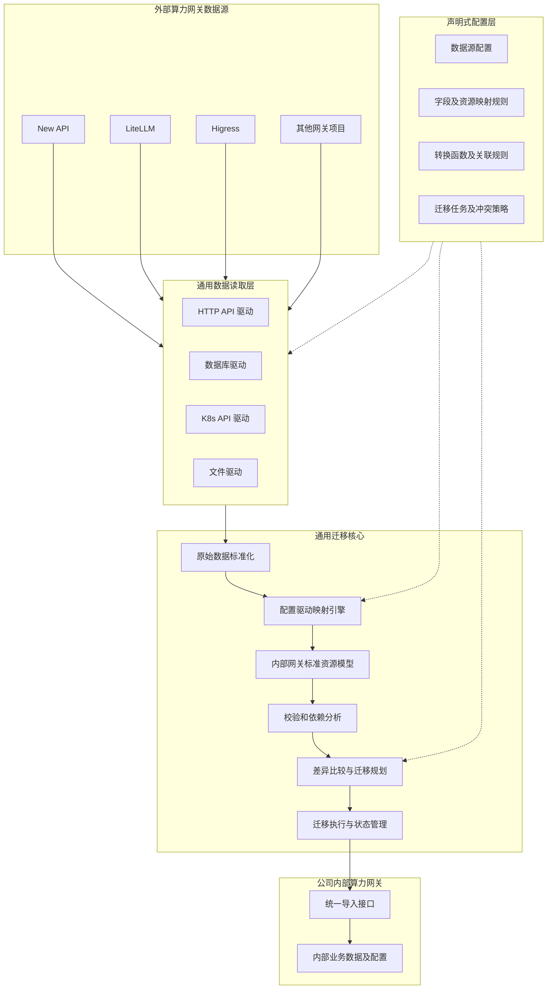
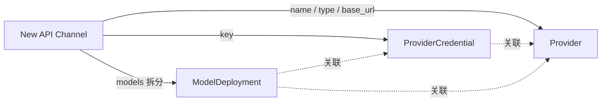
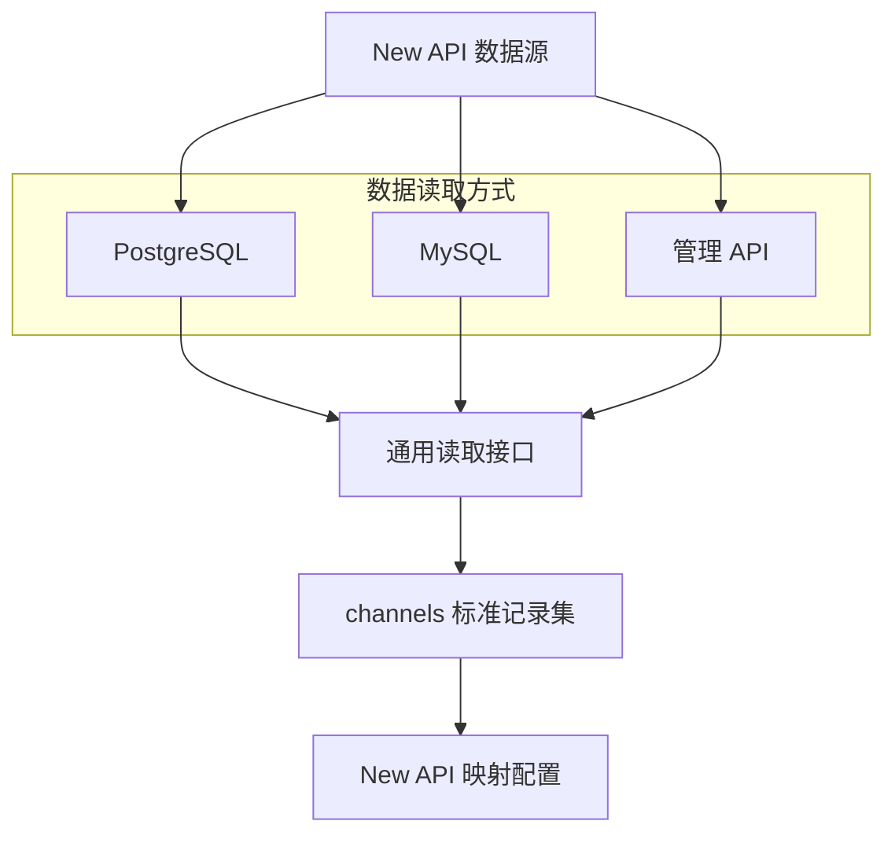
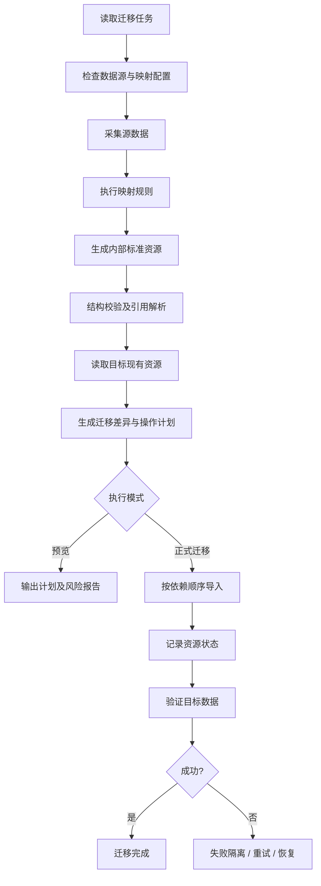

# AI 算力网关通用数据迁移工具——最终架构设计方案

## 一、总体设计思路

建议采用“配置驱动的数据迁移框架”，将不同网关项目之间的数据模型差异尽可能通过 YAML 配置文件解决，而不是为每个网关项目编写专门的数据转换代码。

结合目前已经明确的需求：

1. 单向迁移：New API、LiteLLM、Higress 等外部网关的数据统一迁移至公司内部算力网关。
2. 多源支持：支持 API、MySQL、PostgreSQL、SQLite、配置文件等数据来源。
3. 模型配置化：通过配置文件声明数据源字段、目标字段、类型转换、关联关系等。
4. 框架可扩展：增加一个新的源网关项目，理想情况下只需新增配置文件，无需修改框架代码。
5. 迁移可靠性：支持数据预览、校验、冲突检测、幂等导入、失败恢复。
6. 复杂场景可扩展：配置无法表达的特殊转换逻辑，通过可选的扩展函数实现。

最终推荐：

通用数据读取器 + 声明式映射引擎 + 内部网关标准数据模型 + 统一导入器 + 迁移执行引擎。

不再将 New API、LiteLLM 等项目的独立适配器作为必需模块，而是以配置化的数据源描述和映射规则为主要扩展方式。

## 二、最终总体架构



图中的配置层是整个框架的扩展入口。新增外部网关时，优先增加数据源定义与映射规则，不修改迁移引擎。

### 2.1 各层职责

| 架构层     | 职责                     | 扩展方式        |
| ------- | ---------------------- | ----------- |
| 数据源配置层  | 定义项目、连接方式、查询语句、接口及分页规则 | YAML        |
| 通用数据读取层 | 负责连接数据库、调用 API、读取文件    | 通用驱动        |
| 映射规则层   | 定义字段对应、格式转换、拆分合并、资源关联  | YAML        |
| 数据映射引擎  | 解析并执行映射规则，生成内部标准资源     | 框架通用        |
| 内部标准模型层 | 定义内部网关可导入的业务资源         | Go 结构体及模式约束 |
| 统一导入层   | 负责内部网关的资源创建、更新和查询      | 固定实现        |
| 迁移执行层   | 负责冲突检测、任务状态、重试、校验及恢复   | 框架通用        |

其中最重要的架构决策是：

外部项目的原始数据结构不进入核心业务逻辑；核心引擎只处理通用记录和内部网关标准资源。

例如 New API 数据库中存在 `Channel`，LiteLLM 配置中存在 `model_list`，Higress 存在 AI 服务提供者与插件配置。这些结构存在明显差异。


但通过映射规则转换后，最终都可以产生内部网关所定义的 `Provider`、`ModelDeployment` 等资源。

这样可以把绝大多数项目差异集中在配置文件中管理。

## 三、数据模型映射配置化设计

这一层是整个架构的重点。

建议将映射能力拆分为三个层次：

- 字段映射：字段重命名、类型转换、默认值、枚举映射。
- 资源映射：一条源记录拆分成多个内部资源，或多条源记录合并成一个资源。
- 关联映射：处理供应商、凭据、模型、消费者之间的引用关系。

这三个层次都应尽量通过配置文件表达。

### 3.1 以 New API 渠道迁移为例

New API 的 `Channel` 模型包含 `name`、`key`、`base_url`、`models`、`model_mapping`、`priority` 和 `weight` 等字段。

假设公司内部算力网关具有以下模型（示例，实际需要根据内部项目调整）：

```
Provider
├── name
├── type
├── endpoint
└── enabled

ProviderCredential
├── provider_id
└── secret

ModelDeployment
├── name
├── provider_id
├── credential_id
└── upstream_model
```

一条 New API 渠道可能同时包含供应商信息、密钥以及多个模型。

因此其转换关系是：



这种一对多的资源映射，不能只依靠简单的字段重命名实现，但可以通过声明式资源映射规则完成，不必编写 New API 专属转换函数。

### 3.2 映射配置文件示例

建议设计一套受限的 YAML 映射规则，下面是拟定格式，并非已有工具的实际配置规范。

```

version: 1

profile: newapi-to-acg
source: new-api
target_schema: acg/v1

mappings:
  # Channel -> Provider
  - name: channel-to-provider
    dataset: channels
    emit:
      kind: Provider
      identity: "channel:${row.id}"
      fields:
        name:
          from: name
        type:
          from: type
          lookup: provider_types
        endpoint:
          from: base_url
          required: true
        enabled:
          expr: "row.status == 1"

  # Channel -> ProviderCredential
  - name: channel-to-credential
    dataset: channels
    emit:
      kind: ProviderCredential
      identity: "channel:${row.id}:credential"
      fields:
        provider_ref:
          ref: "Provider/channel:${row.id}"
        secret:
          secret_from: key

  # Channel.models -> ModelDeployment
  - name: channel-to-models
    dataset: channels
    for_each:
      from: models
      transform: split_csv
      as: model
    emit:
      kind: ModelDeployment
      identity: "channel:${row.id}:model:${model}"
      fields:
        name:
          var: model
        upstream_model:
          var: model
        provider_ref:
          ref: "Provider/channel:${row.id}"
        credential_ref:
          ref: "ProviderCredential/channel:${row.id}:credential"

```

这份配置示意了三个关键能力。

一是字段映射。 `name` 映射到内部供应商名称，`base_url` 映射到内部服务地址，`status` 通过表达式转换为布尔状态。

二是一对多转换。 `models` 是逗号分隔的模型字符串，通过 `split_csv` 生成多个 `ModelDeployment` 资源。

三是关联引用。 通过 `identity` 和 `ref` 声明供应商、密钥及模型之间的关系，不直接使用源数据库 ID 作为内部数据库外键。

其中 `provider_types` 应由单独的枚举映射表定义。对于未知渠道类型，默认报错而不是猜测供应商类型。

示例暂按每个渠道只有一个密钥编写。对于一个字段包含多个密钥、密钥采用特殊格式等情况，需要进一步配置拆分规则或使用扩展函数。

### 3.3 建议支持的通用转换函数

| 转换类别  | 函数或操作                          | 示例           |
| ----- | ------------------------------ | ------------ |
| 基础转换  | `to_string`、`to_int`、`to_bool` | `1` → `true` |
| 字符串处理 | `trim`、`lower`、`replace`       | 清理模型名称       |
| 数据拆分  | `split_csv`、`split_lines`      | 模型列表拆分       |
| 数据合并  | `join`、`concat`                | 构造目标标识       |
| 结构转换  | `parse_json`、`get`             | 提取 JSON 内字段  |
| 枚举映射  | `lookup`                       | 渠道类型映射       |
| 默认值   | `default`                      | 空字段处理        |
| 条件表达式 | `expr`                         | 判断资源是否启用     |
| 集合处理  | `filter`、`map`、`group_by`      | 过滤和聚合        |
| 资源关联  | `ref`                          | 引用已转换资源      |
| 敏感数据  | `secret_from`                  | 标记和处理密钥      |

建议采用 Go 的 CEL 表达式引擎来实现受限表达式能力，结合框架内置转换函数，而不允许 YAML 中直接嵌入任意 Go、Python 或 Shell 代码。

对于类型不匹配、枚举值未定义、引用无法解析等问题，默认阻止迁移。

## 四、数据读取方式配置化

同一个项目可能通过多种方式读取数据，因此项目类型和读取方式必须解耦。

例如 New API：

数据库读取配置示例：

```

version: 1

instance: newapi-prod
project: new-api

access:
  type: database
  driver: postgres
  dsn_env: NEWAPI_DSN
  read_only: true

datasets:
  channels:
    query: |
      SELECT
        id, name, type, key,
        base_url, models, model_mapping,
        status, priority, weight
      FROM channels
    primary_key: id

  tokens:
    query: |
      SELECT *
      FROM tokens
    primary_key: id

```

对于 API 数据源，改为配置请求方式、认证、分页和响应字段提取规则即可：

```
access:
  type: api
  base_url: ${SOURCE_API_URL}
  auth:
    type: bearer
    token_env: SOURCE_API_TOKEN

datasets:
  models:
    method: GET
    path: /model/info
    records_path: data
```

上面 API 示例中的 `records_path` 需要根据实际接口响应结构调整。

通用 API 读取器还应支持分页、限流、重试以及鉴权续期；数据库读取器则应支持只读账号、分批查询和一致性快照。

这样，同一个映射配置只要使用相同的逻辑记录集与字段结构，就可以复用不同读取方式。

但如果 API 返回的字段与数据库字段不同，需要在读取阶段进行字段归一化，或者分别使用不同的映射配置。

## 五、哪些逻辑可以配置化，哪些必须保留代码扩展？

这里不建议追求百分之百配置化。否则 YAML 最终会演变成一门复杂的编程语言，增加维护成本。

推荐采用 配置优先、代码扩展兜底 的原则。

| 处理场景              | 推荐实现方式        |
| ----------------- | ------------- |
| 字段重命名、常量、默认值      | YAML          |
| JSON 解析、列表拆分、类型转换 | 内置函数 + YAML   |
| 一条记录生成多个目标资源      | YAML          |
| 多数据集关联、分组聚合       | YAML + 通用关联引擎 |
| 模型别名、供应商类型转换      | YAML 映射表      |
| 常规 REST API 分页    | YAML          |
| 特殊签名认证、非标准分页协议    | 扩展代码          |
| 特殊加解密格式           | 授权扩展代码        |
| 依赖源项目运行逻辑才能计算的字段  | 扩展代码          |
| 无法语义等价的路由或计费规则    | 专门转换策略或人工确认   |

框架提供一个可选的转换扩展接口：

```
type Transformer interface {
    Name() string

    Transform(
        ctx context.Context,
        input any,
        options map[string]any,
    ) (any, error)
}
```

配置中通过转换函数名称引用。

```
fields:
  special_config:
    from: other_info
    transform: newapi_special_config
```

框架启动时注册转换函数。扩展函数只处理特定的数据转换，不负责资源写入、任务状态或重试逻辑。

这可以保证新增普通项目只改配置，碰到特殊业务逻辑才补充少量代码。

## 六、内部网关标准模型及统一导入器

虽然数据映射高度配置化，但内部网关标准模型不建议完全动态化。

建议基于内部业务模型定义一套稳定、带版本号的导入数据结构，例如：

```
acg/v1
├── Provider
├── ProviderCredential
├── ModelDeployment
├── ModelMapping
├── Consumer
├── ConsumerCredential
├── Route
├── RoutingPolicy
└── QuotaPolicy
```

内部资源结构由 Go 类型和 JSON Schema 共同约束：

- Go 类型用于业务逻辑和导入操作。
- JSON Schema 用于校验配置映射后的数据结构。
- 版本号用于应对内部网关后续数据模型升级。

标准模型应该对齐内部网关的业务语义，而非直接使用数据库表结构。内部网关新增数据库字段或调整表关系时，只要导入契约没有变化，外部映射配置就不需要跟着修改。

### 6.1 统一导入器

建议首选内部网关现有的管理 API，如果无法满足批量导入需求，可以为内部网关增加受权限控制的导入接口。

```
type Importer interface {
    // 校验并规划资源操作
    Plan(
        ctx context.Context,
        resources []Resource,
    ) ([]Operation, error)

    // 执行资源写入
    Apply(
        ctx context.Context,
        operation Operation,
    ) (ApplyResult, error)

    // 验证目标状态
    Verify(
        ctx context.Context,
        result ApplyResult,
    ) error
}
```

统一导入器始终只有一套，不随源项目数量增加。

推荐优先通过 API 写入内部业务系统，利用其现有校验、事务、缓存刷新和配置下发机制。

如果内部网关确实需要直写数据库，应作为明确受控的离线写入模式，不建议作为默认方案。

## 七、迁移执行引擎

迁移引擎需要独立于配置映射和数据读取，避免映射规则直接执行数据库写入。



### 7.1 核心执行能力

| 能力     | 建议实现                 |
| ------ | -------------------- |
| 资源唯一标识 | 来源实例 + 资源类型 + 源资源 ID |
| 冲突检测   | 比较资源逻辑身份、业务唯一键及目标内容  |
| 依赖排序   | 使用资源引用构建依赖图          |
| 幂等导入   | 源目标 ID 映射 + 导入操作幂等键  |
| 任务持久化  | 首期使用 SQLite          |
| 迁移预览   | 显示新增、更新、冲突、不支持的资源    |
| 错误处理   | 失败记录、有限重试、跳过或人工处理    |
| 数据验证   | 校验写入结果、关键字段及引用关系     |
| 恢复机制   | 失败后从已确认完成的操作继续执行     |

内部状态应当记录资源级操作结果，而不仅是任务级成功或失败。

尤其是 API 写入超时的情况，目标端可能已经成功创建资源。因此重试前必须先查询目标状态，避免重复创建。

### 7.2 迁移冲突策略

建议提供：

```
policies:
  conflict: fail
  unsupported: fail
  missing_reference: fail
  missing_secret: fail

execution:
  dry_run: true
  batch_size: 100
  retries: 3
  verify_after_write: true
```

`conflict` 可支持 `fail`、`skip`、`update` 等策略，但默认必须是 `fail`，避免无意覆盖目标网关已有配置。

对于多个源网关迁移到一个目标的场景，还需要处理同名模型、重复供应商和消费者标识冲突。建议默认保留来源实例命名空间，只有明确配置合并规则时才合并。

### 7.3 API Key 的特殊处理

API Key 不应该被当作普通字符串参与整个数据映射流程。

建议 `secret_from` 告诉框架该字段属于敏感数据，随后采用受控的秘密值容器或临时密钥引用传递，并对日志、预览报告及持久化状态进行脱敏。

不同来源的密钥还应区别处理：

- 可以取得原始密钥且目标支持原值导入：保留密钥。
- 可以取得原始密钥但目标不支持指定密钥：生成新密钥，建立替换映射。
- 只能取得掩码、哈希或无法解密的密钥：标记为不可直接迁移，执行轮换。

例如 LiteLLM 的 `/model/info` 不会返回完整的敏感 API Key，因此不能简单依靠该接口完成上游密钥迁移。


## 八、最终配置文件组织方式

建议将连接配置、数据映射配置、迁移任务配置分开管理。

```
configs/
├── sources/
│   ├── newapi.yaml
│   ├── litellm.yaml
│   └── higress.yaml
│
├── mappings/
│   ├── newapi-to-acg.yaml
│   ├── litellm-to-acg.yaml
│   └── higress-to-acg.yaml
│
├── lookups/
│   ├── provider-types.yaml
│   └── model-aliases.yaml
│
├── targets/
│   └── internal-acg.yaml
│
└── jobs/
    └── migration.yaml
```

各配置职责明确：

| 配置目录       | 主要内容              | 修改时机      |
| ---------- | ----------------- | --------- |
| `sources`  | 数据源连接、接口、SQL、分页   | 访问方式或版本变化 |
| `mappings` | 外部字段到内部业务资源的映射    | 业务模型差异变化  |
| `lookups`  | 枚举值、模型名称等映射表      | 映射规则调整    |
| `targets`  | 内部网关地址、认证、导入方式    | 目标环境变化    |
| `jobs`     | 迁移范围、来源选择、冲突及执行策略 | 每次迁移任务    |

比如新增 One API，只需先创建：

```
sources/oneapi.yaml
mappings/oneapi-to-acg.yaml
```

如果使用的 API、SQL 和转换函数均已受框架支持，就不需要新增代码。

## 九、推荐的 Go 工程结构

```
gateway-migrator/
├── cmd/
│   └── migrator/
│       └── main.go
│
├── internal/
│   ├── source/               # 通用读取器
│   │   ├── api/
│   │   ├── database/
│   │   ├── kubernetes/
│   │   └── file/
│   │
│   ├── mapping/              # 声明式映射引擎
│   │   ├── parser.go
│   │   ├── compiler.go
│   │   ├── evaluator.go
│   │   ├── transformer.go
│   │   ├── resolver.go
│   │   └── registry.go
│   │
│   ├── transforms/           # 内置转换函数
│   │   ├── string.go
│   │   ├── number.go
│   │   ├── json.go
│   │   ├── collection.go
│   │   └── lookup.go
│   │
│   ├── domain/               # 内部网关标准模型
│   │   ├── resource.go
│   │   ├── provider.go
│   │   ├── model.go
│   │   ├── credential.go
│   │   └── policy.go
│   │
│   ├── importer/             # 内部网关统一导入器
│   │   ├── api.go
│   │   ├── planner.go
│   │   └── validator.go
│   │
│   ├── engine/               # 迁移执行引擎
│   │   ├── engine.go
│   │   ├── executor.go
│   │   ├── dependency.go
│   │   ├── conflict.go
│   │   ├── recovery.go
│   │   └── verifier.go
│   │
│   ├── extensions/           # 可选项目特殊逻辑
│   ├── secrets/              # 密钥保护
│   ├── state/                # 任务状态存储
│   └── config/               # 配置解析与校验
│
├── schemas/                  # 标准模型约束
├── configs/                  # 各网关配置
├── examples/
├── tests/
└── go.mod
```

这里特意取消了之前的 `adapters/newapi/`、`adapters/litellm/` 等必需目录。

它们的主要职责已经由 `sources/` 和 `mappings/` 配置承担。只有无法通过配置实现的特殊逻辑，才放到 `extensions/`。

## 十、最终开发范围及实施顺序

建议第一期不实现全部资源类型，而是先将配置驱动的完整迁移链路打通。

阶段一：确定内部模型与配置规范

明确内部网关的资源结构、字段约束、导入 API，以及 YAML 映射规则规范。先支持字段映射、类型转换、资源拆分和关联引用。

阶段二：实现首个迁移闭环

开发 PostgreSQL/MySQL 和 HTTP API 读取器，使用 New API 的渠道、模型及上游密钥数据验证完整流程，完成预览、执行和校验。

阶段三：验证真正的配置扩展能力

接入 LiteLLM，要求尽可能只新增数据源及映射 YAML。如果需要修改迁移引擎，则优先判断是否缺少通用映射能力，而不是直接增加项目专属分支。

阶段四：完善生产迁移能力

增加 Higress 的 K8s 资源读取、复杂映射、批量导入、冲突策略、任务恢复和密钥处理，并扩展消费者、路由及配额等资源类型。

## 十一、最终架构选型结论

| 架构决策   | 最终方案                  |
| ------ | --------------------- |
| 迁移方向   | 多个外部网关 → 一个内部网关       |
| 标准数据模型 | 对齐内部网关业务资源模型          |
| 数据源扩展  | 配置驱动，特殊情况允许扩展代码       |
| 数据读取   | 通用 API、数据库、K8s、文件驱动   |
| 数据模型差异 | YAML 声明式映射            |
| 转换执行   | 统一映射引擎 + 受限表达式 + 内置函数 |
| 资源关联   | 逻辑标识 + 引用解析 + 依赖排序    |
| 目标端写入  | 单一内部网关导入器，优先 API      |
| 状态管理   | SQLite + 资源级操作状态      |
| 迁移策略   | 默认预览、冲突拒绝、幂等执行        |
| 特殊业务处理 | 可选的代码扩展机制             |
| 开发语言   | Go                    |

最终建议将项目定位为一个“以内部网关资源模型为目标的声明式数据迁移引擎”。

它与传统的项目适配器方案最大的区别，是将大部分项目差异从 Go 代码中提取为可独立维护的配置规则。这样既能保持框架通用性，又避免为不需要的双向迁移设计过多抽象。

接下来真正决定架构能否落地的是内部网关的数据模型。建议针对内部项目首先提取三类信息：业务资源及字段定义、资源间关联关系、可用的管理 API 与数据库写入约束。以这些信息为基础，先正式定义 `acg/v1` 的导入契约，再固化 YAML 映射规范，而不是提前将尚未验证的示例字段作为最终标准。